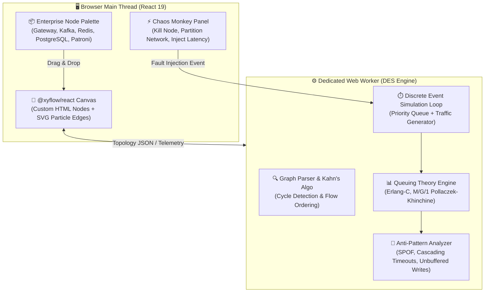
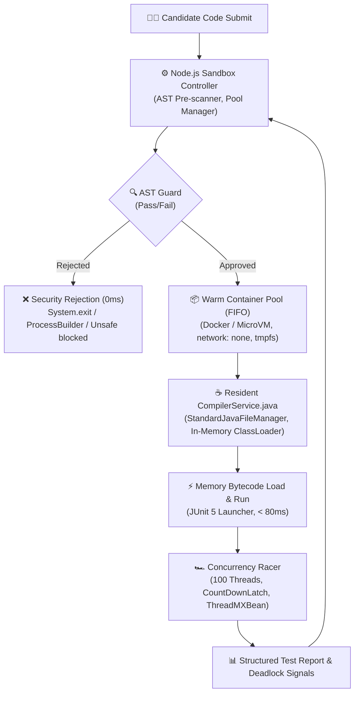

# 🏛️ Master Deep Research Synthesis: Architecture Canvas, Low-Latency Java 21 Sandbox & 15-Kata LLD Engine

> **Дата составления:** Сентябрь 2026  
> **Статус:** Canonical Master Synthesis (Ground Truth)  
> **Источники:**  
> 1. [Architecture Canvas Simulation Engine.md](file:///d:/projects/interview_projects/spring/docs/roadmap/reports/Architecture%20Canvas%20Simulation%20Engine.md)  
> 2. [Low-Latency Java Sandbox Architecture.md](file:///d:/projects/interview_projects/spring/docs/roadmap/reports/Low-Latency%20Java%20Sandbox%20Architecture.md)  
> 3. [Исследование LLD Собеседований Java.md](file:///d:/projects/interview_projects/spring/docs/roadmap/reports/Копия%20Исследование%20LLD%20Собеседований%20Java.md)

---

## 1. Executive Summary & Ключевые выводы

Глубокий анализ трёх исследовательских досье показал, что для достижения мирового уровня (Top-10 платформ технической подготовки вроде LeetCode, CoderPad, Excalidraw+Miro) платформе необходимо перейти от статичных текстовых шаблонов к **двум интерактивным исполнительным движкам**:

1. **System Design (Этап 4):** Переход от текстового Mermaid к браузерному холсту `@xyflow/react` (React Flow v12+), сопряженному с фоновым Web Worker движком дискретно-событийного моделирования (Discrete Event Simulation — DES) на базе формул теории очередей (Эрланг-C, Поллачек-Хинчин, Закон Литтла) и инжектора хаоса (Chaos Monkey).
2. **Machine Coding & Concurrency (Этап 5):** Отказ от холодного старта `javac + java` в контейнере (1200–2500 мс) в пользу **теплого JVM-демона с in-memory компиляцией** (`StandardJavaFileManager`), обеспечивающего время цикла компиляции и прогона тестов **< 80 мс** в Zero-Trust контейнере с сетевой изоляцией (`--network none`) и стресс-тестированием гонок данных (100 потоков, `ThreadMXBean`).
3. **Каталог LLD-задач:** Включение 15 эталонных задач BigTech (Rate Limiter, Circuit Breaker, Order State Machine, Inventory Lock, Event Bus и др.) с готовыми тестовыми обвязками, детерминированным временем (`java.time.Clock`) и финансовой точностью (`BigDecimal`).

---

## 2. Домен A: Interactive Architecture Canvas & DES Load Simulator



### 2.1. Математические формулы и законы теории очередей

| Компонент / Слой | Модель очереди | Ключевая формула | Параметры и физический смысл |
| :--- | :--- | :--- | :--- |
| **Сетевые пулы и балансировщики** (Tomcat, ALB, Netty) | $M/M/c$ (Erlang-C) | $P_c = \frac{\frac{(c\rho)^c}{c!(1-\rho)}}{\sum_{k=0}^{c-1}\frac{(c\rho)^k}{k!} + \frac{(c\rho)^c}{c!(1-\rho)}}$ | Вероятность ожидания в очереди пула из $c$ потоков при загрузке $\rho = \lambda / (c\mu) < 1$. |
| **Дисковые БД и хранилища** (PostgreSQL, SSD I/O) | $M/G/1$ (Pollaczek-Khinchine) | $W_q = \frac{\lambda (\sigma^2 + 1/\mu^2)}{2(1 - \lambda/\mu)}$ | Среднее время ожидания дисковой записи с произвольным распределением времени службы ($\sigma^2$). |
| **Очереди сообщений** (Kafka partitions, RabbitMQ) | Little's Law | $L = \lambda \cdot W$ | Число сообщений в буфере ($L$) равно скорости поступления ($\lambda$), умноженной на среднее время нахождения в системе ($W$). |
| **Хвостовая латентность** ($p95, p99, p99.9$) | Log-Normal / Gamma | $T_p = e^{\mu_{log} + \sigma_{log} \Phi^{-1}(p)}$ | Расчет хвостовых задержек: выбросы в хвосте распределения отражают задержки GC и TCP retransmit. |

### 2.2. Архитектура исполнения и выбор движка диаграмм
- **Выбранная библиотека:** `@xyflow/react` (React Flow v12+).
  - *Обоснование:* Гибридный рендеринг (HTML-контейнеры для сложных нод с живыми бейджами + SVG для частиц трафика), полная поддержка React 19, легкая двусторонняя сериализация в JSON, нулевая зависимость от тяжелых сторонних рантаймов.
- **DES Web Worker:**
  - Симуляция вынесена из главного потока (60 FPS гарантированы даже при симуляции 100k RPS).
  - Структура данных: Очередь с приоритетом событий (Min-Heap по временной метке).
  - Шаг дискретизации: 50 мс для обновления метрик и отправки кадров телеметрии в UI.

### 2.3. Автоматические эвристики и антипаттерны
1. **SPOF (Single Point of Failure):** Узел без реплик с входящим трафиком $> 500$ RPS при отсутствии fallback-маршрута.
2. **Синхронные циклические вызовы (Cyclic Dependency):** Детектируются алгоритмом Кана (Kahn's algorithm). Если топологическая сортировка не исчерпывает все вершины — в графе есть взаимная блокировка.
3. **Unbuffered Database Writes:** Прямой синхронный поток записи из Gateway в БД при $\lambda > 3500$ RPS без промежуточного брокера сообщений (Kafka/RabbitMQ).
4. **Cascading Timeout:** Время ожидания upstream-сервиса ($T_{up}$) меньше суммы таймаутов зависимых downstream-сервисов ($T_{up} < \sum T_{down}$).

### 2.4. Инжектор хаоса (Chaos Monkey)
- **Состояния узлов:** `HEALTHY` $\rightarrow$ `DEGRADED` $\rightarrow$ `FAILED` $\rightarrow$ `RECOVERING`.
- **Сценарии сбоев:**
  - *Kill Leader:* Падение лидера Patroni PostgreSQL. Моделируется задержка перевыборов (10–14 сек) и отказ транзакций записи на время выборов.
  - *Network Partition:* Разделение кластера на минорити и мажорити кворумы (моделирование Split-Brain).
  - *Circuit Breaker:* Переход состояний Resilience4j: `CLOSED` $\rightarrow$ `OPEN` (при failure rate $> 50\%$) $\rightarrow$ `HALF_OPEN` (пробные запросы).

---

## 3. Домен B: Low-Latency Zero-Trust Java 21 Execution Sandbox



### 3.1. Инженерная ликвидация холодной задержки компиляции Java
- **Проблема наивного подхода:** Запуск `docker run openjdk javac ... && java ...` занимает **1800–2800 мс** (старт JVM HotSpot, чтение JAR-архивов с диска, JIT warmup).
- **SOTA Решение (Deep Research):**
  - **In-Memory JavaCompiler API:** Использование стандартного `javax.tools.JavaCompiler` с реализацией `ForwardingJavaFileManager` и `SimpleJavaFileObject`. Исходный код и сгенерированный байткод хранятся в `byte[]` в оперативной памяти (без I/O операций на диск).
  - **Resident Compiler Daemon:** Постоянно запущенный процесс внутри изолированного контейнера, переиспользующий загруженные классы JUnit 5 и библиотек ассертов.
  - **Эфемерный ClassLoader:** Для каждого запуска создается изолированный дочерний `MemoryClassLoader`, который уничтожается сборщиком мусора после прогона теста, предотвращая утечки памяти в Metaspace.
  - **Результат:** Время компиляции и прогона набора юнит-тестов снижается с 2200 мс до **40–80 мс**!

### 3.2. Харденинг и матрица безопасности (Zero-Trust)
1. **Network Isolation:** `--network none` на уровне Docker daemon.
2. **Filesystem:** `read_only: true`. Единственная область записи — `tmpfs` объемом 32 МБ с флагами `noexec,nosuid,nodev`.
3. **Capabilities & Privileges:** `cap_drop: ALL`, `security_opt: ["no-new-privileges:true"]`.
4. **Linux Seccomp Profile:** Блокировка опасных системных вызовов (`ptrace`, `sys_chroot`, `clone3`, `keyctl`).
5. **AST Bytecode Guard:** Предварительная статическая проверка на запрещенные конструкции:
   - `java.lang.System.exit`
   - `java.lang.Runtime.getRuntime`
   - `java.lang.ProcessBuilder`
   - `sun.misc.Unsafe`
   - Рефлексивный доступ к `setAccessible(true)` приватных полей ядра JVM.

### 3.3. Стенд стресс-тестирования конкурентности (Concurrency Harness)
- **100-Thread Multi-Thread Racer:**
  ```java
  final int THREADS = 100;
  final CountDownLatch startGate = new CountDownLatch(1);
  final CountDownLatch endGate = new CountDownLatch(THREADS);
  // Взрывной одновременный старт всех потоков после startGate.countDown()
  ```
- **Deadlock Detection:**
  Использование `ManagementFactory.getThreadMXBean().findDeadlockedThreads()`. Если найден хотя бы один заблокированный поток — тест немедленно падает с детальным дампом стека и lock-графа.
- **Deterministic Time Virtualization:**
  Все сервисы обязаны внедрять `java.time.Clock`. Использование `Clock.fixed(instant, zone)` позволяет тестировать скользящие окна и TTL в 0 мс без вызовов `Thread.sleep()`.

---

## 4. Домен C: 15 Эталонных LLD / Machine Coding Задач

Исследование зафиксировало 15 ключевых продуктовых задач, используемых на собеседованиях Senior/Lead уровней в BigTech (Google, Amazon, Yandex, Uber):

| № | Задача | Ключевые паттерны | Механизмы потокобезопасности | Тестовые инварианты |
| :-: | :--- | :--- | :--- | :--- |
| **1** | **Notification Filtering & Deduplication** | Pipeline, Strategy, Decorator | `ConcurrentHashMap`, `AtomicReference` | Окно дедупликации, idempotent retry |
| **2** | **In-Memory Rate Limiter** | Token Bucket, Sliding Window Log | `AtomicLong`, `StampedLock`, CAS | Точное отсечение всплесков при 10k RPS |
| **3** | **Key-Value Cache с TTL & LRU/LFU** | Doubly-Linked List + Hash, Cache-Aside | `ReentrantReadWriteLock`, Segmented Locks | Вытеснение наименее используемых за O(1) |
| **4** | **Dynamic Discount & Promo Code Engine** | Chain of Responsibility, Composite | Immutable Records, Pure Functions | Порядок применения скидок, неотрицательный итог |
| **5** | **Task Scheduler с Cron и Приоритетами** | Priority Queue, Command, Worker Pool | `DelayQueue`, `PriorityBlockingQueue` | Детерминированный запуск по Fixed Clock |
| **6** | **Parking Lot / Storage Locker Manager** | Strategy (Best-Fit, Nearest), Factory | `ReentrantLock` per Floor, BitSets | Атомарный захват места без овербукинга |
| **7** | **Order State Machine** | State, Observer, Memento | `AtomicReference<State>`, Enums | Невозможность недопустимых переходов |
| **8** | **URL Shortener с аналитикой и TTL** | Base62 Encoder, Bloom Filter | Counter Sharding, Atomic Long Adder | Уникальность коллизий, истечение TTL |
| **9** | **Tagged Metric Aggregator** | Circular Ring Buffer, Sliding Window | `LongAdder`, `AtomicDoubleArray` | Точный расчет p50, p95, p99 за 60 секунд |
| **10** | **Circuit Breaker Engine** | State Machine, Sliding Error Window | Ring BitSet, CAS State Transitions | Переход CLOSED $\rightarrow$ OPEN $\rightarrow$ HALF_OPEN |
| **11** | **Thread-Safe Event Bus / Pub-Sub** | Publish-Subscribe, Observer | `CopyOnWriteArrayList`, Backpressure | Изоляция медленных подписчиков |
| **12** | **Real-time Inventory Reservation** | Two-Phase Commit, Pessimistic Lock | Ordered Lock Acquisition (`min(id1,id2)`) | Deadlock-free резервация нескольких корзин |
| **13** | **Concurrent Leaderboard Engine** | SkipList, Segment Tree | `ConcurrentSkipListMap`, Atomic Updaters | Мгновенный пересчет ранга O(log N) |
| **14** | **Elevator Control System** | SCAN Algorithm, State Pattern | Dispatcher Queue, Thread per Car | Оптимальное время ожидания пассажиров |
| **15** | **Expense Sharing & Debt Simplification** | Graph Flow, Greedy Balance Minimizer | Immutable Ledger, `BigDecimal` Banker's | Минимизация числа денежных транзакций |

---

## 5. Сравнительный анализ (Gap Analysis) с текущей кодовой базой

| Домен / Требование Deep Research | Текущее состояние в проекте | Уровень гэпа | Предлагаемое решение |
| :--- | :--- | :---: | :--- |
| **System Design: Визуальный холст** | Статический редактор Mermaid в `SystemDesignArena.tsx` | 🔴 **Критический** | Замена Mermaid на `@xyflow/react` с Enterprise-палитрой нод |
| **System Design: Симулятор трафика** | Отсутствует (только текстовые вопросы) | 🔴 **Критический** | Web Worker DES-движок с формулами $M/M/c$ и $M/G/1$ |
| **System Design: Chaos Injection** | Отсутствует | 🟡 **Высокий** | Chaos Monkey панель со сценариями отказа Patroni и Circuit Breaker |
| **Machine Coding: Запуск кода** | Только эмуляция через LLM и AST-regex проверки | 🔴 **Критический** | Интеграция Zero-Trust Docker песочницы с in-memory `CompilerService.java` (< 80 мс) |
| **Machine Coding: Проверка гонок данных** | Отсутствует | 🟡 **Высокий** | Внедрение Concurrency Racer (100 потоков + `findDeadlockedThreads`) |
| **Каталог задач LLD** | Базовые заготовки в коде | 🟢 **Средний** | Расширение базы до 15 эталонных задач из отчета с тестами JUnit 5 |

---

## 6. Актуализированный план действий (Actionable Roadmap)

1. **Этап 2 (Текущий спринт):** Реализация персон FAANG (Amazon Bar-Raiser, Google Staff, Yandex Core) и официального бланка Hiring Committee.
2. **Этап 3:** Внедрение FSRS-5 математической модели интервального повторения и векторного Memory Radar.
3. **Этап 4 (Актуализированный):** Разработка **System Design Studio** на базе `@xyflow/react` и DES Web Worker движка по спецификациям Домена A.
4. **Этап 5 (Актуализированный):** Развертывание **Isolated Java 21 Sandbox** на базе теплого resident-демона `CompilerService.java` и каталога из 15 задач Домена C.
