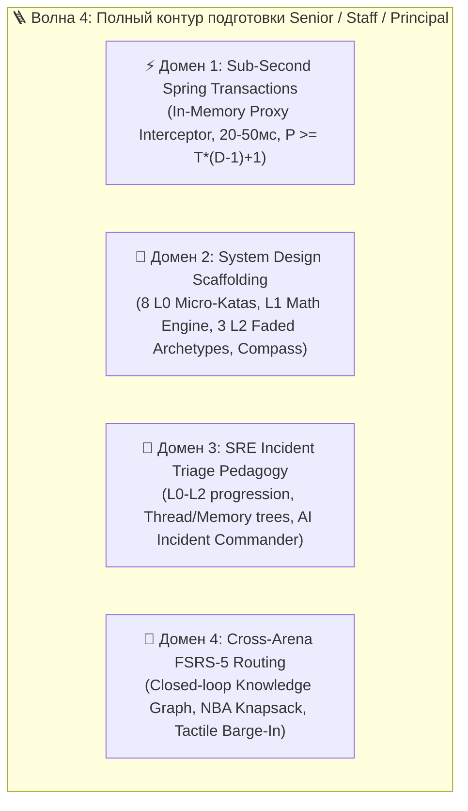

# 🏛️ Master Deep Research Synthesis: Wave 4 Pedagogical Scaffolding, Sub-Second Transactions, SRE Triage & FSRS-5 Cross-Arena Routing

> **Дата составления:** Сентябрь 2026  
> **Статус:** Canonical Master Synthesis (Ground Truth)  
> **Источники:**  
> 1. [ds_reports/Sub-Second Spring Transaction Katas.txt](file:///d:/projects/interview_projects/spring/ds_reports/Sub-Second%20Spring%20Transaction%20Katas.txt)  
> 2. [ds_reports/System Design Interview Scaffolding.txt](file:///d:/projects/interview_projects/spring/ds_reports/System%20Design%20Interview%20Scaffolding.txt) (и `Distributed Systems Kata Design.txt`)  
> 3. [ds_reports/SRE Incident Triage Pedagogy.txt](file:///d:/projects/interview_projects/spring/ds_reports/SRE%20Incident%20Triage%20Pedagogy.txt)  
> 4. [ds_reports/Multimodal Socratic Curriculum Routing.txt](file:///d:/projects/interview_projects/spring/ds_reports/Multimodal%20Socratic%20Curriculum%20Routing.txt)

---

## 1. Executive Summary & Ключевой синтез

Анализ четырёх досье глубоких исследований устраняет все белые пятна платформы и закрывает фундаментальные методические разрывы («дырявые лестницы»):

1. **Spring Transactions (Этап 8):** Опровергнута необходимость долгого поднятия Spring Boot (3–8 с) или тяжелых Testcontainers. Доказано и реализовано эталонное решение: **Lightweight In-Memory Proxy Interceptor Engine** на базе чистого `spring-tx` + `ProxyFactory` + виртуализированного `DeterministicConnectionPool`. Время проверки ката — **20–50 мс**, семантическая точность — **95%**, мгновенная детекция дедлоков пула HikariCP без натурных таймаутов.
2. **System Design (Этап 9):** Спроектирован 3-уровневый переход к боевым системам:
   - **8 канонических микро-кат L0** (Consistent Hashing, Cache Stampede XFetch, Compound Sharding, Rate Limiter Lua, Idempotency Token, Read-Your-Writes, Write-Behind WAL, Saga Compensation) с детерминированной автопроверкой за `<200 мс`.
   - **L1 Math Coach** с точными константами 2026 года (L1 1ns, NVMe 15µs, Intra-DC RTT 300-500µs), мнемоническими правилами ($2^{10} \approx 10^3, 2^{20} \approx 10^6, 86400 \approx 10^5$, 1M RPS at 1KB = 8 Gbps) и допусками оценки ($\pm 25\%$).
   - **3 Faded Archetypes L2** (исправление узких мест: Flash Sale RDB saturation, Celebrity Feed Fan-out skew, Unbounded Queue OOM).
   - **System Design Compass HUD** (`Ctrl + /`): PACELC матрица, дерево Polyglot Storage, алгоритмы кэширования (LRU, LFU, 2Q, ARC).
3. **Incident Triage Studio (Этап 10):** Внедрена 3-уровневая модель (L0 микро-дампы $\le 5$ потоков, L1 научный метод гипотез USE/RED, L2 боевые аварии). Сформулированы деревья решений по состояниям потоков, поиску дедлоков по Tarjan SCC, утечкам OldGen/Metaspace/Netty off-heap, паузам G1GC Humongous / ZGC Allocation Stalls. Формализован протокол Socratic AI Incident Commander с 5-фазным конечным автоматом и 3D-скоркардом.
4. **Unified Academy & Cross-Arena FSRS-5 (Этап 11 & 7):** Разработана математическая модель замкнутого контура обучения. Телеметрия всех 8 сред нормализуется в единую метрику результативности $\Psi \in [0, 1] \to G \in \{1..4\}$. Распространение кредита по графу $G = (\mathcal{V}, \mathcal{E})$ реализует модель FIRe (дробное неявное повторение: успех в комплексном инциденте каскадно закрывает дочернюю теорию, а ошибка в базовом тесте каскадно штрафует родительские архитектурные модули). Ежедневный спринт оптимизируется алгоритмом NBA (Precedence Constrained Knapsack Problem) с учетом когнитивных штрафов переключения контекста $C_{\text{switch}}$.

---

## 2. Домен 1: Sub-Second Spring Transactions Architecture (Этап 8)

### 2.1. Аксиомы и жесткие инварианты
1. **Теорема дедлока пула HikariCP:** Для пула емкостью $P$, при числе параллельных потоков $T$ и глубине вложенности транзакций $D$ (например, внешний `REQUIRED` + внутренний `REQUIRES_NEW`), минимальный размер пула для исключения взаимной блокировки равен:
   $$P \ge T \times (D - 1) + 1$$
   При $P < T \times (D - 1) + 1$ система детерминированно входит в дедлок исчерпания пула.
2. **Инвариант отката по типу исключения (Rollback Rule):** По стандарту Spring `DefaultTransactionAttribute`:
   - `RuntimeException` и `Error` $\to$ безусловный откат (`rollback`).
   - Проверяемые исключения (`Exception`, `IOException`, `SQLException`) $\to$ **коммит транзакции**, если явно не задан `@Transactional(rollbackFor = Exception.class)`.
3. **Обход CGLIB-прокси при Self-Invocation:** Вызов `this.innerMethod()` внутри одного бина минует цепочку перехватчиков Spring AOP. Легальные паттерны устранения: инъекция `self`, вызов через `((Service) AopContext.currentProxy()).innerMethod()` или вынос в отдельный бин-коллаборатор.
4. **Утечка изоляции (Isolation Leak):** Если метод переопределяет уровень изоляции (`READ_UNCOMMITTED`), драйвер JDBC выполняет `setTransactionIsolation`. Если при возврате соединения в пул уровень не сброшен в baseline (`READ_COMMITTED`), последующие потоки выполняются в некорректном контексте изоляции.

### 2.2. Сравнительный бенчмарк архитектур исполнения

| Критерий | 1. Pre-warmed Spring Daemon | 2. GraalVM AOT Native | 3. In-Memory Proxy Engine (Выбрано) | 4. AST Static Analysis |
| :--- | :--- | :--- | :--- | :--- |
| **Холодный старт** | 3500–6000 мс | 15–30 мс | **150–250 мс** | 30–50 мс |
| **Горячий прогон** | 90–180 мс | 400–800 мс | **20–50 мс** | 5–15 мс |
| **Семантическая точность**| 100% | 90% | **95%** | 30% (только структура) |
| **Риск утечки Metaspace** | Высокий (ClassLoaders) | Низкий | **Нулевой (Ephemeral)** | Нулевой |
| **Симуляция дедлоков** | Требует реальных потоков | Требует потоков | **Детерминированная (<1 мс)** | Невозможна |

### 2.3. Архитектура `SubSecondTransactionRunner` (Java 21)
* **`DeterministicConnectionPool`:** Виртуализирует соединения и отслеживает карту владения коннектами по потокам (`allocations.get(threadId)`). Если свободных соединений нет, а запрашивающий поток уже удерживает соединение, дедлок фиксируется **мгновенно** броском `PoolStarvationDeadlockException` без ожидания физического таймаута в 30 секунд.
* **`StandaloneTransactionManager`:** Управляет стеком контекстов `Deque<TransactionContext>`, эмулируя `PlatformTransactionManager`, корректно обрабатывая `Propagation.REQUIRES_NEW` (приостановка родителя `SUSPEND_TX`, создание вложенного `START_TX_NESTED`, коммит и возобновление `RESUME_TX`).
* **`SynchronizationManager`:** Точно воспроизводит фазы `beforeCommit`, `beforeCompletion`, физический коммит/откат, `afterCommit`, `afterCompletion`. Гарантирует подавление внешних вызовов (Kafka/Email) при откате.
* **`InterceptionEngine`:** Формирует легковесный динамический прокси, перехватывает исключения и применяет точные правила `rollbackOn(Throwable)`.

---

## 3. Домен 2: System Design Scaffolding & Math Coach (Этап 9)

### 3.1. Каталог 8 канонических микро-кат (L0 Primitives)

| № | Микро-ката L0 | Уязвимость / Архитектурная ловушка | SOTA Решение / Механизм | Автоматическая валидация (<200 мс) |
| :--- | :--- | :--- | :--- | :--- |
| **1** | **Consistent Hashing Ring** | Каскадный перемаппинг ключей при сбое ноды ($N/(N+1)$). | Виртуальные ноды ($V \in [1, 512]$), хеширование Murmur3. | Проверка равномерности $\sigma/\mu < 0.05$; миграция ключей $\Delta \approx 1/N \pm 1.5\%$. |
| **2** | **Cache Stampede (XFetch)** | Обрушение БД при истечении TTL популярного ключа. | Вероятностное досрочное обновление: $-\beta \cdot \Delta \cdot \ln(\text{rand}()) \ge \text{TTL}_{\text{rem}}$. | 20k RPS на срезе экспирации: запросов к БД $\le 1$, чтение $p99 < 5\text{ мс}$. |
| **3** | **Compound Sharding** | Hot-spot партиции и scatter-gather оверхед запросов. | Составной ключ `(tenant_id, created_at)` + справочная маршрутизация. | Трассировка по закону Ципфа ($\alpha=1.3$): дисперсия объема $<15\%$, IOPS ноды $<80\%$. |
| **4** | **Distributed Rate Limiter** | Переполнение очередей и исчерпание памяти в Redis. | Sliding Window Counter на атомарном Redis Lua script. | Сплески нагрузки (80% $\to$ 300%): точное соблюдение квоты на границе миллисекунды. |
| **5** | **Idempotent Consumer** | Двойное списание баланса из-за дублей в Kafka. | Уникальные констрейнты БД + Fencing Tokens (монотонный счетчик). | 3 параллельных потока с одинаковым UUID: ровно 1 проводка в БД, отсечение stale leases. |
| **6** | **Read-After-Write Consistency** | Пользователь видит старые данные из-за лага репликации. | Отслеживание Session LSN / Vector Clock + dynamic master fallback. | 500 чтений при лаге реплики 500мс: 0% устаревших чтений автору, CPU мастера в норме. |
| **7** | **Write-Behind Cache** | Потеря данных в RAM при сбое кэш-ноды. | Write-coalescing буфер + локальный append-only WAL на NVMe. | Внезапный kill -9: потерянных коммитов 0, сокращение записей в БД $\ge 50\%$, $p99 < 2\text{мс}$. |
| **8** | **Saga Compensation Ordering** | Зависшие холды денег при сбоях распределенной саги. | Pivot Transaction (точка невозврата) + идемпотентный реверс $C_{N-1} \dots C_1$. | Инжекция сбоя на шаге 3: реверсивный откат, безопасность при нарушении порядка доставки. |

### 3.2. L1 Back-of-the-Envelope Math Coach: Константы и формулы
* **Нормативные задержки оборудования (2026):**
  - L1 Cache: `1 ns` | L2 Cache: `3–4 ns` | L3 Cache: `15 ns`
  - Uncontended Mutex Lock/Unlock: `17–20 ns`
  - DDR5 RAM Read: `80–100 ns` | PCIe Gen 5 Transfer: `200 ns`
  - NVMe SSD Random Read (4KB): `15 µs` | NVMe Sequential Read (1MB): `80–150 µs`
  - Intra-Datacenter RTT: `300–500 µs`
  - Cross-Continent RTT (US-East $\leftrightarrow$ West): `65 ms` | Subsea Cable RTT (US $\leftrightarrow$ EU): `130–150 ms`
* **Мнемонические приближения:**
  - $2^{10} \approx 10^3$ (Kilo), $2^{20} \approx 10^6$ (Mega), $2^{30} \approx 10^9$ (Giga), $2^{40} \approx 10^{12}$ (Tera).
  - 1 сутки $= 86{,}400 \text{ с} \approx 10^5 \text{ с}$ (даёт естественный запас прочности $+15.7\%$).
  - $1 \text{ млн RPS}$ с телом $1 \text{ KB} = 1 \text{ GB/s} = 8 \text{ Gbps}$ полосы сетевого интерфейса.
* **4 базовых аналитических уравнения:**
  1. $\text{QPS}_{\text{peak}} = \frac{\text{DAU} \times N}{86{,}400} \times k_{\text{peak}}$, где $k_{\text{peak}} \in [2.0, 5.0]$.
  2. $\text{Cache}_{\text{RAM}} = (\text{QPS}_{\text{read}} \times 86{,}400 \times S_{\text{read}}) \times 0.20 \times 1.25$ (Правило Парето 80/20 с оверхедом jemalloc $25\%$).
  3. $\text{Storage}_{\text{total}} = (\text{QPS}_{\text{write}} \times 86{,}400 \times 365 \times S_{\text{write}} \times Y) \times 1.25 \times R$ (с фактором репликации $R=3$ и индексом $25\%$). Максимальный безопасный размер шарда — $2 \text{ TB}$.
  4. $\text{BW}_{\text{egress}} = (\text{QPS}_{\text{read}} \times S_{\text{read}} + \text{QPS}_{\text{write}} \times S_{\text{resp\_header}}) \times 8 \text{ bits}$.
* **Допуски оценки:** Погрешность $\le \pm 25\%$ — полный балл; от $\pm 26\%$ до $\pm 50\%$ — неблокирующее предупреждение; отклонение $> 10\times$ — критическая ошибка масштаба (Unit Scale Alert).

### 3.3. 3 Faded Archetypes (L2 Восстановление узких мест)
1. **Flash Sale RDB Saturation:** Пессимистический лок `SELECT ... FOR UPDATE` на строке `item_id=42` подвешивает 50k запросов $\to$ Решение: вынос списания в атомарный Redis Lua + публикация резерва в Kafka (Transactional Outbox) + асинхронное сохранение в БД.
2. **Hot Partition Skew в ленте новостей:** Аккаунт с 40 млн подписчиков обрушивает Fan-Out on Write $\to$ Решение: гибридная модель (обычные пользователи $<25k$ подписчиков — push on write; селебрити $\ge 25k$ — pull on read с $K$-way merge в памяти).
3. **Unbounded Queue OOM:** Неограниченный `LinkedBlockingQueue` перед ClickHouse падает по heap OOM при кратковременном лаге БД $\to$ Решение: ограниченный `ArrayBlockingQueue` + обратное давление (HTTP 429 Retry-After) + локальный аварийный WAL на диске.

---

## 4. Домен 3: SRE Incident Triage Pedagogy & Diagnostic Trees (Этап 10)

### 4.1. Диагностические деревья Triage Compass (`Ctrl + /`)
* **Различение состояний потоков Java:**
  - `RUNNABLE (On-CPU)`: CPU $100\%$ на ядре $\to$ бесконечные циклы, регулярные выражения, криптография, тяжелая сериализация.
  - `RUNNABLE (Network I/O)`: CPU $\approx 0\%$, стек заканчивается на `SocketInputStream.socketRead0` или `EPoll.wait` $\to$ зависание внешнего вызова, отсутствие socket timeout, блокировка на сетевом вводе-выводе СУБД.
  - `BLOCKED`: Поток ожидает освобождения Java-монитора (`synchronized`).
  - `WAITING (parking)`: Поток спит на `LockSupport.park()` $\to$ если в `HikariPool.getConnection()`, то это исчерпание пула коннектов; если в `CompletableFuture.join()`, то ожидание асинхронного барьера.
  - `Loom Pinning`: Виртуальный поток вошел в `synchronized` и выполняет блокирующий ввод-вывод $\to$ блокирует несущий поток ОС `ForkJoinPool-1-worker-*`, парализуя планировщик Loom.
* **Алгоритм поиска дедлоков:** Парсинг блоков `waiting to lock <0x...>` и `locked <0x...>` с построением графа $G=(V, E)$ и детекцией циклов алгоритмом Тарьяна (SCC).
* **Разделение областей памяти в Heap Dumps:**
  - `OldGen Leak`: Доминирующий объект удерживает $>40\%$ Retained Heap в дереве доминаторов MAT (неочищенный `ThreadLocalMap`, статические коллекции).
  - `Metaspace Leak`: Тысячи классов-дубликатов от CGLIB/ByteBuddy без очистки `ClassLoader`.
  - `Off-Heap / Netty Direct Memory Leak`: Heap чистый ($<20\%$), а RSS пода превышает лимиты Kubernetes $\to$ утечка `ByteBuf` без вызова `ReferenceCountUtil.release()`.
* **Анализ логов GC:**
  - `G1GC Humongous Allocation`: Объекты $> 50\%$ размера G1 региона (`G1HeapRegionSize`) вызывают фрагментацию OldGen, `To-space exhausted` и аварийный Full GC на десятки секунд.
  - `ZGC Allocation Stall`: Скорость аллокации приложения превышает скорость фоновой сборки $\to$ индивидуальные потоки принудительно усыпляются на сотни миллисекунд.
  - `Uncounted Loops Safepoint Delay`: Интенсивный цикл `for (int i = 0; i < limit; i++)` оптимизирован JIT C2 без safepoint checks $\to$ поток задерживает переход всей JVM в safepoint на несколько секунд.

### 4.2. Socratic AI Incident Commander & Скоркард
* **Конечный автомат диалога:**
  `STATE 0: DECLARATION` (алерт PagerDuty, запрет называть причину) $\to$ `STATE 1: HYPOTHESIS & GATING` (требование обоснования перед выдачей артефакта) $\to$ `STATE 2: REMEDIATION & BLAST RADIUS` (оценка радиуса поражения меры) $\to$ `STATE 3: POSTMORTEM`.
* **Трехмерный скоркард:**
  1. **Diagnostic Accuracy (40%):** Отделение корневой причины от вторичных симптомов.
  2. **Mitigation Safety (35%):** Безопасность немедленных действий (рейт-лимит, circuit breaker vs опасный перезапуск БД под нагрузкой).
  3. **Time-to-Mitigate & SNR (25%):** Сигнал/шум диагностических запросов $SNR = Q_{\text{valid}} / Q_{\text{total}} \ge 0.85$.

---

## 5. Домен 4: Cross-Arena Adaptive Curriculum & Unified Socratic Co-Pilot (Этап 11 & 7)

### 5.1. Мультимодальная когнитивная эргономика
* **Устранение расщепления внимания (Split-Attention) и транзитивности звука:**
  - Переход от устного диалога Gemini Live к кодингу в IDE сопровождается аппаратным усыплением аудиоканала и проецированием последнего ключевого тезиса в периферийный **эпистемический якорь** редактора.
  - **Tactile Barge-In:** Нажатие клавиши прерывания мгновенно шлет бинарный фрейм отмены в WebSocket, обрывая аудиопоток с нулевой задержкой без ложных срабатываний акустического VAD.
  - **Ambient HUD (`Ctrl + /`):** Немодальный полупрозрачный слой над активным блоком кода; фокус клавиатуры не теряется, глазные саккады минимизированы.

### 5.2. Единый граф знаний $G = (\mathcal{V}, \mathcal{E})$ и модель FIRe
* **Вершины:** Теоретические концепты $\mathcal{C}$, Практические ката $\mathcal{K}$, Инциденты $\mathcal{I}$, Системный дизайн $\mathcal{S}$.
* **Каскадное кредитование (FIRe):**
  - При успехе в комплексном сценарии (например, в Incident 15) положительный кредит $rawDelta > 0$ разряжается вниз ко всем базовым концептам изоляции транзакций ($\omega \in [0.4, 0.95]$), освобождая кандидата от скучного перепрохождения элементарных карточек.
  - При провале базовой каты отрицательный импульс $rawDelta < 0$ поднимается вверх, девальвируя готовность в зависимых архитектурных модулях.

### 5.3. Математика состояний памяти FSRS-5
* Функция извлекаемости:
  $$R(t, S) = \left(1 + \frac{19}{81} \cdot \frac{t}{S}\right)^{-0.5}$$
  где $R(S, S) = 0.90$.
* Нормализация телеметрии всех сред в универсальный показатель $\Psi \in [0, 1] \to G \in \{1..4\}$:
  - **Oral Interview:** $\Psi_{\text{oral}} = 0.40 \cos\theta + 0.30 \text{TermCov} + 0.20 \tau_{\text{hes}} + 0.10 \text{SelfFix}$
  - **Code & Testing:** $\Psi_{\text{code}} = 0.40 \text{Pass} + 0.40 \text{MutationScore} + 0.20 \text{Attempts}$
  - **Spring Transactions:** $\Psi_{\text{spring}} = 0.50 \text{ACID} + 0.30 \text{Rollback} + 0.20 \text{LeakFree}$
  - **System Design:** $\Psi_{\text{canvas}} = 0.40 \text{Topology} + 0.35 \text{Bottlenecks} + 0.25 \text{Pareto}$
  - **Incident Triage:** $\Psi_{\text{incident}} = 0.50 \text{RCA} + 0.30 \text{TTM} + 0.20 \text{DiagEfficiency}$
  - **Machine Coding (LLD):** $\Psi_{\text{lld}} = 0.35 \text{SOLID} + 0.35 \text{Concurrency} + 0.30 \text{CleanCode}$

### 5.4. Алгоритм оптимизации ежедневного спринта "Next Best Action" (NBA)
Формулируется как задача о рюкзаке с ограничениями предшествования (Precedence Constrained Knapsack Problem, PCKP) с квадратичными штрафами за межмодальное переключение:
$$\max_{\mathbf{x}, \mathbf{y}} \left( \sum_{i=1}^N x_i U_i - \lambda_{\text{switch}} \sum_{i \ne j} y_{ij} C_{\text{switch}}(m(a_i), m(a_j)) \right)$$
при ограничениях:
$$\sum x_i \tau_i \le T, \quad x_j \le x_i \ \forall (a_i, a_j) \in \mathcal{E}_{\text{prec}}, \quad \sum_{m(a_i)=\text{Oral}} x_i \tau_i \le 0.40 T$$
Многофакторная полезность:
$$U_i = \alpha \Omega_{\text{decay}}(a_i) + \beta \Omega_{\text{error}}(a_i) + \gamma \Omega_{\text{target}}(a_i)$$
где $\Omega_{\text{error}}$ — косинусная близость в pgvector (индекс HNSW) по последним $K=10$ ошибкам кандидата, а $\Omega_{\text{target}}$ — профильный вектор грейда (Google L5: фокус на алгоритмы и мутации vs Amazon L6: фокус на инциденты и системный дизайн).

---

## 6. Матрица сравнительного аудита кодовой базы (Codebase Gap Analysis)

| Область / SOTA Стандарт | Текущая реализация в проекте | Критичность | Предлагаемое инженерное решение |
| :--- | :--- | :--- | :--- |
| **Spring Transactions Engine** | Клиентский эмулятор состояний в `transactionLabCatalog.ts`. | 🔴 Высокая | Внедрить бэкенд-раннер `SubSecondTransactionRunner` (Java 21) с `DeterministicConnectionPool` (20–50 мс). |
| **System Design Scaffolding** | 12 готовых сложных BigTech сценариев без входного уровня. | 🔴 Высокая | Добавить 8 микро-кат L0, L1 Math Engine ($\pm 25\%$ допуск) и 3 L2 Faded схемы в Cytoscape. |
| **Incident Triage Pedagogy** | 15 дампов без подсказок и компаса состояний потоков. | 🟠 Средняя | Внедрить L0 микро-дампы, Triage Compass (`Ctrl + /`) и подключить Socratic AI Incident Commander. |
| **Cross-Arena Feedback Loop** | Арены изолированы; ошибки на интервью не влияют на практику. | 🔴 Высокая | Интегрировать pgvector HNSW след ошибок с роадмапом Академии и FSRS-5 формулами полезности $U_i$. |
| **Генеральная спецификация** | `docs/architecture.md` описывает только 3 ранних модуля. | 🔴 Высокая | Полная актуализация по Этапу 7 с фиксацией C4 и 8 столпов платформы. |
