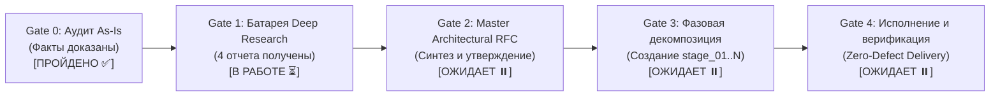

# 🏛️ Wave 5 Program Charter: Full-Spectrum Engineering & AI Systems Architecture

> **Программа:** Wave 5 (Волна 5: Когнитивная лестница, гармонизация SSOT и AI System Design)  
> **Методология:** Multi-Faceted Research-Driven Architecture (MFRDA)  
> **Статус:** `PHASE_0_RESEARCH_AND_AUDIT` (Активная батарея Deep Research)  
> **Дата запуска:** Сентябрь 2026  
> **Связанные документы:** [01_BASELINE_DEFECT_AUDIT.md](01_BASELINE_DEFECT_AUDIT.md), [02_RESEARCH_INQUIRY_SUITE.md](02_RESEARCH_INQUIRY_SUITE.md), [03_DECISIONS_AND_HYPOTHESES_LOG.md](03_DECISIONS_AND_HYPOTHESES_LOG.md)

---

## 1. Миссия и цели программы

Превратить InterviewPrep AI из сильного тренажера по распределенным системам и JVM в **мировой эталон комплексной инженерной подготовки от Junior (L3/L4) до Staff/Principal (L6/L7)**, объединяющий:
1. Фундаментальную инженерную грамотность (Core Web, Networking, Storage).
2. Классический HighLoad System Design (ACID, sharding, replication, queues, consensus).
3. Современную AI/GenAI инфраструктуру (RAG pipelines, Vector DBs, LLM Serving, Agentic orchestration).

---

## 2. Ключевые принципы MFRDA (Multi-Faceted Research-Driven Architecture)

1. **Zero-Anchoring Principle (Нулевое когнитивное якорение):**
   - Запрещено принимать архитектурные решения на основе шаблонных предположений или поверхностных ответов LLM.
   - Любая развилка исследуется через открытые, беспристрастные Deep Research запросы без навязывания вариантов А/Б/В.
2. **Empirical Ground-Truth Verification (Верификация реальности As-Is):**
   - До создания любых планов или спецификаций факт текущего состояния кодовой базы должен быть проверен и доказан тестами или инспекцией кода (см. [01_BASELINE_DEFECT_AUDIT.md](01_BASELINE_DEFECT_AUDIT.md)).
3. **Spec-Driven Progressive Elaboration (Пошаговая детализация):**
   - Фазы реализации (`stage_01`, `stage_02`...) создаются **только после** синтеза отчетов Deep Research в единый согласованный Master RFC.
4. **Shared Core Invariant (Единое технологическое ядро):**
   - Запрещено дублировать пользовательские интерфейсы (UI) или создавать разрозненные движки для разных дисциплин. Движок холста (`@xyflow/react`), Web Worker симулятор очередей и речевой агент Gemini Live развиваются как общая платформа.
5. **Strict Anti-Tech-Debt Standard:**
   - Никаких временных костылей, скрытых дубликатов каталогов или разорванных ссылок в навигации. Единый источник правды (SSOT) для всех типов сценариев.

---

## 3. Матрица исследовательских фронтов (Research Battery)

Программа разделена на 4 параллельных исследовательских трека высокой точности:

| Трек | Домен исследования | Статус | Документ с промптом |
| :--- | :--- | :---: | :--- |
| **Track 1** | **Макро-таксономия и парадигма платформы (2026 SOTA)** | ⏳ В процессе DR | [02_RESEARCH_INQUIRY_SUITE.md#track-1](02_RESEARCH_INQUIRY_SUITE.md#track-1) |
| **Track 2** | **Педагогика «Когнитивной лестницы» (Junior $\rightarrow$ Senior)** | ⏳ Готов к запуску | [02_RESEARCH_INQUIRY_SUITE.md#track-2](02_RESEARCH_INQUIRY_SUITE.md#track-2) |
| **Track 3** | **Математика симуляции AI в браузере (DES Web Worker)** | ⏳ Готов к запуску | [02_RESEARCH_INQUIRY_SUITE.md#track-3](02_RESEARCH_INQUIRY_SUITE.md#track-3) |
| **Track 4** | **Архитектура каталогов интерактивного контента (SSOT)** | ⏳ Готов к запуску | [02_RESEARCH_INQUIRY_SUITE.md#track-4](02_RESEARCH_INQUIRY_SUITE.md#track-4) |

---

## 4. Контрольные точки перехода (Gates of Progress)

