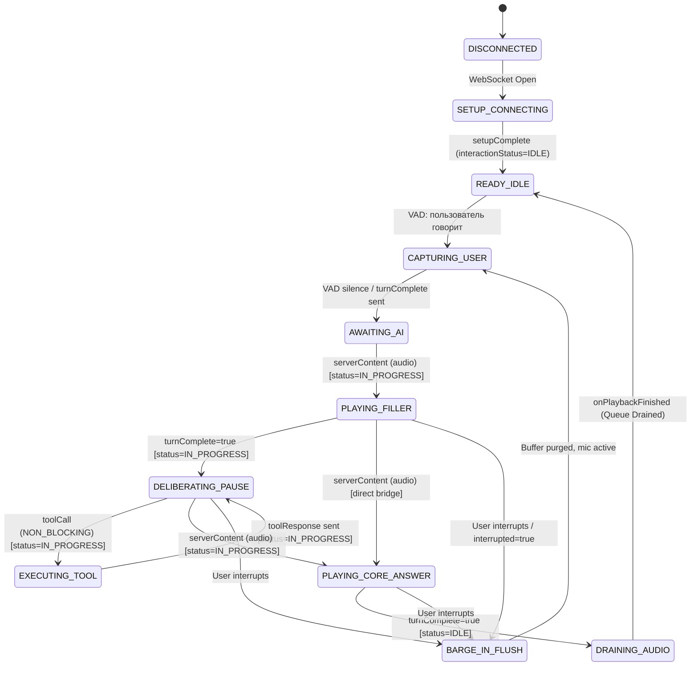

# 🏛️ Master RFC: Gemini 3.8 Live Extended Thinking Integration & Dual-Key State Machine (SOTA September 2026)

> **Статус:** `PROPOSED_FOR_APPROVAL`  
> **Дата:** 16 сентября 2026 г.  
> **Методология:** Multi-Faceted Research-Driven Architecture (MFRDA)  
> **Основано на:** Аудите кодовой базы и 4 отчётах Deep Research (`docs/roadmap/reports/20260916/`)

---

## 1. Executive Summary & Ключевые Выводы Исследования

Проведённое исследование 4 независимых треков (протокол, задержки/FinOps, педагогическая ценность, гибридная оркестрация) позволило установить фундаментальные факты:

1. **`gemini-3.8-live-extended-thinking` — это чемпион по глубине рассуждений**:
   - **#1 в мире** на Speech-to-Speech Quality Index (82.6 балла против 76.0 у стандартной модели).
   - **+38.5% прирост** в решении агентных задач ($\tau$-Voice: **68.6%** против 30.1% у `gemini-3.8-live`).
   - **97.7%** на Big Bench Audio (акустическая логика и проверка инвариантов).
   - Устраняет угодничество (anti-sycophancy) в распределённых системах (CAP/NTP lease drift), многопоточности (JMM, carrier thread pinning в Java 21) и финансах (`BigDecimal` vs `double`).
2. **Тектонический протокольный сдвиг**:
   - `turnComplete: true` больше **НЕ означает** завершение хода! Он лишь сигнализирует об окончании конкретного речевого фрагмента (разговорного наполнителя/филлера).
   - Истинным индикатором завершения хода стал `interaction_status`:
     - `IN_PROGRESS` — модель думает в фоне, исполняет `NON_BLOCKING` инструмент или произносит промежуточный филлер.
     - `IDLE` — взаимодействие полностью завершено, и только теперь можно ожидать ответа пользователя.
3. **Операционная стоимость и профиль задержек (FinOps & Latency)**:
   - Эффективная стоимость в 4.16 раза выше ($3.50/час против $0.84/час у стандартной Live), так как внутренние токены рассуждений тарифицируются по ставке текстового вывода ($4.50 / 1M).
   - При сложных задачах полное время хода составляет от 8.5 до 24 секунд (при маскировке филлерами за ~1.35 с).
   - Всплески токенов рассуждений (до 6,000 токенов за 3–5 секунд) нелинейно расходуют квоту TPM, создавая риск HTTP 429.
4. **Невозможность переключения «на лету» внутри одного сокета**:
   - Протокол Gemini Live запрещает смену модели и межмодельное возобновление сессий (`SessionResumptionConfig`). Переключение требует разрыва сокета, повторной передачи всей истории диалога через `clientContent` (пауза 700–1500 мс) и приводит к слышимому дрейфу тембра голоса.
   - **SOTA-решение**: Специализация по режимам (Session-Level / Mode Specialization) в сочетании с жестким инвариантом лаконичности речи (Audio Brevity Invariant).

---

## 2. Сравнительная матрица моделей: Standard Live vs Extended Thinking

| Характеристика | `gemini-3.8-live` (Текущая) | `gemini-3.8-live-extended-thinking` (Новая) | Влияние на платформу InterviewPrep AI |
| :--- | :--- | :--- | :--- |
| **Базовая архитектура** | Gemini 3 Pro (Native Audio) | Gemini 3 Pro + Test-Time Compute | Единая база, но разный контур инференса |
| **S2S Quality Index** | 76.0 | **82.6 (#1)** | Качественный скачок в точности ответов |
| **$\tau$-Voice Task Completion** | 30.1% (поверхностная) | **68.6% (глубокая)** | Ловит скрытые race conditions и баги JMM |
| **Speech Agent Arena Elo** | **1083 (Casual #2)** | 990 (Pedantic) | Для обычного чата модель кажется занудной |
| **TTFA (Time to First Audio)** | **1.18 сек** (прямой ответ) | **1.35 сек** (филлер-мостик) | Минимальная разница благодаря аудио-филлерам |
| **Полное время хода (сложная задача)** | 3.5 – 5.5 сек | 8.5 – 24.0 сек | Требует непрерывного удержания микрофона |
| **Управление мышлением** | **Не поддерживается** (ошибка 400) | `thinkingLevel: "low"\|"medium"\|"high"` | Требует явной настройки в `setup` |
| **Поведение инструментов** | `BLOCKING` или `NON_BLOCKING` | **Строго `NON_BLOCKING`** | `BLOCKING` приводит к фатальной ошибке |
| **Индикатор конца хода** | `turnComplete: true` | `interaction_status: "IDLE"` | Требует переработки стейт-машины клиента |
| **Стоимость часа работы** | **~$0.84 / час** | ~$3.50 / час (4.16x) | Нельзя включать на тривиальные вопросы |
| **Риск превышения лимитов TPM** | Низкий (плавный стриминг) | **Высокий** (всплески до 6K токенов) | Требует расширения квот в `litellm_proxy` |

---

## 3. Архитектурные Инварианты для Внедрения (Hard Invariants)

### Инвариант 1: Двухключевой гейт микрофона (Dual-Key Microphone Gate Invariant)
Клиентский аудио-драйвер **ни при каких обстоятельствах** не имеет права разблокировать микрофон кандидата только по флагу `turnComplete: true`.

Разблокировка микрофона разрешена **только и исключительно** при одновременном выполнении двух условий:
$$
\text{MicrophoneGate} = (\text{interactionStatus} \equiv \text{IDLE}) \land (\text{AudioPlayoutState} \equiv \text{DRAINED})
$$

- Если `turnComplete: true`, но `interactionStatus: "IN_PROGRESS"`:
  - Это разговорный филлер (*«Дай взглянуть на блокировки в твоём коде...»*) или промежуточная пауза.
  - Микрофон остаётся **ЗАБЛОКИРОВАННЫМ** (`isRecording = false`).
  - Таймеры неактивности (silence watchdogs) **БЛОКИРУЮТСЯ**.
  - В UI отображается состояние: *«ИИ обдумывает детали...»* (а не «Ваша очередь»).

### Инвариант 2: Изоляция частей рассуждений (Thought Part Filtering Invariant)
В массиве `serverContent.modelTurn.parts` все элементы с `thought: true` содержат внутренние токены размышлений и криптографическую подпись `thoughtSignature`.
- Эти части **строго отфильтровываются** из пайплайна декодирования Web Audio.
- Они не озвучиваются и не загрязняют реплики кандидата.
- При необходимости они транслируются в служебный UI («Радар мышления ИИ») для наглядного обучения.

### Инвариант 3: Обязательное объявление `NON_BLOCKING` инструментов
Все инструменты, передаваемые в `setup.tools.functionDeclarations` (включая `update_whiteboard` и `submit_interview_evaluation`), обязаны содержать `"behavior": "NON_BLOCKING"`.
- Любая попытка передать `"BLOCKING"` в модель Extended Thinking пресекается на этапе валидации бэкенда до отправки в сокет.
- Реализуется обработка `toolCallCancellation`: при прерывании пользователем незавершённые вызовы инструментов немедленно аннулируются.

### Инвариант 4: Лаконичность устной речи (Audio Brevity Invariant)
Модели с Extended Thinking по умолчанию склонны произносить длинные лекции. В системный промпт внедряется жесткое ограничение:
- **Размер устной реплики**: Строго 1–3 предложения (до 40 слов).
- **Принцип**: *«Думай максимально глубоко в скрытых токенах рассуждений, но говори кратко, остро и сократически»*.
- **Устранение угодничества**: Полный запрет на вводные комплименты (*«Отличная идея»*, *«Верно»*). При наличии ошибки — немедленная формулировка контрпримера в виде вопроса.

---

## 4. Схема состояний (State Machine) на клиенте (`VoiceModal.tsx`)

---

## 5. Доработки по компонентам системы

### 5.1. Наш внутренний шлюз `litellm_proxy` (`C:\projects\litellm_proxy`)
1. **Поддержка модели в конфиге**:
   - Зарегистрировать алиас `gemini-live-thinking` $\rightarrow$ `gemini-3.8-live-extended-thinking`.
2. **Прозрачный WebSocket Passthrough**:
   - Гарантировать трансляцию поля `interaction_status` (`IN_PROGRESS` / `IDLE`), частей `thought: true` с `thoughtSignature`, и событий `toolCallCancellation`.
   - Пропускать объект `thinkingConfig: { thinkingLevel: "MEDIUM", includeThoughts: true }` в стартовом фрейме `setup`.
3. **Управление квотами и Circuit Breaker**:
   - Выделить пул API-ключей с повышенными TPM-квотами под модель Extended Thinking для предотвращения 429 ошибок.

### 5.2. Бэкенд (`backend/src/services/live/`)
1. **`liveWsConnectionHandler.ts`**:
   - Добавить селектор модели: если `tutorMode === 'system_design_defense'` или `challengeDomain === 'concurrency'`, сессия стартует с `liveModel = process.env.GEMINI_LIVE_THINKING_MODEL || 'gemini-live-thinking'`.
   - В `setupMessage`: если выбрана модель thinking, добавлять `thinkingConfig: { thinkingLevel: 'MEDIUM', includeThoughts: true }`.
   - Для всех деклараций инструментов выставлять `behavior: 'NON_BLOCKING'`.
2. **`liveAudioStreamRouter.ts`**:
   - Отслеживать `interaction_status` из входящих серверных фреймов.
   - Запись реплики ИИ в постоянную память `mem.turns` производить **только при переходе в `interactionStatus === 'IDLE'`** (чтобы не записывать обрывки филлеров).
   - Обрабатывать фрейм `toolCallCancellation`.

### 5.3. Фронтенд (`frontend/src/`)
1. **`VoiceModal.tsx` & `useLegacyLiveAudioSession.ts`**:
   - Внедрить двухключевой гейт: разблокировать микрофон кандидата только когда `serverContent.interactionStatus === 'IDLE'` **И** `AudioPlayoutManager` полностью опустошил очередь звука.
   - При `turnComplete: true` с `interactionStatus === 'IN_PROGRESS'` переключать статус UI в «ИИ обдумывает...», блокировать микрофон и подавлять silence watchdogs.
   - Игнорировать части с `thought: true` при передаче PCM в `enqueuePcmChunk`.

---

## 6. Стратегия внедрения (Рекомендация)

Учитывая 4.16x кратность стоимости и просадку в динамике обычного разговора (Elo 990 vs 1083), внедрять Extended Thinking как единственный глобальный дефолт — **архитектурная ошибка**.

**Рекомендуемая стратегия — Selective Arena Activation**:
1. **Стандартный режим (Default)**: Обычные интервью, квизы, тренировка Junior/Middle и свободный чат продолжают использовать сверхбыстрый и дешевый `gemini-3.8-live` (TTFA 1.18 с, стоимость $0.84/час).
2. **Apex-режимы высокой когнитивной сложности**:
   - **System Design Bar-Raiser Defense** (защита архитектуры перед строгим интервьюером);
   - **Concurrency & Memory Model Bug Hunt** (поиск тонких багов JMM / виртуальных потоков);
   - **Production Incident Forensics** (расследование каскадных сбоев);
   Здесь сессия подключается к `gemini-3.8-live-extended-thinking` с включенным двухключевым гейтом микрофона, где модель демонстрирует свой непревзойденный интеллект (68.6% $\tau$-Voice, 97.7% Big Bench Audio) без риска прерывания или сломанного UX.
