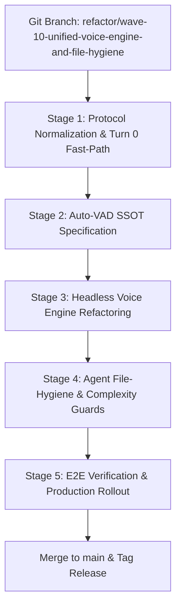

# Wave 10: Unified Headless Voice Engine & Architectural File-Hygiene Standards (UHVE-AFHS)

> **Living Specification & Single Source of Truth (SSOT)**  
> **Target Standard:** SOTA Late September 2026  
> **Base Commit:** `d27d8224c9296d39f49e063e0e8948ee82f37676` (`main`)  
> **Development Branch:** `refactor/wave-10-unified-voice-engine-and-file-hygiene`  
> **Execution Paradigm:** Test-Driven Development (TDD), Strict Periodic Commits, Zero-Phantom-Fallback, Cognitive Bounding ($\le 350$ lines/file).

---

## 1. Executive Summary & Problem Formulation

In Waves 08 and 09, the platform introduced automated acoustic matrix testing and pre-flight canary validation on the VPS. However, practical usage in production revealed three deep architectural defects:

1. **Protocol Signal Fracture (`generationComplete` vs `turnComplete`):**
   Google Gemini Live Multimodal API (`models/gemini-3.8-live` via LiteLLM) emits `serverContent.generationComplete: true` upon completing speech synthesis for a turn. The application backend and frontend strictly listened only for `turnComplete: true`, resulting in a permanent state deadlock:
   - Backend `session.isAiGenerating` remained `true` indefinitely.
   - `liveWsConnectionHandler`'s `ECHO_GUARD` suppressed 100% of candidate microphone packets (empirically verified: 775 dropped chunks / 31 seconds of silent suppression).
   - Frontend microphone button remained frozen in "AI Speaking" (pink glow) and never transitioned to "Your turn" (green mic).

2. **Turn 0 Cognitive & Function-Calling Overhead:**
   In `sessionType: 'interview'`, the system declared the heavyweight `submit_interview_evaluation` tool with a 5-criteria rubric on Turn 0. This caused Gemini to allocate background reasoning to function calling rather than streaming fast, contiguous audio, resulting in speech stalling after a single greeting sentence while text trickled out at high latency. Conversely, `sessionType: 'tutor'` (without evaluation tools) generated speech cleanly.

3. **Monolithic "God Component" & Parallel Engine Sprawl:**
   `VoiceModal.tsx` grew to **4,220 lines of code**, intertwining Web Audio DSP, WebSocket transport, subtitle pacing, committee verdicts, and React presentation. Because modifying a 4,200-line monolith incurs extreme cognitive load and risk of regression, past agent interventions repeatedly bypassed reuse, adding duplicate logic in `ProjectDefenseStudio.tsx` and fragmented `if (sessionType === 'tutor')` branches.

Wave 10 resolves these defects at their root cause through a clean **Headless Voice Engine**, complete protocol normalization, a canonical **Auto-VAD SSOT Specification**, and **Architectural File-Hygiene Invariants** enforced statically.

---

## 2. Global Architectural Invariants (SOTA Late 2026)

All tasks and stages in Wave 10 must strictly adhere to these 6 non-negotiable invariants:

1. **Canonical Terminal Event Equivalence Invariant:**
   The end of an AI speech turn is signaled by:
   $$\text{TurnFinished} \equiv \text{Boolean}(\text{serverContent.turnComplete} \lor \text{serverContent.generationComplete})$$
   Both backend stream router and frontend audio engine MUST treat either signal as authoritative termination of AI generation, immediately calculating physical playout drain epoch and transferring turn custody.

2. **Turn 0 Audio-Fast-Path Invariant:**
   On Turn 0 (greeting and question recitation), evaluation tools (`submit_interview_evaluation`, `submit_defense_evaluation`) MUST NOT be registered or available to the model. The model operates exclusively in streaming speech mode until the candidate's first spoken answer is committed.

3. **Headless Voice Engine & Single Responsibility Invariant:**
   All Web Audio graph construction, AudioWorklet message dispatch, WebSocket transport, keepalives, and VAD state machines MUST reside in a pure TypeScript headless module (`LiveVoiceEngine.ts`), independent of React. UI components (`VoiceModal`, `ProjectDefenseStudio`, `PracticeArena`) are strictly presentational subscribers. Direct instantiation of `new WebSocket('/ws/live')` outside `LiveVoiceEngine` is forbidden.

4. **Cognitive Bounding & File Ceiling Invariant ($\le 350$ lines):**
   - No newly created TypeScript or React file may exceed **350 lines**.
   - No existing file undergoing refactoring may exceed **400 lines**.
   - God Components exceeding 400 lines MUST be decomposed into atomic, single-responsibility files before adding new features.

5. **Branching & Periodic Commit Invariant:**
   All work executes in `refactor/wave-10-unified-voice-engine-and-file-hygiene` branched from `main`. Every discrete task step ends with automated test verification and a conventional Git commit (`feat:`, `fix:`, `refactor:`, `test:`, `docs:`).

6. **Zero-Phantom-Fallback & Deterministic Testing:**
   Never fabricate mock responses or fallback heuristics. Every stage must pass headless acoustic replay (`replay_turn.ts`) and Playwright Web Audio E2E tests before progressing.

---

## 3. Hierarchical Phase Decomposition

Wave 10 is partitioned into 5 sequential stages with strict gates:

| Stage | Document | Scope & Key Deliverables | Definition of Done |
| :--- | :--- | :--- | :--- |
| **Stage 1** | [STAGE_01_PROTOCOL_NORMALIZATION_AND_TURN0_FASTPATH.md](file:///d:/projects/interview_projects/spring/docs/roadmap/wave_10_unified_headless_voice_engine_and_file_hygiene/STAGE_01_PROTOCOL_NORMALIZATION_AND_TURN0_FASTPATH.md) | Hotfix & Unblock: Normalize `generationComplete`, implement Turn 0 Fast-Path (no eval tools on greeting), and handle hot-reconnect turn re-arming. | `replay_turn.ts` passes with exit code 0; 0 dropped chunks in EchoGuard. |
| **Stage 2** | [STAGE_02_AUTO_VAD_LIVE_AUDIO_SPECIFICATION.md](file:///d:/projects/interview_projects/spring/docs/roadmap/wave_10_unified_headless_voice_engine_and_file_hygiene/STAGE_02_AUTO_VAD_LIVE_AUDIO_SPECIFICATION.md) | Auto-VAD SSOT Specification: Full protocol specification, mathematical latency models, dual-sided handshake truth table, and audio buffer math. | Formally approved specification document committed as SSOT. |
| **Stage 3** | [STAGE_03_HEADLESS_VOICE_ENGINE_REFACTORING.md](file:///d:/projects/interview_projects/spring/docs/roadmap/wave_10_unified_headless_voice_engine_and_file_hygiene/STAGE_03_HEADLESS_VOICE_ENGINE_REFACTORING.md) | Architecture Decomposition: Extract `LiveVoiceEngine.ts` (~300 lines) from `VoiceModal.tsx` (4,220 lines); decompose UI into atomic subcomponents ($\le 300$ lines each). | `VoiceModal.tsx` reduced from 4220 to $< 250$ lines; all unit & UI tests pass. |
| **Stage 4** | [STAGE_04_AGENT_FILE_HYGIENE_AND_COMPLEXITY_GUARDS.md](file:///d:/projects/interview_projects/spring/docs/roadmap/wave_10_unified_headless_voice_engine_and_file_hygiene/STAGE_04_AGENT_FILE_HYGIENE_AND_COMPLEXITY_GUARDS.md) | Agent Instructions & Static Guards: Update `AGENTS.md` and skills with file size ceiling ($\le 350$ lines), anti-duplication invariant, and ESLint rule. | CI static lint fails on files $> 400$ lines; agent skill bound to SSOT. |
| **Stage 5** | [STAGE_05_E2E_VERIFICATION_AND_PRODUCTION_ROLLOUT.md](file:///d:/projects/interview_projects/spring/docs/roadmap/wave_10_unified_headless_voice_engine_and_file_hygiene/STAGE_05_E2E_VERIFICATION_AND_PRODUCTION_ROLLOUT.md) | Production Rollout: Local e2e tests, VPS canary container execution, and zero-downtime rolling deployment to production. | Live verification on VPS: both "Собеседование" and "Спросить" pass turn cleanly. |

---

## 4. Execution Dependency Graph

---

## 5. Git Branch Lifecycle & Periodic Commit Cadence

To guarantee traceability, safety, and zero regression against `main`:

### 5.1. Branch Isolation
- All development and refactoring work takes place strictly on:
  `refactor/wave-10-unified-voice-engine-and-file-hygiene`
- Base commit: `d27d8224c9296d39f49e063e0e8948ee82f37676` (`main`).
- No direct commits or pushes to `main` until Stage 5 is 100% verified.

### 5.2. Periodic Commit Table & Checkpoints

| Commit # | Phase / Deliverable | Commit Type & Scope | Verification Checkpoint |
| :---: | :--- | :--- | :--- |
| **C1** | Roadmap & Specifications | `docs(roadmap): establish Wave 10 master roadmap and stage specifications` | Markdown links verified; architecture reviewed |
| **C2** | Stage 1: Protocol & Turn 0 | `fix(voice): normalize generationComplete terminal signal and enforce Turn 0 fast-path` | `replay_turn.ts` passes; 0 dropped chunks |
| **C3** | Stage 2: SSOT Specification | `docs(voice): establish authoritative Auto-VAD live audio SSOT specification` | SSOT document created and linked in docs |
| **C4** | Stage 3: Headless Engine | `refactor(voice): extract headless LiveVoiceEngine and decompose VoiceModal monolith` | Unit tests pass; `VoiceModal.tsx` < 250 lines |
| **C5** | Stage 4: File-Hygiene Guards | `chore(rules): enforce 350-line file ceiling, Auto-VAD SSOT binding, and anti-duplication guards` | `verify_file_hygiene.ts` passes on repo; `AGENTS.md` updated |
| **C6** | Stage 5: E2E Verification | `test(voice): verify end-to-end audio streaming across interview and tutor modes` | Dual-mode replay verified; canary verified |
| **C7** | Release & Production | `release(wave-10): complete unified headless voice engine rollout and file-hygiene guards` | VPS production updated and healthy |

