# Wave 12: Platform-Wide Code & UI/UX Actualization Master Implementation Plan

> **Directory:** `docs/roadmap/wave_12_platform_code_and_uiux_actualization/`  
> **Status:** Active Master Roadmap  
> **Target Standard:** SOTA Late September 2026  
> **Parent Specification SSOT:** [docs/architecture/specs/README.md](file:///d:/projects/interview_projects/spring/docs/architecture/specs/README.md)  
> **Master Architecture:** [docs/architecture.md](file:///d:/projects/interview_projects/spring/docs/architecture.md)

---

## 1. Executive Summary & Architectural Objective

Following the establishment of the **Hub-and-Spoke Domain Specifications Hierarchy** (Wave 11), the platform requires a systematic, deeply evidenced audit and actualization of both the underlying backend code and the frontend UI/UX across all 8 learning pillars and core infrastructure.

This plan guarantees:
1. **1-to-1 Specification Alignment:** Every code file and UI component is audited directly against its authoritative domain specification in [`docs/architecture/specs/`](file:///d:/projects/interview_projects/spring/docs/architecture/specs/README.md).
2. **Root-Cause Remediation:** Eliminate monolithic God-objects, parallel re-implementations, unhandled race conditions, and outdated libraries.
3. **SOTA UI/UX Standards:** Enforce soft-luxury pastel aesthetics (`#FFF0F5`, gentle mesh glows), `100dvh` mobile ergonomics, tactile feedback, micro-animations, and unified `Ctrl + /` heuristic compasses across all interactive arenas.
4. **Cognitive Bounding Compliance:** Enforce the $\le 350$ lines ceiling on all newly created or refactored files via `npm run verify-hygiene`.

```mermaid
graph TD
    M["00_MASTER_IMPLEMENTATION_PLAN.md"] --> S0["STAGE_00_CORE_INFRASTRUCTURE_AND_SECURITY.md"]
    M --> S1["STAGE_01_ORAL_VOICE_AND_AUTO_VAD.md"]
    M --> S2["STAGE_02_MUTATION_TESTING_ARENA.md"]
    M --> S3["STAGE_03_SPRING_TRANSACTIONS_LAB.md"]
    M --> S4["STAGE_04_SYSTEM_DESIGN_ARENA.md"]
    M --> S5["STAGE_05_INCIDENT_TRIAGE_SRE.md"]
    M --> S6["STAGE_06_MACHINE_CODING_AND_LLD.md"]
    M --> S7["STAGE_07_GUIDED_ACADEMY_AND_FSRS5.md"]
    M --> S8["STAGE_08_STUDYDECK_AND_PODCASTS.md"]
```

---

## 2. Stage Execution Index & Domain Mapping

| Stage | Domain / Pillar | Stage Specification File | Authoritative Domain SSOT | Primary Focus |
| :---: | :--- | :--- | :--- | :--- |
| **00** | **Core Infra & Security** | [`STAGE_00_CORE_INFRASTRUCTURE_AND_SECURITY.md`](STAGE_00_CORE_INFRASTRUCTURE_AND_SECURITY.md) | [`00_CORE_INFRASTRUCTURE_AND_SECURITY.md`](../../architecture/specs/00_CORE_INFRASTRUCTURE_AND_SECURITY.md) | LiteLLM circuit breakers, SQLite WAL tuning, Zero-Trust invite auth UX |
| **01** | **Oral Mock Interview** | [`STAGE_01_ORAL_VOICE_AND_AUTO_VAD.md`](STAGE_01_ORAL_VOICE_AND_AUTO_VAD.md) | [`01_ORAL_MOCK_INTERVIEW_AND_AUTO_VAD.md`](../../architecture/specs/01_ORAL_MOCK_INTERVIEW_AND_AUTO_VAD.md) | Decommission legacy voice hooks, strict `LiveVoiceEngine` reuse, 100dvh voice HUD |
| **02** | **Testing & Mutation** | [`STAGE_02_MUTATION_TESTING_ARENA.md`](STAGE_02_MUTATION_TESTING_ARENA.md) | [`02_TESTING_AND_MUTATION_ARENA.md`](../../architecture/specs/02_TESTING_AND_MUTATION_ARENA.md) | Sub-80ms Pitest mutation runner, interactive mutant diff inspector, Testing Compass |
| **03** | **Spring Transactions** | [`STAGE_03_SPRING_TRANSACTIONS_LAB.md`](STAGE_03_SPRING_TRANSACTIONS_LAB.md) | [`03_SPRING_TRANSACTIONS_LAB.md`](../../architecture/specs/03_SPRING_TRANSACTIONS_LAB.md) | In-memory proxy engine, multi-thread swimlane timeline visualizer, Transaction Compass |
| **04** | **System Design Arena** | [`STAGE_04_SYSTEM_DESIGN_ARENA.md`](STAGE_04_SYSTEM_DESIGN_ARENA.md) | [`04_SYSTEM_DESIGN_ARENA.md`](../../architecture/specs/04_SYSTEM_DESIGN_ARENA.md) | Cytoscape graph canvas, DES packet simulator worker, L1 capacity math coach |
| **05** | **Incident Triage SRE** | [`STAGE_05_INCIDENT_TRIAGE_SRE.md`](STAGE_05_INCIDENT_TRIAGE_SRE.md) | [`05_PRODUCTION_INCIDENT_TRIAGE.md`](../../architecture/specs/05_PRODUCTION_INCIDENT_TRIAGE.md) | Tarjan SCC deadlock engine (<1ms), interactive thread hierarchy visualizer, MTTM/MTTR timer |
| **06** | **Machine Coding & LLD** | [`STAGE_06_MACHINE_CODING_AND_LLD.md`](STAGE_06_MACHINE_CODING_AND_LLD.md) | [`06_MACHINE_CODING_AND_LLD.md`](../../architecture/specs/06_MACHINE_CODING_AND_LLD.md) | AST rules audit (Clock injection, BigDecimal), multi-tab IDE layout, 5-factor scorecard |
| **07** | **Guided Academy Studio** | [`STAGE_07_GUIDED_ACADEMY_AND_FSRS5.md`](STAGE_07_GUIDED_ACADEMY_AND_FSRS5.md) | [`07_GUIDED_ACADEMY_AND_FSRS5.md`](../../architecture/specs/07_GUIDED_ACADEMY_AND_FSRS5.md) | FSRS-5 17-parameter memory decay, 8-track curricular DAG, Memory Radar drawer, NBA |
| **08** | **StudyDeck & Podcasts** | [`STAGE_08_STUDYDECK_AND_PODCASTS.md`](STAGE_08_STUDYDECK_AND_PODCASTS.md) | [`08_STUDYDECK_AND_AUDIO_PODCASTS.md`](../../architecture/specs/08_STUDYDECK_AND_AUDIO_PODCASTS.md) | Two-host dialogue synthesis, EBU R128 loudness, lock-screen `MediaSession`, in-audio rating |

---

## 3. Universal Execution Invariants

1. **Git Isolation & Atomic Commits:**  
   Each stage is executed in an isolated branch (`refactor/wave-12-stage-XX`) branched from `main`, committed with conventional messages (`fix:`, `refactor:`, `perf:`, `ui:`), verified against all gates, and merged into `main` via `--no-ff`.
2. **Cognitive Bounding Limit ($\le 350$ Lines):**  
   Any newly created file MUST NOT exceed 350 lines. Any existing file touched during refactoring that exceeds 400 lines MUST be decomposed into single-responsibility submodules before adding new capabilities.
3. **Zero Phantom Fallbacks:**  
   No fabricated or mock fallbacks disguised as AI generation. All interactive features must connect to deterministic backend engines or verified LiteLLM models.
4. **100dvh Viewport & Mobile Ergonomics:**  
   All full-screen modals and arenas use `100dvh` (`h-[calc(100dvh-4rem)]`), module-level reference-counted scroll locking (`useBodyScrollLock`), and CSS virtualization (`content-visibility: auto`) for 120 FPS performance.
