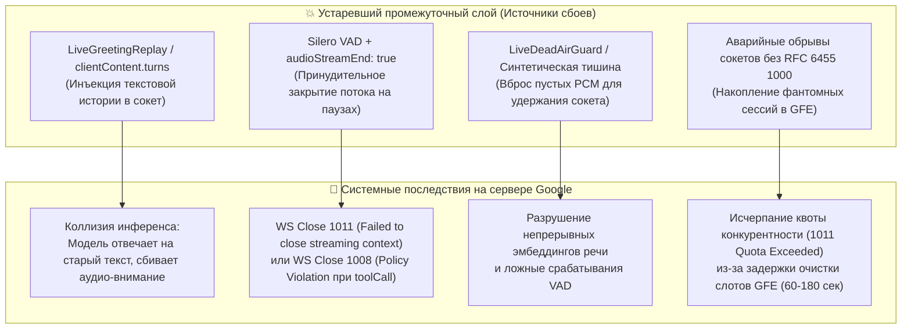
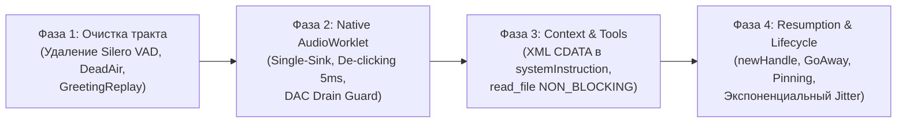

# 🏛️ Master Architectural RFC: Нативная архитектура Gemini 3.8 Live (Zero-Middleware)

> **Статус:** Canonical Master RFC (SOTA Late 2026)  
> **Дата:** Октябрь 2026  
> **Основание:** Синтез 6 исследовательских досье MFRDA (`reports/01_report.md` — `reports/06_report.md`)

---

## 1. Первопричины системных отказов (Root Cause Analysis)

Сбои в диалоге («ответил невпопад и перестал отвечать», ошибки `1011` и рассинхронизация) вызваны фундаментальным конфликтом между эвристическим промежуточным слоем приложения и сквозным мультимодальным трансформером Google:



1. **Коллизия `clientContent` и `realtimeInput` (Ответ «невпопад»):** Инъекция текстовой истории диалога (`turns`) в активный сокет во время поступления аудиопотока пользователя ломает граф внимания модели. Модель бросает слушать микрофон и генерирует голосовой ответ на старый текст, после чего десинхронизируется и замолкает.
2. **Патология `audioStreamEnd`:** Сигнал зарезервирован Google исключительно для физического отключения микрофона. Отправка его для ускорения ответа на паузах ломает вокодер и вызывает `1011 Internal Error`.
3. **Разгадка ошибки `1011 ... head to: h`:** В RFC 6455 длина Close Frame ограничена 125 байтами (123 байта текста). Google Front End механически обрезает стандартный шаблон ошибки квоты на 123-м байте ровно на символе `h` схемы `https://`. При этом GFE транслирует в код `1011` как исчерпание сессий, так и внутренние падения воркеров gRPC `INTERNAL` из-за нарушения порядка кадров.

---

## 2. Архитектурный манифест Zero-Middleware (Целевое состояние)

Полная ликвидация эвристических адаптеров и переход на нативный сквозной стек Google BidiGenerateContent:

| Устаревший компонент | Причина ликвидации | Нативная замена в SOTA 2026 |
| :--- | :--- | :--- |
| **Silero VAD v5 на клиенте** | Ложный эндпоинтинг на когнитивных паузах, конфликты с сервером | **Native Cloud VAD** (`gemini-3.8-live` совмещает акустику и семантику фразы) |
| **`LiveDeadAirGuard`** | Разрушает эмбеддинги инжекцией синтетического PCM | **Нативный сокет** с протокольным TCP Keepalive и `proactive_audio` |
| **`LiveGreetingReplay`** | Вызывает коллизии внимания и потерю аудиоконтекста | **Чистый старт** без инъекции истории; контекст передается в `systemInstruction` |
| **Ручной реплей при реконнекте** | Ответы «невпопад», дублирование токенов | **`sessionResumption.handle`** (восстановление KV-кэша на сервере за 0 мс) |
| **Ротация ключей при реконнекте** | Токен сессии привязан к ключу; с новым ключом летит `1011`/`1008` | **Session-Pinned Key** (привязка API-ключа к сессии на весь её жизненный цикл) |

---

## 3. Спецификация ключевых подсистем

### 3.1. Native Cloud VAD и калибровка сессии
Конфигурация инициализирующего сообщения `setup` (строго первое сообщение в сокете):

```json
{
  "setup": {
    "model": "models/gemini-3.8-live",
    "generationConfig": {
      "responseModalities": ["AUDIO"],
      "speechConfig": { "voiceConfig": { "prebuiltVoiceConfig": { "voiceName": "Puck" } } }
    },
    "realtimeInputConfig": {
      "automaticActivityDetection": {
        "disabled": false,
        "startOfSpeechSensitivity": "START_SENSITIVITY_LOW",
        "prefixPaddingMs": 200,
        "endOfSpeechSensitivity": "END_SENSITIVITY_LOW",
        "silenceDurationMs": 500
      },
      "activityHandling": "START_OF_ACTIVITY_INTERRUPTS"
    },
    "sessionResumption": {}
  }
}
```

* Поток микрофона передается **непрерывно** (`audio/pcm;rate=16000`, 512 сэмплов / 32 мс в чанке). Никаких `audioStreamEnd` во время диалога.

### 3.2. Заземление контекста кода (Workspace Grounding)
* **Ядро проекта (до 15 000 токенов):** Передается в `setup.systemInstruction.parts` в структурированном виде XML (`<workspace_context><file path="...">...<![CDATA[...]]></file></workspace_context>`).
  * *Свойство:* Зафиксировано в префиксном KV-кэше, **никогда не вымывается** скользящим окном памяти в ходе 15-минутного аудиодиалога.
  * *Оптимизация:* Аппаратно ускоряется TPU через Implicit Caching без накладных расходов.
* **Вспомогательные файлы:** Догружаются динамически через асинхронный инструмент `read_file(filePath)` с параметром `behavior: "NON_BLOCKING"`.
* **Запрет `cachedContent`:** Явное кэширование имеет аппаратный порог минимум 32 768 токенов; для каталогов 3–15k токенов неприменимо.

### 3.3. Канонический Session Resumption & GoAway Handshake
1. **Захват дескриптора:** При получении `sessionResumptionUpdate` клиент сохраняет `newHandle`, только если `resumable === true`.
2. **Мягкий реконнект:** При разрыве открывается новый сокет с тем же API-ключом и `setup.sessionResumption.handle: savedHandle`. Модель мгновенно продолжает диалог без повторной передачи истории.
3. **Обработка `goAway`:** На 9-й минуте (лимит сокета — 10 минут) сервер шлет `goAway.timeLeft`. Клиент упреждающе открывает параллельный сокет B по `newHandle`, переключает аудио и закрывает сокет A со статусом `1000 Normal Closure`.
4. **Fallback:** При ошибках `1008`/`1011` дескриптор обнуляется, выполняется холодный старт с кратким системным резюме.

### 3.4. Асинхронные инструменты (NON_BLOCKING) и interactionStatus
* Все функции объявляются со строгим верхним регистром типов Protobuf (`OBJECT`, `STRING` и т.д.) и `behavior: "NON_BLOCKING"`.
* При отправке подтверждений отрисовки доски/кода используется `scheduling: "SILENT"`, чтобы модель не проговаривала вслух технические статусы.
* **FSM готовности:** Переход микрофона и интерфейса в режим `IDLE` (ожидание ответа соискателя) выполняется строго по конъюнкции:
  $$\text{Ready} \iff (\text{AudioBuffer} == \emptyset) \land (\text{PendingTools} == 0) \land (\text{interactionStatus} == \text{"IDLE"})$$
* **Turn 0 Lockdown:** Трехуровневая защита: клиентский Fail-Closed Gate + негативная системная директива + требование токена этапа для `submit_interview_evaluation`.

### 3.5. Аудиоподсистема браузера (Single-Sink Web Audio)
* **Capture:** `AudioWorklet` (16 кГц Mono Int16) $\to$ передача права владения ArrayBuffer (Transferable, 0 мс GC-пауз) $\to$ WebSocket.
* **Playback:** `AudioWorklet` (24 кГц Mono, кольцевой буфер $2^{20}$ сэмплов) $\to$ прямой выход в `AudioContext.destination` (без скрытых тегов `<audio>` во избежание сбоя системного AEC).
* **Barge-In De-clicking:** При флаге `interrupted: true` активируется спад огибающей ровно на 5 мс (120 сэмплов) по формуле $g(n) = 1 - n/120$, гарантируя отсутствие щелчков в динамиках.
* **Symmetrical DAC Drain:** Автомат не считает реплику завершенной по приходу сетевого флага `turnComplete`, а ждет физического опустошения ЦАП:
  $$T_{\text{drain}} = t_{\text{ctx}} + \frac{N_{\text{ring\_unplayed}} + N_{\text{hardware}}}{f_s}$$

---

## 4. План реализации по фазам (Roadmap)



1. **Фаза 1: Демонтаж костылей (Purge):** Отключение Silero VAD, удаление `LiveDeadAirGuard` и `LiveGreetingReplay`. Перевод потока микрофона в честный непрерывный режим.
2. **Фаза 2: Браузерный DSP-стек:** Обновление `pcm-capture-processor` и `pcm-playback-processor` с кольцевым буфером $2^{20}$, спадом 5 мс и отслеживанием $T_{\text{drain}}$.
3. **Фаза 3: Заземление кода и неблокирующие тулы:** Формирование XML-манифеста файлов в `systemInstruction`, внедрение `read_file` (`NON_BLOCKING`), обработка `interactionStatus`.
4. **Фаза 4: Управление жизненным циклом сессии:** Поддержка `sessionResumptionUpdate`, обработка `goAway`, session-pinned API keys в LiteLLM, корректное закрытие сокетов RFC 6455 1000.
