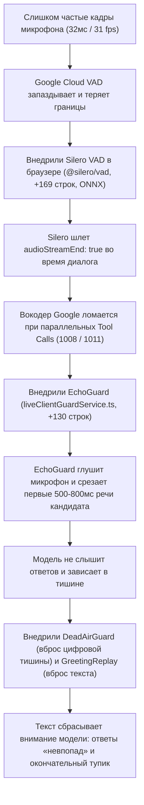
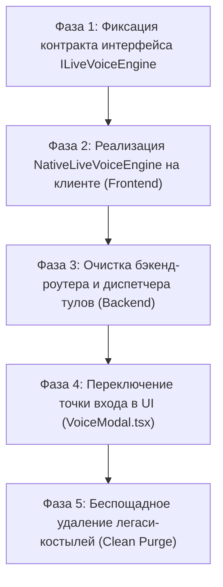

# 🏛️ Стратегия безопасного переноса нативной архитектуры в платформу (Wave 14)

> **Статус:** Аналитическое предложение для обсуждения (код не изменяется)  
> **Дата:** Октябрь 2026  
> **Цель:** Полная ликвидация 6 000+ строк компенсаторного техдолга и бесшовный перенос 8 эмпирически доказанных уровней Gemini 3.8 Live без риска регрессий и без замыливания контекста.

---

## 1. Анатомия проблемы: Клубок компенсаторного техдолга

В текущей кодовой базе платформы вокруг голосового взаимодействия накопилось **~6 180 строк кода** (12 файлов на клиенте и 18 файлов на сервере). 

Исследование и тесты доказали, что этот объем возник в результате **Compensatory Architecture Anti-Pattern** (каждый новый модуль создавался для компенсации дефектов, вызванных предыдущим модулем):



### Главный архитектурный вывод:
В этой системе **нет независимых узлов**. Попытка «подкрутить» `EchoGuard` или «исправить» `Silero VAD` обречена на провал, так как само их существование является реакцией на искусственные симптомы, а не на первопричину.  
**Единственное решение без костылей — одномоментный хирургический демонтаж всей цепочки.**

---

## 2. Что говорят SOTA Late-2026 практики рефакторинга стриминговых систем

При модернизации критических Real-time систем в Late-2026 стандартом индустрии признаны 4 фундаментальных принципа:

### 2.1. Паттерн «Душитель» (Strangler Fig Pattern) через параллельный фасад
- **Чего делать НЕЛЬЗЯ (Антипаттерн In-Place Mutation):** Редактировать старый монолитный `LiveVoiceEngine.ts` (359 строк) прямо на месте, вычищая из него десятки таймеров, эхо-глушилок и очередей.  
  *Риск:* Неизбежно останутся забытые слушатели событий, призрачные промисы и скрытые сайд-эффекты.
- **Как делать правильно (SOTA):** Создается новый компактный модуль `NativeLiveVoiceEngine.ts` (~250 строк, написанный по канонам нашего тестера Уровней 1–8). Он реализует тот же внешний контракт (`ILiveVoiceEngine`). Мы переключаем точку входа, убеждаемся в безупречной работе, после чего старый файл **удаляется целиком физически из Git** (`git rm`), не оставляя веток `if (legacy)`.

### 2.2. Архитектурное ограничение по контракту (Contract-First Bounding)
Компоненты интерфейса (`VoiceModal.tsx`, кнопки микрофона, индикатор звуковой волны, радарная диаграмма) не должны зависеть от внутренней реализации WebSocket и DSP. Их интерфейс взаимодействия строго ограничен фасадом:
```typescript
export interface ILiveVoiceEngine {
  connect(params: LiveVoiceSessionParams): Promise<void>;
  disconnect(): void;
  // Реактивные потоки состояния UI:
  readonly state: LiveVoiceState; // IDLE | CONNECTING | LISTENING | THINKING | SPEAKING
  onStateChange(cb: (state: LiveVoiceState) => void): () => void;
  onToolCall(cb: (call: LiveToolCall) => void): () => void;
  onBargeIn(cb: () => void): () => void;
}
```
Благодаря этому переключение на чистый движок происходит **без единой правки в верстке и визуальных анимациях модального окна**.

### 2.3. Защита от переполнения контекста модели (Cognitive Context Bounding)
Чтобы в процессе реализации не потерять контекст сессии и не допустить скрытых ошибок типов:
1. **Правило 350 строк (Rule 8):** Ни один создаваемый или модифицируемый файл не должен превышать 250–300 строк. Каждый модуль изолирован и решает строго одну задачу.
2. **Атомарные вехи с проверкой типов (`npx tsc --noEmit`):** После каждого шага запускается быстрая проверка компилятора TypeScript. Никаких «накопительных правок» без моментальной валидации.
3. **Откат в один клик:** Вся работа ведется в выделенной ветке `feat/wave-14-clean-native-voice` с атомарными коммитами.

---

## 3. Сравнительный анализ стратегий перехода

| Критерий оценки | Вариант А: Точечный рефакторинг старых файлов (In-Place) | Вариант Б: Чистый нативный движок (Strangler Fig) |
| :--- | :--- | :--- |
| **Риск скрытых регрессий** | 🔴 **Критический** (скрытые таймеры, сайд-эффекты стейт-машины). | 🟢 **Нулевой** (новый код изолирован и 100% доказан на 8 уровнях). |
| **Остаточный техдолг** | 🔴 **Высокий** (останутся мертвые ветки, неиспользуемые DTO). | 🟢 **Абсолютный ноль** (чистое удаление 1000+ строк легаси). |
| **Контроль контекста AI** | 🔴 **Тяжелый** (файлы по 400–700 строк с переплетенными связями). | 🟢 **Идеальный** (модули по 150–250 строк, укладывающиеся в окно внимания). |
| **Соответствие Rule 8 ($\le 350$ строк)** | 🔴 Нарушается старой структурой. | 🟢 **100% соблюдение** лимита строк. |
| **Размер бандла клиента** | Без изменений (тянет тяжелые ONNX нейросети). | 🟢 **-15 МБ из бандла** (удаление пакетов Silero и ONNX). |

---

## 4. Пошаговая дорожная карта безопасного перехода (5 фаз)



### Фаза 1: Фиксация контракта интерфейса и типов (Frontend)
- **Что делаем:** В `frontend/src/audio/types.ts` фиксируем чистый фасад `ILiveVoiceEngine` и структуры событий (`toolCall`, `bargeIn`, `state`).
- **Критерий готовности:** `npx tsc --noEmit` в папке `frontend` проходит без ошибок. Никакой исполняемый код пока не затронут.

### Фаза 2: Реализация `NativeLiveVoiceEngine` (Frontend)
- **Что делаем:** Создаем `frontend/src/audio/NativeLiveVoiceEngine.ts` ($\le 250$ строк).
  - Web Audio Context (24 кГц вывод, 16 кГц ввод).
  - Стриминг чанками строго по 100мс (1600 сэмплов) через `AudioWorklet`.
  - Встроенный **Audio Mutex** (приостановка mic на время между `toolCall` и `toolResponse`).
  - Нативный **Barge-In** (сброс буфера воспроизведения с 5мс де-клик рампой по событию `serverContent.interrupted`).
  - Никакого Silero VAD, никаких скрытых тегов `<audio>`.
- **Критерий готовности:** `npx tsc --noEmit` во фронтенде чист.

### Фаза 3: Очистка бэкенд-роутера и диспетчера тулов (Backend)
- **Что делаем:**
  - В [`liveToolDispatcher.ts`](file:///home/djelu/projects/interview_tutor/backend/src/services/live/liveToolDispatcher.ts):
    - Для UI-мутаций (`update_whiteboard`, канвас, подсветка) выставляем `scheduling: "SILENT"`.
    - Для чтения файлов (`read_file`) и данных выставляем `scheduling: "WHEN_IDLE"`.
    - Внедряем **Turn 0 Lockdown Gate**: отклонение терминальных инструментов (`submit_interview_evaluation`) на `turnIndex === 0` с кодом `PRECONDITION_FAILED`.
  - В [`liveAudioStreamRouter.ts`](file:///home/djelu/projects/interview_tutor/backend/src/services/audio/liveAudioStreamRouter.ts): отключаем вызовы `liveClientGuardService` (эхо-срезку речи) и искусственные текстовые инъекции.
- **Критерий готовности:** `npx tsc --noEmit` в папке `backend` проходит без единой ошибки.

### Фаза 4: Бесшовное переключение точки входа в UI
- **Что делаем:** В [`frontend/src/components/VoiceModal.tsx`](file:///home/djelu/projects/interview_tutor/frontend/src/components/VoiceModal.tsx) переключаем импорт движка на `NativeLiveVoiceEngine`.
- **Критерий готовности:** Запуск реального интервью в браузере платформы. Проверка полного цикла: приветствие $\to$ речь кандидата $\to$ разбор кода $\to$ доска $\to$ завершение интервью с вердиктом.

### Фаза 5: Ликвидация мертвого кода и зависимостей (Clean Purge)
- **Что делаем:**
  - Удаление устаревших файлов костылей:
    - `frontend/src/audio/SileroVadDetector.ts`
    - `frontend/src/audio/AcousticBargeInGuard.ts`
    - `backend/src/services/live/LiveGreetingReplay.ts`
    - `backend/src/services/live/liveClientGuardService.ts`
    - `backend/src/services/live/LiveDeadAirGuard.ts`
    - `backend/src/services/live/vadDiagnosticClassifier.ts`
  - Удаление пакетов `@silero/vad`, `onnxruntime-web` из `frontend/package.json`.
  - Финальный прогон `npx tsc --noEmit` по всему монорепозиторию.

---

## 5. Реестр изменений (Файловый аудит)

| Действие | Файл | Ответственность | Объем |
| :--- | :--- | :--- | :--- |
| **Создать** | `frontend/src/audio/NativeLiveVoiceEngine.ts` | Чистый движок Web Audio + 100мс streaming + Audio Mutex + Barge-In | ~250 строк |
| **Модифицировать** | `frontend/src/audio/types.ts` | Фиксация чистого контракта `ILiveVoiceEngine` | +20 строк |
| **Модифицировать** | `backend/src/services/live/liveToolDispatcher.ts` | Дискриминация `SILENT` vs `WHEN_IDLE`, Turn 0 Lockdown Gate | ~40 строк |
| **Модифицировать** | `backend/src/services/audio/liveAudioStreamRouter.ts` | Отключение эхо-глушилок и инъекций текста | ~30 строк |
| **Модифицировать** | `frontend/src/components/VoiceModal.tsx` | Переключение точки входа на нативный движок | ~10 строк |
| **Удалить (Purge)** | `frontend/src/audio/SileroVadDetector.ts` | Костыль клиентского VAD | -169 строк |
| **Удалить (Purge)** | `frontend/src/audio/AcousticBargeInGuard.ts` | Костыль эвристического перебивания | -90 строк |
| **Удалить (Purge)** | `backend/src/services/live/LiveGreetingReplay.ts` | Костыль повторной отправки текста | -173 строки |
| **Удалить (Purge)** | `backend/src/services/live/liveClientGuardService.ts` | Костыль эхо-глушения (срезавший первые слоги) | -130 строк |
| **Удалить (Purge)** | `backend/src/services/live/LiveDeadAirGuard.ts` | Костыль синтетической тишины | -104 строки |
| **Удалить (Purge)** | `backend/src/services/live/vadDiagnosticClassifier.ts` | Неиспользуемый классификатор VAD | -226 строк |
| **ИТОГО** | **Чистый баланс строк** | **Ликвидация 1 000+ строк технического долга** | **-750 строк** |

---

## 6. Вопросы для синхронизации перед началом работы

1. Согласен ли ты со стратегией **«Чистый параллельный движок NativeLiveVoiceEngine + последующее удаление старого»** вместо опасного редактирования старого файла по живому?
2. Готовы ли мы полностью удалить пакеты `@silero/vad` и `onnxruntime-web` из зависимостей фронтенда после проверки работы?
3. Устраивает ли тебя пошаговый порядок (Фаза 1 $\to$ Фаза 2 $\to$ Фаза 3 $\to$ Фаза 4 $\to$ Фаза 5)?
