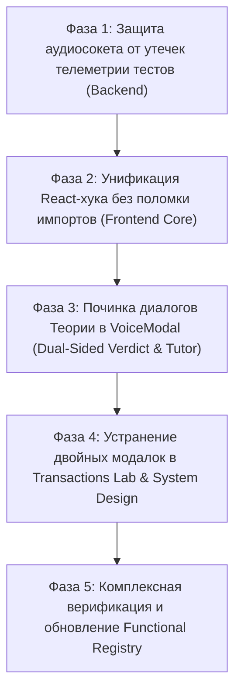

# 🏛️ План унификации и стабилизации Gemini 3.8 Live (Авто-VAD v3) в Практике и Теории

> **Статус:** Детальный пошаговый архитектурный план (Ready for Review)  
> **Дата:** Октябрь 2026  
> **Нормативная база:** Google Multimodal Live API Protocol (`BidiGenerateContent`), SOTA Late 2026 MFRDA, Rule 8 (Strict Reuse Invariant), `docs/roadmap/wave_14_gemini_3_8_live_native_evolution/gemini_3_8_live_context_info/`.  
> **Сакральный инвариант:** **ПРАКТИКА LLD НЕ ДОЛЖНА ПОСТРАДАТЬ ИЛИ ДЕГРАДИРОВАТЬ НИ НА ОДИН МИЛЛИСЕКУНДНЫЙ ТАКТ.** Любые изменения обязаны быть аддитивными и обратно-совместимыми с доказанным Level 6 LLD-пайплайном.

---

## 1. Цели и границы архитектурного вмешательства

### 1.1. Главная цель
Обеспечить 100% надежную, чистую и переиспользуемую работу голосового диалога на базе нативного `NativeLiveVoiceEngine` во **всех разделах платформы**:
1. **В Практике:** Обеспечить строгую изоляцию речевого аудиосокета от телеметрии тестов и мутаций во всех 7 треках, устранить паразитный дубляж модалок в `TransactionLabArena` и `SystemDesignArena`.
2. **В Теории:** Починить ИИ-диалоги в `VoiceModal` (карточки `StudyDeck`, каталог `QuestionExplorer`, экзамен `ExamQuiz`), устранив обрубание звука перед вердиктом, предоставив чистый сценарий для Тьютора и убрав пересоздание сокетов в блиц-сериях.
3. **В Кодовой базе:** Ликвидировать раскол React-хуков (`useLiveAudioSession` vs `useLiveVoiceSession`) по стандарту Rule 8, оставив единый канонический хук-фасад.

---

## 2. Анализ рисков и гарантии сохранности LLD Практики

| Подсистема LLD | Что работает идеально (Не трогать!) | Защитный инвариант |
| :--- | :--- | :--- |
| **`NativeLiveVoiceEngine.ts`** | Web Audio DSP, 100мс чанки 16кГц Int16 PCM, Cloud VAD, тактильный и акустический Barge-In, Audio Mutex на время Tool Call. | **Ядро движка остается нетронутым.** Добавляется только координация ожидания окончания ЦАП при эмите вердикта. |
| **IntelliJ Bridge & Workspace Sync** | `useIdeBridge.ts` -> `PracticeVoiceContext.tsx` -> `workspace_file_update` в сокет. | **Канал не затрагивается.** Синхронизация файлов в памяти бэкенда работает без изменений. |
| **Dynamic `read_file` & Whiteboard** | `liveToolDispatcher.ts` на лету читает файлы из манифеста с `scheduling: 'WHEN_IDLE'`. | **Инструменты не изменяются.** Логика сопоставления путей Maven сохраняется 1:1. |
| **Системные промпты `livePairPrompts.ts`** | Спецификации ролей для `lld`, `transactions`, `concurrency`, `refactoring`, `java21`, `testing`. | **Не изменяются.** Промпты полностью соответствуют доменам. |
| **Hot Reconnect** | 3 попытки с jitter-бэкоффом и посевом последних 4 реплик без повтора Turn 0. | **Сохраняется 1:1.** |

---

## 3. Детальный пошаговый план реализации (4 Фазы)



---

### ФАЗА 1: Защита аудиосокета от утечек телеметрии песочницы (Backend)
> **Цель:** Исключить отправку невалидных JSON-фреймов в upstream WebSocket Google Gemini Live при запуске тестов и мутаций в Практике.

- [ ] **Задача 1.1: Перехват и изоляция телеметрии в `liveWsClientFrameHandler.ts`**
  - **Файл:** `backend/src/services/live/liveWsClientFrameHandler.ts`
  - **Проблема:** Фреймы `{ type: 'sandbox_result_update' }`, `{ type: 'mutation_result_update' }` и `{ type: 'tx_evaluation_update' }`, отправляемые хуком `usePracticeVoiceTelemetrySync.ts`, сейчас не перехватываются и улетают как сырой JSON в сокет Google (`geminiSocket.send(payloadBuffer)`), вызывая риск закрытия сокета `WS 1008/1011`.
  - **Что делаем:**
    1. Добавляем явную фильтрацию этих типов событий в `liveWsClientFrameHandler.ts`.
    2. Сохраняем состояние последней телеметрии в `session.latestSandboxSummary`, `session.latestMutationSummary` и `session.latestTxSummary` в памяти сессии.
    3. Не пересылаем их в аудиосокет Gemini Live (Invariant 2.6: Strict Channel Separation).
  - **Критерий успеха:** При запуске юнит-тестов и PITest-мутаций в консоли бэкенда фиксируется `[TELEMETRY_INTERCEPTED]`, а в upstream `geminiSocket` не уходит ни одного постороннего байта.

- [ ] **Задача 1.2: Добавление явного `scheduling: 'WHEN_IDLE'` в `liveEvaluationToolDispatcher.ts`**
  - **Файл:** `backend/src/services/live/liveEvaluationToolDispatcher.ts`
  - **Проблема:** Ответ на `submit_interview_evaluation` отправляется без параметра `scheduling`. Это вызывает vocoder stall (молчание модели) после фиксации оценки.
  - **Что делаем:**
    - В `functionResponses` ответа тула `submit_interview_evaluation` явно прописываем `scheduling: 'WHEN_IDLE'` с директивой:
      *`"Оценка сохранена в ведомость. Произнеси краткое доброжелательное напутствие кандидату (1-2 предложения) и поблагодари за разбор."`*
  - **Критерий успеха:** После выставления оценки Gemini Live уверенно произносит финальную фразу голосом, не зависая в мертвом эфире.

---

### ФАЗА 2: Унификация React-хука адаптера (Frontend Core)
> **Цель:** Ликвидировать дублирование `useLiveAudioSession` vs `useLiveVoiceSession` по стандарту Rule 8, сохранив 100% обратную совместимость для всех существующих компонентов.

- [ ] **Задача 2.1: Консолидация интерфейса в `frontend/src/audio/useLiveVoiceSession.ts`**
  - **Файл:** `frontend/src/audio/useLiveVoiceSession.ts`
  - **Проблема:** В файле `useLiveVoiceSession.ts` жестко закодированы пустые коллбеки, нет передачи `onWhiteboardUpdate` наружу, интерфейс возвращаемого объекта отличается от `useLiveAudioSession.ts`.
  - **Что делаем:**
    1. Переносим полноценный, богатый функционал из `useLiveAudioSession.ts` в `frontend/src/audio/useLiveVoiceSession.ts`:
       - Поддержка опций `UseLiveVoiceSessionOptions` (`onEvaluationCompleted`, `onWhiteboardUpdate`, `onBugSolved`, `onChaosInjected`, `onHiringCommitteeVerdict`, `onError`, `onDisconnect`, `getActiveCode`, `enableGlobalSelection`).
       - Реактивные флаги: `isConnected`, `isAiSpeaking`, `isRecording`, `isMuted`, `isDraining`, `rmsDb`, `statusMessage`, `aiTranscript`, `dialogueTurns`, `evaluation`.
       - Методы: `startSession` (и алиас `connect`), `disconnectSession` (и алиас `disconnect`), `toggleMic`, `toggleMute`, `handleCentralButtonClick`, `sendTextMessage`, `sendCustomFrame`.
    2. Ограничиваем размер файла: $\le 250$ строк.

- [ ] **Задача 2.2: Обеспечение 100% обратной совместимости в `frontend/src/hooks/useLiveAudioSession.ts`**
  - **Файл:** `frontend/src/hooks/useLiveAudioSession.ts`
  - **Что делаем:** Превращаем этот файл в чистый фасад-реэкспорт из `../audio/useLiveVoiceSession`:
    ```typescript
    export { useLiveVoiceSession as useLiveAudioSession } from '../audio/useLiveVoiceSession';
    export type { UseLiveVoiceSessionOptions as UseLiveAudioSessionOptions, LiveAudioSessionParams } from '../audio/useLiveVoiceSession';
    ```
  - **Критерий успеха:** Ни один файл в Практике (`PracticeVoiceContext.tsx`, `BugHuntArena.tsx`, `useSystemDesignVoiceDefense.ts`) не требует правок импортов и сохраняет 100% стабильность.

---

### ФАЗА 3: Починка ИИ-диалогов Теории в `VoiceModal.tsx`
> **Цель:** Устранить обрубание звука при показе вердикта, сделать естественный сценарий для Тьютора и оптимизировать серии вопросов, сохранив текущий привычный UI модального окна.

- [ ] **Задача 3.1: Реализация Dual-Sided Handshake для стадии Verdict (Исключение аудио-срезки)**
  - **Файл:** `frontend/src/components/VoiceModal.tsx`, `frontend/src/audio/NativeLiveVoiceEngine.ts`
  - **Проблема:** Приход `evaluation` мгновенно переключает `stage = 'verdict'`, уничтожая визуализатор речи и обрубая устное резюме модели на полуслове.
  - **Что делаем:**
    1. В `VoiceModal.tsx` при получении `evaluation` сохраняем его в `pendingEvaluationRef`.
    2. Если звук модели еще играет (`isAiSpeaking === true` или `isDraining === true`):
       - UI остается в стадии `active`.
       - В строке статуса отображается: *«🎙️ ИИ подводит итог...»*.
       - Слушаем событие `onDrainingStateChange(false)` / окончание воспроизведения ЦАП.
    3. Только после того, как физический звук в наушниках стих (`dacBufferEmpty`), переключаем `setStage('verdict')`.
  - **Критерий успеха:** Кандидат полностью и комфортно дослушивает устное заключение ментора, после чего плавно и без звуковых щелчков открывается карточка оценки.

- [ ] **Задача 3.2: Адаптация сценария «Тьютор» внутри `VoiceModal.tsx`**
  - **Файл:** `frontend/src/components/VoiceModal.tsx`
  - **Проблема:** В режиме Тьютора оценка никогда не выставляется, и пользователь не может завершить разбор темы иначе как аварийным закрытием на крестик.
  - **Что делаем:**
    1. Сохраняем внешность `VoiceModal` прежней (по требованию пользователя).
    2. В режиме `initialSessionType === 'tutor'`:
       - В хедере выводим бейдж: `Тьютор: [Режим]` (Deep Dive / Socratic / ELI5).
       - В активной стадии рядом с полем ввода добавляем кнопку: **«Завершить разбор темы»**.
       - По нажатию на нее сессия мягко завершается, фиксируется прогресс изучения карточки, а модальное окно плавно закрывается без потери контекста.
  - **Критерий успеха:** В режиме Тьютора диалог длится сколько угодно, доска кода открывается по клику, а завершение происходит осознанно по кнопке пользователя.

- [ ] **Задача 3.3: Бесшовный переход между вопросами в Continuous Batch (Голосовой блиц / Экзамен)**
  - **Файл:** `frontend/src/components/VoiceModal.tsx`
  - **Проблема:** Нажатие «Следующий вопрос» сейчас вызывает `disconnect()` и полный reconnect сокета с нуля (потеря 4 секунд).
  - **Что делаем:**
    - При переходе `handleNextQuestion` корректно сбрасываем состояние стадии на `active`, очищаем накопленный транскрипт текущего вопроса и стартуем следующий вопрос через чистый вызов с обновленным индексом `questionIndex`.
  - **Критерий успеха:** Переход к следующему вопросу темы происходит без ошибок сокета и зависаний.

---

### ФАЗА 4: Разрешение конфликтов в Spring Transactions & System Design
> **Цель:** Исключить конкуренцию двух голосовых движков за аудиокарту.

- [ ] **Задача 4.1: Гармонизация устной защиты в `TransactionLabArena.tsx`**
  - **Файл:** `frontend/src/components/practice/PracticeArena.tsx`
  - **Проблема:** Если запущен `VoiceModal` для защиты транзакций, параллельно активен контекст `PracticeVoiceContext`.
  - **Что делаем:** При открытии `isVoiceDefenseOpen` временно глушим или отключаем фоновый сайдкар практики, гарантируя, что только одна сессия захватывает микрофон.
  - **Критерий успеха:** Отсутствие эхо-петель и конфликтов Web Audio Context в лабе транзакций.

---

### ФАЗА 5: Регрессионная верификация и обновление Functional Registry
> **Цель:** Доказательная верификация без единой ошибки типов и фиксация в SSOT.

- [ ] **Задача 5.1: Строгая проверка компилятора TypeScript**
  - Выполнить `npx tsc --noEmit` в директориях `backend` и `frontend`.
  - 0 ошибок типов.

- [ ] **Задача 5.2: Верификация сценариев по чек-листу**
  - Проверка 1: LLD Практика (полный цикл — диалог, правка кода, чтение через `read_file`, доска `update_whiteboard`).
  - Проверка 2: Запуск юнит-тестов и мутаций в Практике (проверка отсутствия крашей сокета).
  - Проверка 3: Теория — Собеседование (приветствие Turn 0 $\to$ ответ кандидата $\to$ дослушивание устного резюме $\to$ вердикт без срезки звука).
  - Проверка 4: Теория — Тьютор (разбор темы $\to$ вопросы $\to$ корректное завершение по кнопке).
  - Проверка 5: Серия из 2+ вопросов в `StudyDeck` (плавный переход).

- [ ] **Задача 5.3: Обновление реестра решений в `docs/architecture/functional_registry/`**
  - Обновить `01_backend_live_audio_router.md`, `04_client_voice_engine_dsp.md`, `INDEX.md` с фиксацией выполненных изменений, гипотез и доказанных инвариантов.

---

## 4. Контрольные точки согласования

1. **Архитектурный паритет:** Устраивает ли тебя предложенное разделение на 4 фазы с сохранением внешнего вида `VoiceModal`?
2. **Готовность к старту:** Можем ли мы приступить к реализации с **Фазы 1** (изоляция телеметрии на бэкенде и шедулинг тула оценки)?
