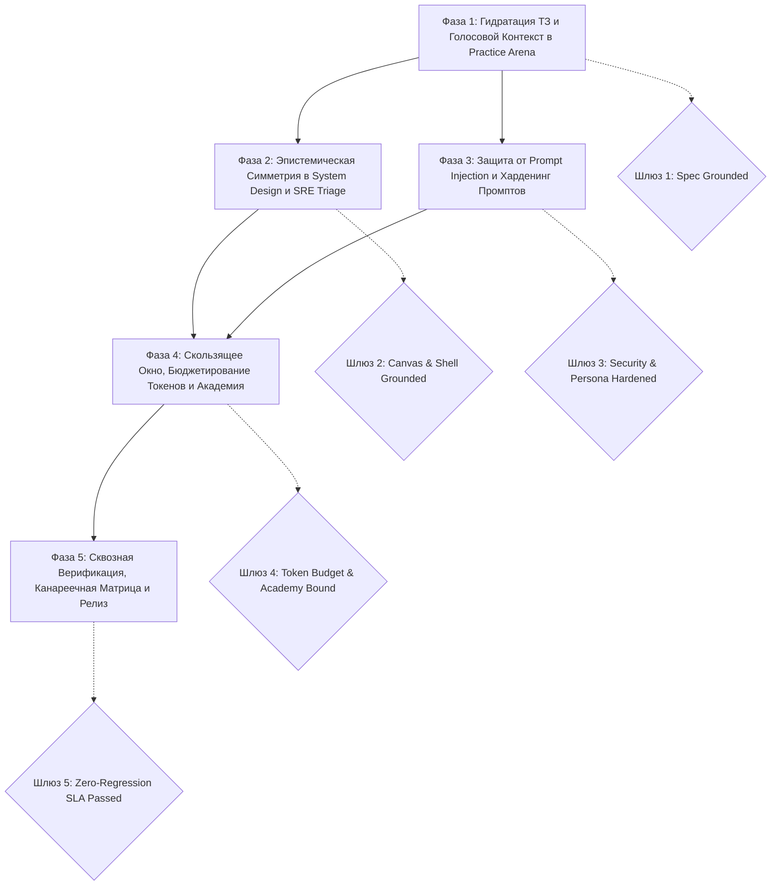

# Wave 15: Master Context & Grounding Remediation Plan (Фазово-Шлюзовый План)

> **Статус программы:** ✅ ВСЕ 5 ШЛЮЗОВ УСПЕШНО ПРОЙДЕНЫ (VERIFIED & LOCKED)  
> **Директория:** `docs/roadmap/wave_15_context_and_grounding_remediation/`  
> **Целевой стандарт:** SOTA Late 2026 Context Grounding, Zero-Hallucination Epistemic Symmetry & Prompt Hardening  
> **Связанный аудит:** [`docs/reports/ai_context_deep_audit_report.md`](../../reports/ai_context_deep_audit_report.md)

---

## 1. Миссия и стратегический чартер

В результате глубокого беспристрастного аудита всех 7 студий платформы InterviewPrep AI был зафиксирован критический класс архитектурных дефектов: **Context Blindness & Epistemic Asymmetry (Слепота контекста и эпистемическая асимметрия)**. 
Самым ярким проявлением стал подтвержденный баг в Practice Arena: **голосовой и текстовый ИИ заявляет пользователю, что «не видит спецификации задачи»**.

Причина этого и сопутствующих дефектов кроется не в локальных сбоях интерфейса, а в **структурных разрывах конвейера доставки контекста**:
1. Попытка передавать контекст через параметры строки запроса WebSocket URL (Query String), где спецификации задач отсекаются из-за риска превышения лимитов длины URL, в то время как бэкенд не гидрирует задачу из базы SQLite.
2. Инициализация голосовой сессии Gemini Live до получения `session_init` без возможности динамической модификации `systemInstruction`.
3. Полная изоляция холста System Design и терминала SRE Triage от контекста консультанта и оценщика.
4. Отсутствие защитных конвертов (XML boundaries) от Prompt Injection в оценочных модулях (`eval.ts`, `systemDesignEvaluator.ts`).
5. Неконтролируемый рост расхода токенов в текстовом тьюторе (до 25 000 токенов за ход) из-за отправки полного файлового дерева без скользящего окна.

**Цель Wave 15:** Полное устранение первопричин слепоты контекста, гарантирование 100% эпистемической симметрии между пользователем и ИИ, внедрение жестких шлюзов безопасности и бюджетирования токенов во всех режимах платформы.

---

## 2. Архитектурные инварианты Wave 15 (Hard Invariants)

1. **Инвариант 1: Бэкенд-центричная гидратация из SSOT SQLite (SSOT Hydration Invariant)**  
   Контекст задачи (полный текст ТЗ, тесты, подсказки, эталонное решение) никогда не должен передаваться целиком через URL WebSocket или полагаться на клиентский стейт. Фронтенд передает только идентификаторы (`challengeId`, `questionId`, `incidentId`). Серверные сервисы (`liveWsSessionParams.ts`, `tutor.ts`, `eval.ts`) обязаны гарантированно гидрировать спецификацию напрямую из базы данных SQLite (`coding_challenges`, `bug_challenges`, `production_triage_challenges`, `system_design_manifests`).
2. **Инвариант 2: Эпистемическая симметрия холста и терминала (Interactive Epistemic Symmetry)**  
   В интерактивных аренах (System Design, SRE Triage, Bug Hunt) ИИ-ассистент обязан в каждом ходе располагать актуальным снимком рабочего пространства: топологией холста (Mermaid/JSON digest) и журналом выполненных команд терминала с их выводами (`jstack`, `top`, Tarjan SCC deadlock detector).
3. **Инвариант 3: Двусторонний контекст в оценщиках (Bidirectional Evaluation Invariant)**  
   Оценочные модули всех арен обязаны анализировать не только финальный артефакт (код, топологию, гипотезу), но и полный диалог сессии (`conversationHistory`), оценивая рассуждения, аргументацию трейдоффов и реакцию кандидата на подсказки.
4. **Инвариант 4: Строгая изоляция недоверенных данных (Prompt Injection Defense Invariant)**  
   Любые пользовательские данные (код, топология, ответы, лог терминала) обязаны оборачиваться в стандартизированные XML-конверты (`<untrusted_candidate_submission>`) с инъекцией директив `PROMPT_INJECTION_DEFENSE_DIRECTIVE` и `ANTI_SYCOPHANCY_DIRECTIVES`. Прямая строковая интерполяция запрещена.
5. **Инвариант 5: Скользящее окно и дифференциальный контекст (Token Budgeting Invariant)**  
   История диалога текстового тьютора обязана сжиматься скользящим окном (последние $K=6$ ходов с резюме ранних ходов). Вместо повторной отправки нетронутых файлов рабочей области передаются только активный файл и AST-дифф изменений.

---

## 3. Граф зависимостей и фазово-шлюзовая структура

---

## 4. Сводная матрица фаз и критерии прохождения шлюзов

| Фаза | Документ спецификации | Основная решаемая проблема | Критерий прохождения шлюза (Gate Exit) |
|---|---|---|---|
| **Фаза 1** | [`phase_01_practice_spec_and_voice_grounding.md`](phase_01_practice_spec_and_voice_grounding.md) | ИИ не видит ТЗ задачи в Practice Arena (Voice WebSocket + Text Drawer). | ✅ ШЛЮЗ 1 ПРОЙДЕН: 100% coding-задач имеют полную авторизованную спецификацию из SQLite; ИИ цитирует задачу на Turn 0. |
| **Фаза 2** | [`phase_02_system_design_and_sre_triage_epistemic_symmetry.md`](phase_02_system_design_and_sre_triage_epistemic_symmetry.md) | Слепота консультантов и оценщиков к холсту System Design и терминалу Triage. | ✅ ШЛЮЗ 2 ПРОЙДЕН: Консультант видит топологию холста и заметки; оценщик учитывает историю диалога; в Triage передается телеметрия потоков и Tarjan SCC. |
| **Фаза 3** | [`phase_03_prompt_injection_defense_and_epistemic_sanitization.md`](phase_03_prompt_injection_defense_and_epistemic_sanitization.md) | Сырая интерполяция без защиты от инъекций; баг с полом пользователя в тестах. | ✅ ШЛЮЗ 3 ПРОЙДЕН: Все оценочные сервисы защищены `wrapUntrustedContext` и `PROMPT_INJECTION_DEFENSE_DIRECTIVE`; пол пользователя синхронизирован. |
| **Фаза 4** | [`phase_04_token_budgeting_sliding_window_and_academy_context.md`](phase_04_token_budgeting_sliding_window_and_academy_context.md) | Перерасход токенов (25k/turn) в тьюторе; изоляция уроков Академии от практики. | ✅ ШЛЮЗ 4 ПРОЙДЕН: Скользящее окно ограничивает промпт до $\le 5500$ токенов (экономия 53-65%); мост Академии проброшен в практику и голос. |
| **Фаза 5** | [`phase_05_verification_matrix_and_canary_test_suite.md`](phase_05_verification_matrix_and_canary_test_suite.md) | Сквозное автоматизированное тестирование и безопасное развертывание. | ✅ ШЛЮЗ 5 ПРОЙДЕН: 15/15 тестов Master Canary Matrix успешно пройдены в контейнере; Инвариант 8 и Правило 0 строго соблюдены. |

---

## 5. Политика соблюдения системных правил и ограничений

- **Строжайшее соблюдение Правила 0 (VPS RAM 1.8 GB):**  
  Запрещены любые локальные сборки (`docker build`, `docker compose build`). Все образы компилируются исключительно в GitHub Actions. На VPS выполняется только `docker compose pull && docker compose up -d`.
- **Файловая гигиена (Инвариант 8):**  
  Каждый создаваемый документ плана и последующий файл реализации строго ограничен лимитом $\le 350$ строк.
- **Работа с первопричиной:**  
  Запрещено маскировать дефекты локальными костылями (например, передавать обрезки ТЗ через query-параметры браузера). Источником правды всегда выступает нормализованная реляционная база данных SQLite.
