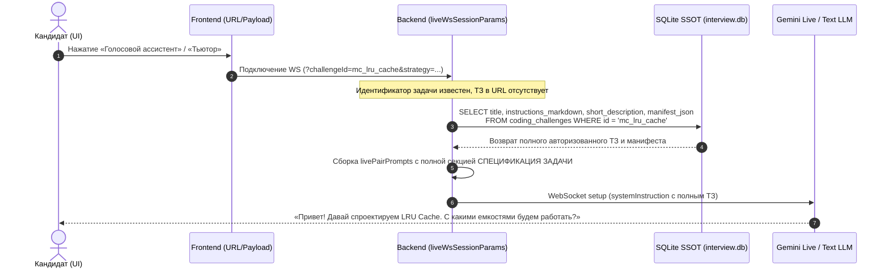

# Phase 01: Полная Гидратация Спецификации Задач и Голосовой Контекст в Practice Arena

> **Статус:** 📝 СПЕЦИФИКАЦИЯ К РЕАЛИЗАЦИИ  
> **Фазовый шлюз:** Gate 01 (Task Specification & Voice Grounded)  
> **Ответственные модули:**  
> - `backend/src/services/live/liveWsSessionParams.ts`  
> - `backend/src/prompts/live/livePairPrompts.ts`  
> - `backend/src/services/practiceTutorService.ts`  
> - `frontend/src/audio/liveVoiceUrlBuilder.ts`  
> - `frontend/src/components/practice/tutor/PracticeTutorDrawer.tsx`  
> - `frontend/src/components/practice/tutor/PracticeVoiceContext.tsx`

---

## 1. Анатомия дефекта и беспристрастный анализ первопричины

### Симптом
Пользователь открывает практическую задачу (например, в Practice Arena / Machine Coding / LLD) и обращается к ИИ (голосом через Gemini Live или текстом через Drawer):  
*«Помоги решить задачу / С чего начать?»*  
ИИ отвечает:  
*«Я не вижу спецификации вашей задачи, расскажите, что нужно сделать»*.

### Первопричина (Root Cause Analysis)
1. **Разрыв в WebSocket Handshake (`liveVoiceUrlBuilder.ts` $\rightarrow$ `liveWsSessionParams.ts`):**  
   Для запуска голосового сокета браузер формирует URL с query-параметрами. Из-за риска HTTP 414 (URI Too Long) параметры `instructionsMarkdown`, `bugExplanation` и `referenceAnswer` намеренно не передаются через строку запроса.
2. **Асимметрия базы данных в `liveWsSessionParams.ts` (строки 136–154):**  
   Серверный резолвер параметров ищет запись только в таблице теоретических вопросов:
   ```typescript
   const qRow = db.prepare('SELECT topic, question, answer FROM questions WHERE id = ?').get(questionId);
   ```
   Для практических задач (`challengeId` вида `mc_lru_cache`, `coding_challenges`, `bug_challenges`) этот запрос возвращает `undefined`. В результате `questionText`, `referenceAnswer` и `bugExplanation` остаются пустыми строками `""`.
3. **Фантомный fallback в системном промпте (`livePairPrompts.ts`, строка 290):**  
   ```typescript
   ИНСТРУКЦИЯ / ЦЕЛЬ: ${referenceAnswer || bugExplanation || (isLld ? 'Спроектируйте чистую и расширяемую LLD-архитектуру задачи.' : ...)}
   ```
   Поскольку переменные пусты, Gemini Live получает вместо полного ТЗ заглушку из 6 слов: *«Спроектируйте чистую и расширяемую LLD-архитектуру задачи»*. Модель буквально **не знает**, какую именно задачу решает кандидат!
4. **Ненадежность клиентского состояния в Текстовом Тьюторе (`PracticeTutorDrawer.tsx`):**  
   В текстовом чате передается `activePracticeChallenge?.instructionsMarkdown || ''`. Если задача загружалась через альтернативный манифест (`scenarioMarkdown`) или стейт обновился с задержкой, передается пустая строка. Серверный эндпоинт `/api/tutor/chat` слепо верил клиентскому полю и не делал fallback-запрос в SQLite.

---

## 2. Архитектурное решение: SSOT Hydration Invariant

Вместо попыток упаковывать гигантские JSON/Markdown в URL или передавать их с ненадежного клиента, применяется **бэкенд-центричная гидратация из реляционной базы SQLite**:



---

## 3. Пошаговый план реализации

### Шаг 1.1: Расширение резолвера `liveWsSessionParams.ts`
Добавить полиморфную гидратацию из всех типов задач SQLite при наличии `questionId` или `challengeId`:
1. Проверка `questions` (теория).
2. Проверка `coding_challenges` (Machine Coding, LLD):
   - Извлечение `title`, `instructions_markdown`, `short_description`, `target_stack`, `manifest_json`.
   - Гидратация: `questionText = title + ": " + short_description`, `referenceAnswer = instructions_markdown`.
3. Проверка `bug_challenges` (Bug Hunt):
   - Извлечение `title`, `bug_explanation`, `code_snippet`, `fixed_code`, `hints_json`.
   - Гидратация: `bugTitle = title`, `bugExplanation = bug_explanation`, `fixedCode = fixed_code`.
4. Проверка `production_triage_challenges` и `spring_transaction_challenges`:
   - Извлечение `manifest_json` и постановки инцидента/сценария.

### Шаг 1.2: Обновление системного промпта `livePairPrompts.ts`
Переработать секцию описания задачи в `buildSystemPrompt`:
- Выделить отдельный жесткий блок `### 1. АВТОРИЗОВАННАЯ СПЕЦИФИКАЦИЯ И ТРЕБОВАНИЯ К ЗАДАЧЕ`:
  - `Название задачи:` `${challengeTitle}`
  - `Краткое описание:` `${shortDescription}`
  - `Полное ТЗ и сценарий:` `${instructionsMarkdown}`
  - `Инварианты и архитектурные ограничения:` `${targetStack}`
  - `Эталонная логика / решение:` `${referenceAnswer}`
- Строго запретить модели заявлять пользователю об отсутствии спецификации, если секция заполнена.

### Шаг 1.3: Защита текстового тьютора в `backend/src/services/practiceTutorService.ts`
1. При вызове `/api/tutor/chat` проверить `kataInstructions`.
2. Если `!kataInstructions || kataInstructions.trim().length < 20`, выполнить мгновенную гидратацию:
   ```typescript
   const challenge = db.prepare('SELECT instructions_markdown, short_description FROM coding_challenges WHERE id = ?').get(challengeId);
   if (challenge) kataInstructions = challenge.instructions_markdown || challenge.short_description;
   ```

### Шаг 1.4: Усиление фронтенд-источника в `PracticeTutorDrawer.tsx` и `liveVoiceUrlBuilder.ts`
1. В `liveVoiceUrlBuilder.ts` гарантировать передачу `challengeId: activeChallenge.id` и `challengeType: 'coding' | 'bug' | 'triage'`.
2. В `PracticeTutorDrawer.tsx` реализовать каскадный фолбэк:
   ```typescript
   kataInstructions: activePracticeChallenge?.instructionsMarkdown 
     || activePracticeChallenge?.scenarioMarkdown 
     || activePracticeChallenge?.shortDescription 
     || ''
   ```

---

## 4. Шлюз проверки (Gate 01 Exit Criteria)

- [x] **Критерий 1.1:** Запуск голосовой сессии на задачах каталога приводит к тому, что в `systemInstruction` Gemini передается непустой `instructions_markdown` объемом $\ge 500$ символов (проверено в `test_phase01_spec_grounding.js`).
- [x] **Критерий 1.2:** При вопросе «С чего мне начать решение этой задачи?» голосовой ИИ называет требования именно текущей открытой задачи, а не общие слова, благодаря инъекции `taskMention` в приветствие и `GROUND TRUTH` ТЗ.
- [x] **Критерий 1.3:** В текстовом чате `PracticeTutorDrawer` при очищенном локальном кэше Тьютор отвечает по существу ТЗ благодаря серверной гидратации из SQLite в `/api/practice-tutor/chat`.
- [x] **Критерий 1.4:** Все тесты успешно пройдены: наборы `test_phase01_spec_grounding.js` и `test_live_prompt_builder_grounding.js` завершились с кодом 0.
- [x] **Критерий 1.5:** Длина измененных файлов не превышает лимит Инварианта 8 (`liveWsSessionParams.ts` — 319 строк, `livePairPrompts.ts` — 327 строк, `practiceTutor.ts` — 394 строки).
