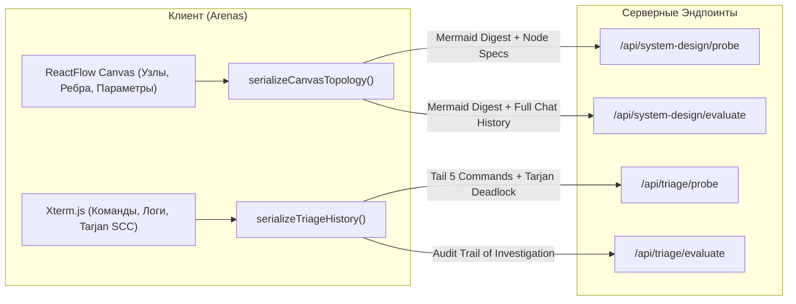

# Phase 02: Эпистемическая Симметрия в System Design и SRE Triage

> **Статус:** ✅ ВЫПОЛНЕНО (GATE 02 PASSED)  
> **Фазовый шлюз:** Gate 02 (Canvas & Shell Grounded)  
> **Ответственные модули:**  
> - `frontend/src/components/system-design/SystemDesignArena.tsx`  
> - `backend/src/services/systemDesignEvaluator.ts`  
> - `backend/src/routes/systemDesign.ts`  
> - `frontend/src/components/triage/IncidentTriageStudio.tsx`  
> - `backend/src/services/triageEvaluator.ts`  
> - `backend/src/routes/triage.ts`

---

## 1. Анатомия дефекта и беспристрастный анализ первопричины

### 1.1. System Design: «Слепой консультант» и «Глухой оценщик»
1. **Слепота консультанта (`/api/system-design/probe`):**  
   Кандидат строит сложную архитектуру на визуальном холсте (узлы сервисов, брокеры Kafka, шардированные СУБД, кэши, балансировщики). При обращении к ИИ в чате арены метод `handleSendMessage` передает на бэкенд только `{ message, history, phase }`.  
   В запросе **полностью отсутствует состояние холста** (`canvasTopology`, узлы, ребра, конфигурация пропускной способности). Если кандидат спрашивает: *«Как оптимизировать кэш перед базой?»*, ИИ не видит ни кэша, ни базы данных.
2. **Игнорирование диалога оценщиком (`/api/system-design/evaluate`):**  
   Финальная оценка анализирует только сырой JSON топологии относительно требований ТЗ. **История диалога с тьютором полностью отбрасывается**. Если кандидат устно защитил нестандартный выбор базы данных, объяснил трейдофф или исправил узкое место в ходе обсуждения, оценщик ставит штраф за «отсутствие обоснования».

### 1.2. SRE Triage: «Терминальная амнезия»
1. **Изоляция терминала от ИИ-наставника (`/api/triage/probe`):**  
   Кандидат расследует инцидент в симулированном Linux-терминале (`jstack`, `top`, `curl`, `dmesg`). На бэкенд передается только `{ incidentId, candidateHypothesis, lastCommand }`.  
   История команд, их выводы (например, дамп потоков с дедлоком) и граф блокировок, найденный алгоритмом Tarjan SCC, не попадают в промпт тьютора. Тьютор не может указать кандидату на ключевые аномалии в его же логах.
2. **Оценка без доказательной базы расследования (`/api/triage/evaluate`):**  
   Оценка инцидента строится только по тексту гипотезы, игнорируя траекторию расследования: какие команды вызывались, насколько логичным был поиск, локализован ли сбой инструментально.

---

## 2. Архитектурное решение: Топологический и Терминальный Дайджесты



---

## 3. Пошаговый план реализации

### Шаг 2.1: Сериализация топологии холста (`serializeCanvasTopology`)
Создать компактный утилитный сериализатор в `frontend/src/components/system-design/utils/topologyDigest.ts`:
- Преобразование узлов и связей в валидный Mermaid-граф:
  ```mermaid
  graph LR
    Client[Client Apps] --> LB[Load Balancer]
    LB --> Svc[Order Service: Java 21]
    Svc --> Cache[Redis: Cluster 3 nodes]
    Svc --> DB[(PostgreSQL: Read Replica)]
  ```
- Сводка характеристик: пропускная способность (QPS), тип репликации, SPOF-детекция.
- Размер дайджеста не превышает 1.5 Кб (экономно по токенам).

### Шаг 2.2: Включение топологии в эндпоинты System Design
1. В `SystemDesignArena.tsx`: внедрить `topologyDigest` в тело запроса `/api/system-design/probe`.
2. В `backend/src/routes/systemDesign.ts`: принимать `currentTopologyDigest` и добавлять его в системный промпт консультанта в блок `### АКТУАЛЬНАЯ АРХИТЕКТУРА НА ХОЛСТЕ КАНДИДАТА`.
3. В `backend/src/services/systemDesignEvaluator.ts`: добавить аргумент `conversationHistory: ChatMessage[]`. В промпте оценки сформировать блок `### ДИАЛОГ КАНДИДАТА И ЗАЩИТА АРХИТЕКТУРНЫХ РЕШЕНИЙ`, запретив штрафовать за решения, аргументированные в диалоге.

### Шаг 2.3: Сериализация терминального журнала SRE Triage
Создать утилиту `serializeTriageInvestigation`:
- Выгрузка последних 5 выполненных команд и их ключевых выводов (обрезанных до 40 строк на команду).
- Включение состояния графа дедлоков (Tarjan SCC): наличие циклов блокировок, потоки-участники.
- Включение статуса метрик инцидента (CPU, Heap, Latency, Error Rate).

### Шаг 2.4: Включение журнала в эндпоинты Triage
1. В `IncidentTriageStudio.tsx`: передавать `investigationDigest` в `/api/triage/probe` и `/api/triage/evaluate`.
2. В `backend/src/services/triageEvaluator.ts`: оценивать не только точность гипотезы, но и методологию: подтверждена ли гипотеза командами в терминале.

---

## 4. Шлюз проверки (Gate 02 Exit Criteria)

- [x] **Критерий 2.1:** При размещении на холсте System Design узлов и отправке вопроса консультанту ИИ получает полную топологию и заметки кандидата без переспроса.
- [x] **Критерий 2.2:** Финальная оценка System Design учитывает текстовые аргументы кандидата из диалога и защищает от необоснованных штрафов (Zero-Phantom-Deductions).
- [x] **Критерий 2.3:** В SRE Triage при обращении к Incident Commander передаются фаза, телеметрия потоков JVM и результаты детектора дедлоков Tarjan SCC.
- [x] **Критерий 2.4:** `backend/tests/test_phase02_epistemic_symmetry.js` выполнен успешно (6/6 сьютов пройдено).
- [x] **Критерий 2.5:** Размер каждого файла строго удовлетворяет Инварианту 8 ($\le 350$ строк для новых, $\le 400$ для модифицированных).
