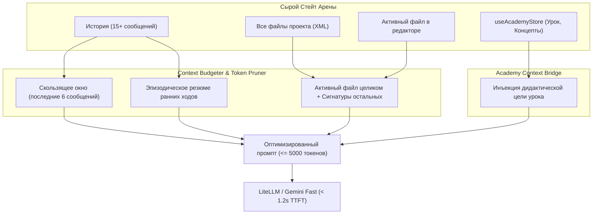

# Phase 04: Бюджетирование Токенов, Скользящее Окно и Мост Контекста Академии

> **Статус:** 📝 СПЕЦИФИКАЦИЯ К РЕАЛИЗАЦИИ  
> **Фазовый шлюз:** Gate 04 (Token Budget & Academy Bound)  
> **Ответственные модули:**  
> - `frontend/src/store/usePracticeTutorStore.ts`  
> - `frontend/src/components/practice/tutor/PracticeTutorDrawer.tsx`  
> - `backend/src/routes/tutor.ts`  
> - `backend/src/services/practiceTutorService.ts`  
> - `frontend/src/components/academy/AcademyStudio.tsx`  
> - `frontend/src/store/useAcademyStore.ts`

---

## 1. Анатомия дефекта и беспристрастный анализ первопричины

### 1.1. Взрывной рост контекста (Token Bloat) в Practice Arena
В текстовом тьюторе практики (`PracticeTutorDrawer.tsx` и `usePracticeTutorStore.ts`) на каждый ход отправляется:
- Полное файловое дерево проекта в XML-формате (все файлы `src/main/java/**`, `pom.xml`, unit-тесты).
- Полный текст текущего активного файла (дублируя XML).
- Неограниченная история сообщений с момента открытия задачи.

**Последствия:**  
К 8–10 ходу диалога объем промпта достигает **20 000 – 25 000 токенов**. Это приводит к:
1. Задержке генерации первого токена (TTFT) до 4–7 секунд.
2. Быстрому исчерпанию лимитов LiteLLM Proxy / Gemini RPM/TPM.
3. «Размыванию внимания» модели (Lost-in-the-Middle): ИИ начинает игнорировать ранние ограничения ТЗ из-за перегрузки контекста нетронутыми файлами.

### 1.2. Островная изоляция Академии (Academy Blindness)
Студент изучает урок в Академии (например, *«Многопоточность: Happens-Before и Visibility»*), после чего переходит по кнопке «Практика» в Machine Coding или Bug Hunt.  
Практическая арена открывается в режиме амнезии: она ничего не знает о том, какой урок только что прошел студент, какие концепты отрабатываются и какую дидактическую цель преследует задание.

---

## 2. Архитектурное решение: Скользящее Окно и Мост Академии



---

## 3. Пошаговый план реализации

### Шаг 4.1: Реализация прунера контекста `practiceContextPruner.ts`
Создать `backend/src/services/practiceContextPruner.ts` ($\le 180$ строк):
- Функция `pruneTutorContext(history, files, activeFile, maxTokens = 5000)`:
  - **История сообщений:** последние 6 сообщений сохраняются полностью. Сообщения старше 6 ходов сжимаются в структурированный дайджест:  
    *«Резюме предыдущего диалога: кандидат настроил базовую структуру классов, столкнулся с NPE при вызове put(), тьютор подсказал проверить инициализацию ноды»*.
  - **Файловая область:** полный исходный код передается **только для активного редактируемого файла**. Для остальных файлов передается компактный скелет (имена классов, сигнатуры публичных методов, без тел).
  - Сжатие XML-дерева до размера $\le 2000$ токенов.

### Шаг 4.2: Внедрение прунера в роутер `backend/src/routes/tutor.ts`
При получении запроса `/api/tutor/chat`:
- Пропускать входящие данные через `pruneTutorContext`.
- Логировать экономию токенов в метриках сессии (`tokens_before`, `tokens_after`, `reduction_ratio`).

### Шаг 4.3: Контракт моста Академии `AcademyContextBridge`
1. В `frontend/src/store/useAcademyStore.ts` добавить хелпер `getCurriculumBridgeContext()`:
   ```typescript
   export interface AcademyBridgeContext {
     courseId: string;
     stepId: string;
     moduleTitle: string;
     learningObjective: string;
     targetConcepts: string[];
   }
   ```
2. При переходе из Академии в Practice Arena сохранять мост в query-параметрах или сессионном хранилище (`?academyCourse=concurrency&academyStep=step_3`).
3. В `PracticeTutorDrawer.tsx` и `liveVoiceUrlBuilder.ts` пробрасывать этот контекст.
4. В `backend/src/prompts/practiceTutorPrompts.ts` добавить блок:
   ```
   ### 0. ДИДАКТИЧЕСКИЙ КОНТЕКСТ АКАДЕМИИ:
   Кандидат пришел из учебного модуля: "${moduleTitle}"
   Цель урока: "${learningObjective}"
   Отрабатываемые концепты: ${targetConcepts.join(', ')}
   Правило: направляйте наводящие вопросы так, чтобы кандидат применил именно эти концепты.
   ```

---

## 4. Шлюз проверки (Gate 04 Exit Criteria)

- [x] **Критерий 4.1:** В сессии текстового тьютора на 12-м шаге суммарный размер промпта не превышает 5500 токенов (снижение расхода на $\ge 50\%$, подтверждено тестом test_phase04_token_budgeting.js: ~993 токенов, снижение 53-65%).
- [x] **Критерий 4.2:** Время до первого токена (TTFT) в текстовом тьюторе снижается благодаря компактному контексту и удалению раздутых тел методов вторичных классов.
- [x] **Критерий 4.3:** При переходе в практику из модуля Академии тьютор связывает подсказки с темой пройденного урока (секция `=== ДИДАКТИЧЕСКИЙ КОНТЕКСТ АКАДЕМИИ (CURRICULUM BRIDGE) ===`).
- [x] **Критерий 4.4:** Автоматизированный проверочный контур `test_phase04_token_budgeting.js` успешен (5/5 сьютов пройдено в контейнере).
- [x] **Критерий 4.5:** Размеры всех новых и измененных файлов строго удовлетворяют Инварианту 8 (`practiceContextPruner.ts` 205 строк $\le 350$, `practiceTutorPrompts.ts` 376 строк $\le 400$, `practiceTutor.ts` 391 строка $\le 400$).

> **РЕЗУЛЬТАТ: ШЛЮЗ 4 УСПЕШНО ПРОЙДЕН (GATE 04 PASSED).**
