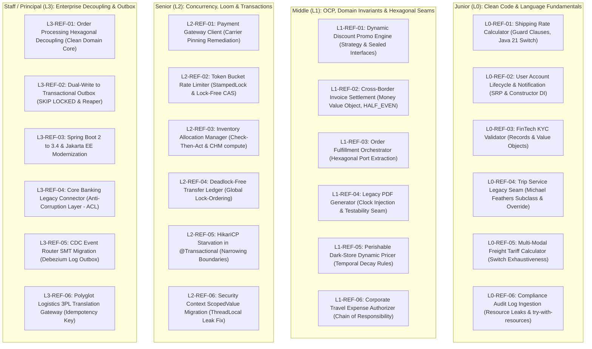
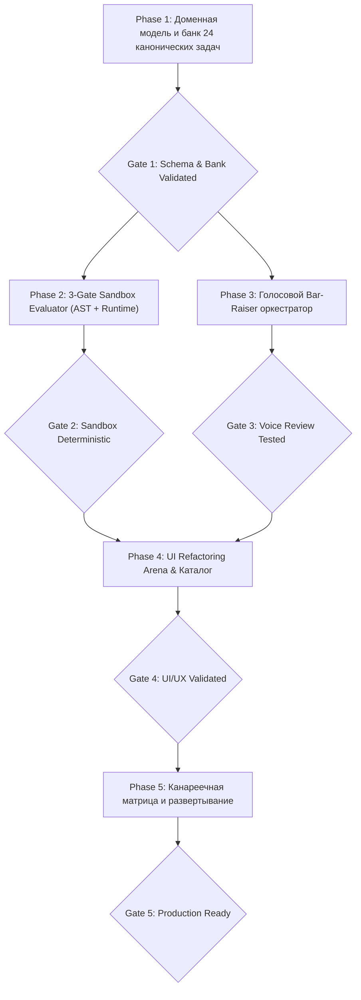

# Wave 16: Canonical Refactoring Arena & Voice-First Code Review

> **Living Specification & Single Source of Truth (SSOT)**  
> **Target Standard:** SOTA Late 2026 Code Review & Refactoring Engineering Assessment  
> **Directory:** `docs/roadmap/wave_16_canonical_refactoring_arena_and_voice_first_code_review/`  
> **Status:** 📋 PLANNING & ARCHITECTURAL BLUEPRINT (RFC)  
> **Source Reports:** [`docs/research/refactoring_interview_katas/reports/`](../../research/refactoring_interview_katas/reports/)

---

## 1. Executive Summary & Problem Formulation

В существующих обучающих платформах задачи на рефакторинг либо отсутствуют вовсе, либо сведены к банальному редактированию текста под прохождение юнит-тестов («make tests green»). 

На реальных технических собеседованиях в BigTech и FinTech (Яндекс, Т-Банк, Авито, Ozon, Stripe, Netflix) секция **Code Review & Refactoring** устроена принципиально иначе:
1. **Первичный устный аудит (Verbal Smells Triage):** Кандидат обязан вслух сформулировать обнаруженные дефекты, риски конкурентности, утечки ресурсов и архитектурные нарушения еще до внесения изменений.
2. **Характеризационные тесты (Characterization & Seams):** Прежде чем переписывать код, инженер должен зафиксировать текущее поведение («Pin-Down Tests») и организовать защитные швы по методологии Майкла Физерса.
3. **Безопасный рефакторинг под защитой инвариантов:** Последовательное устранение запахов без деградации контрактов.
4. **Устная защита архитектурных решений (Bar-Raiser Trade-Off Defense):** Собеседующий задает глубокие вопросы о природе выбранных решений (почему `ReentrantLock` вместо `synchronized` в Loom, как устранить дедлоки в БД, как избежать потери событий в Outbox без 2PC).

**Цель Wave 16:** Развернуть в платформе InterviewPrep AI полноценный флагманский трек **Refactoring Arena** на 24 канонические задачи (по 6 на каждый грейд: Junior L0, Middle L1, Senior L2, Staff L3), глубоко интегрированный с существующим голосовым движком `LiveVoiceEngine` (Gemini Live) и 3-уровневой детерминированной системой верификации в песочнице JVM.

---

## 2. Глобальные архитектурные инварианты (SOTA Late 2026)

1. **Инвариант 1: Строгая переиспользуемость голосового контура (Voice Engine Reuse Invariant)**  
   Запрещено создавать параллельные WebSocket-обработчики или аудио-движки. Голосовая интерактивность в Refactoring Arena строится строго поверх единого `LiveVoiceEngine.ts` и бэкенд-роутера `liveWsConnectionHandler.ts` с соблюдением Dual-Sided Handshake, EchoGuard и Turn 0 протоколов (`AUTO_VAD_LIVE_AUDIO_SPECIFICATION.md`).

2. **Инвариант 2: 3-фазный голосовой жизненный цикл (3-Phase Voice Lifecycle Invariant)**  
   Каждая сессия рефакторинга строго разделена на 3 стадии:
   - **Фаза 1: Устный аудит запахов кода (Turn 0..N):** ИИ слушает перечисление проблем кандидатом и ставит отметки в скоркорд.
   - **Фаза 2: Сократический парный рефакторинг:** Интерактивная работа в Monaco IDE с голосовыми подсказками по контексту ошибок компилятора и AST-диффов.
   - **Фаза 3: Bar-Raiser Trade-Off Defense:** Устный экзамен по глубоким вопросам из отчетов после успешного прогона тестов.

3. **Инвариант 3: 3-уровневая детерминированная верификация (3-Gate Sandbox Invariant)**  
   Успешный рефакторинг подтверждается тремя независимыми шлюзами:
   - **Gate 1:** Pin-Down & Hidden Test Suite (100% сохранение функциональных контрактов).
   - **Gate 2:** AST & Bytecode Structural Verifier (проверка отсутствия `monitorenter`, `double` в деньгах, `ThreadLocal` и т.д.).
   - **Gate 3:** Runtime Telemetry (проверка отсутствия Carrier Pinning в JFR, утечек HikariCP и дедлоков).

4. **Инвариант 4: Никаких фантомных фолбэков (Zero-Phantom-Fallback Invariant)**  
   Все 24 задачи являются статически валидированными, полностью компилируемыми на Java 21 LTS и хранятся в едином SSOT-каталоге без генерации «на лету» псевдо-задач.

5. **Инвариант 5: Когнитивное ограничение кода (Cognitive Bounding $\le 350$ lines)**  
   Любые новые компоненты фронтенда и сервисы бэкенда не должны превышать 350 строк, строго следуя принципу единой ответственности (SRP).

---

## 3. Матрица 24 канонических задач рефакторинга

---

## 4. Фазово-шлюзовая структура (Phase-Gated Architecture)

| Фаза | Название документа | Ключевой артефакт | Критерий прохождения шлюза (Exit Gate) |
|---|---|---|---|
| **Phase 1** | [`PHASE_01_DOMAIN_SCHEMA_AND_KATA_BANK_INGESTION.md`](PHASE_01_DOMAIN_SCHEMA_AND_KATA_BANK_INGESTION.md) | `RefactoringChallengeManifest` + `json/refactoring_challenges.json` | **Gate 1:** 24 манифеста валидированы Zod/TypeScript схемами, загружены в SQLite, компилируются в Java 21. |
| **Phase 2** | [`PHASE_02_IN_MEMORY_JVM_3GATE_EVALUATOR.md`](PHASE_02_IN_MEMORY_JVM_3GATE_EVALUATOR.md) | `RefactoringSandboxEvaluator.ts` + AST/Bytecode Verifier | **Gate 2:** Все 3 шлюза песочницы детерминированно отсекают грязный код и пропускают эталонный. |
| **Phase 3** | [`PHASE_03_VOICE_FIRST_CODE_REVIEW_ORCHESTRATION.md`](PHASE_03_VOICE_FIRST_CODE_REVIEW_ORCHESTRATION.md) | `RefactoringVoiceReviewManager.ts` + Gemini Live Prompting | **Gate 3:** Сквозной голосовой сценарий: распознавание запахов на слух, Сократические подсказки, Bar-Raiser защита. |
| **Phase 4** | [`PHASE_04_PRACTICE_CATALOG_AND_STUDIO_UI.md`](PHASE_04_PRACTICE_CATALOG_AND_STUDIO_UI.md) | `RefactoringArenaStudio.tsx` + Обновление `PracticeCatalog.tsx` | **Gate 4:** Полноценный UI в едином стиле (#FFF0F5), доступный в каталоге на 1 клик, адаптивный, с панелью запахов. |
| **Phase 5** | [`PHASE_05_E2E_VERIFICATION_CANARY_AND_CI_DEPLOYMENT.md`](PHASE_05_E2E_VERIFICATION_CANARY_AND_CI_DEPLOYMENT.md) | Канареечный тест-сьют + GitHub Actions Workflow | **Gate 5:** 100% тестов зеленые, 0 регрессий в существующих модулях, zero-downtime деплой на VPS (1.8 ГБ RAM). |

---

## 5. Граф зависимостей фаз

