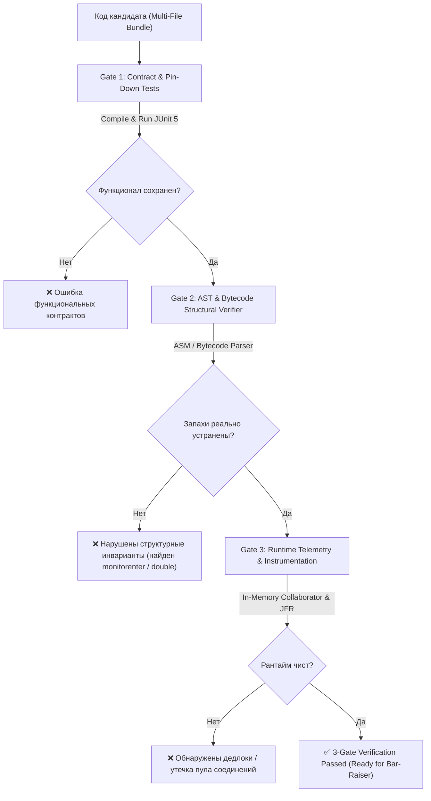

# Phase 2: Трехуровневая детерминированная верификация (3-Gate Sandbox Evaluator)

> **Директория:** `docs/roadmap/wave_16_canonical_refactoring_arena_and_voice_first_code_review/`  
> **Целевой стандарт:** SOTA Late 2026 Multi-Gate Code Review & Bytecode Verification  
> **Шлюз:** `Gate 2: Sandbox Deterministic`

---

## 1. Проблема и цели этапа

Обычного запуска `mvn test` или `junit-platform-console-standalone` недостаточно для оценки рефакторинга:
1. **Ложноположительные прохождения (False Positives):** Кандидат может «захардкодить» возвращаемые значения или подавить ошибку через `try { ... } catch (Exception ignored) {}`, при этом тесты пройдут, но архитектурный дефект (например, Carrier Pinning или утечка соединений HikariCP) останется нетронутым.
2. **Отсутствие проверки запахов:** Юнит-тест функциональности не знает, заменен ли `double` на `BigDecimal`, или остался ли `ThreadLocal` вместо `ScopedValue`.
3. **Ресурсные ограничения VPS:** На сервере с 1.8 ГБ RAM запуск тяжелых Docker-контейнеров или многократный холодный старт JVM недопустим (Rule 0).

**Цель Фазы 2:** Реализовать сверхбыстрый In-Memory 3-Gate Evaluator, объединяющий функциональные тесты, статический анализ байткода/AST и рантайм-телеметрию с временем отклика $< 1.5$ секунды.

---

## 2. Архитектура 3-Gate Evaluation Pipeline

---

## 3. Детальная спецификация каждого шлюза

### Gate 1: Contract & Pin-Down Invariant Verification
- **Компиляция:** `javac --release 21 -cp "junit-jupiter-api-5.10.jar:assertj-core-3.25.jar:..."`
- **Прогон тестов:** Запускаются как тесты кандидата (`pinDownTests`), так и скрытые валидационные тесты платформы (`hiddenEvaluationTests`).
- **Защита от подмены:** Тестовые классы платформы компилируются в изолированном пространстве имен и защищены от модификации кандидатом.

### Gate 2: AST & Bytecode Structural Verifier (`BytecodeSmellDetector.ts / .java`)
Анализирует сгенерированные `.class` файлы кандидата на уровне опкодов байткода (через легковесный парсер байткода или AST JavaParser):
1. **Проверка отсутствия `monitorenter` / `monitorexit`:**
   В задачах `L2-REF-01` (Carrier Pinning) и `KATA-13` верификатор проверяет, что в методах сетевого взаимодействия отсутствуют опкоды мониторов `0xc2` (`monitorenter`), что гарантирует корректный переход на `ReentrantLock`.
2. **Проверка точности финансовых типов:**
   В задачах `L0-REF-01`, `L1-REF-02`, `L1-REF-04` верификатор анализирует дескрипторы полей классов и утверждает отсутствие примитивов `D` (`double`) и `F` (`float`), требуя `Ljava/math/BigDecimal;`.
3. **Проверка `try-with-resources`:**
   В `L0-REF-06` и `L1-REF-08` верификатор проверяет генерацию вызова `AutoCloseable.close()` в синтетических блоках `finally`.
4. **Проверка искоренения `ThreadLocal`:**
   В `L2-REF-06` проверяется отсутствие инструкций вызова `java/lang/ThreadLocal.get()` или `set()`, требуя использования `java/lang/ScopedValue`.

### Gate 3: Runtime Telemetry & In-Memory Instrumented Collaborators
Для проверки задач на транзакции и конкурентность используются легковесные in-memory заглушки:
1. **Инструментированный пул соединений / репозиторий (`InMemoryInstrumentedOrderRepository`):**
   Отслеживает количество захватов и удержаний соединений:
   $$\text{Assert: } \text{maxConcurrentHeldConnections} \le 1 \land \text{connectionHoldDurationMs} < 50\text{ms}$$
2. **Детектор дедлоков и многопоточная провокация:**
   В задачах `L2-REF-04` (Deadlock-Free Transfer) запускается 50 параллельных потоков на 10 000 перекрестных транзакций. Тест гарантирует отсутствие взаимных блокировок в течение 500 мс без вызовов `Thread.sleep()`.

---

## 4. Архитектурная изоляция и производительность (Sandbox Contract)

- Все исполнение изолировано в JVM Sandbox Runner (`sandbox/src/main/java/com/interview/sandbox/eval/RefactoringRunner.java`).
- Никаких вызовов тяжелого `mvn clean compile` во время сессии — вся компиляция и проверка выполняются в памяти через `StandardJavaFileManager` и `javax.tools.JavaCompiler`.
- Холодный старт: 0 мс (демон-процесс песочницы уже запущен в Docker-контейнере `interview-sandbox`).
- Потребление памяти: $\le 128$ МБ кучи на инстанс песочницы, что полностью укладывается в бюджет памяти VPS (1.8 ГБ RAM).

---

## 5. Критерии приемки и прохождение Шлюза 2 (Exit Gate 2)

- [ ] Модуль `BytecodeSmellDetector` реализован и протестирован на тестовом наборе скомпилированных классов.
- [ ] Грязный исходный код из 24 задач гарантированно падает на Gate 2 (обнаруживаются `monitorenter`, `double`, `ThreadLocal` и т.д.).
- [ ] Эталонный чистый код из 24 задач успешно проходит все 3 шлюза за время $< 1500$ мс.
- [ ] Ошибки верификатора возвращают структурированный JSON с точной строкой и пояснением запаха кода.
