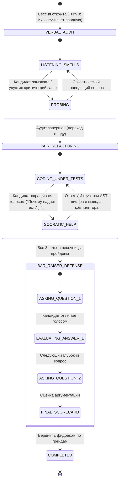

# Phase 3: Голосовой Bar-Raiser оркестратор (Voice-First Code Review)

> **Директория:** `docs/roadmap/wave_16_canonical_refactoring_arena_and_voice_first_code_review/`  
> **Целевой стандарт:** SOTA Late 2026 Voice-First Interactive Technical Assessment  
> **Шлюз:** `Gate 3: Voice Bar-Raiser Pipeline Integrated`

---

## 1. Проблема и цели этапа

В традиционных платформах кандидат молча пишет код в редакторе. Однако на реальном собеседовании в FAANG / Tier-1 FinTech **молчаливый разработчик получает отказ (Strong No Hire)**, даже если его код работает. Собеседующего интересует:
- Способен ли кандидат ясно излагать мысли и структурированно проводить ревью вслух?
- Понимает ли он физику процессов в JVM, а не просто копирует паттерны из документации?
- Как он аргументирует выбор между альтернативными решениями (например, `StampedLock` vs `ConcurrentHashMap`, `Pessimistic Locking` vs `Optimistic Locking`)?

**Цель Фазы 3:** Реализовать сквозную интеграцию `LiveVoiceEngine` и Gemini Live API для проведения полноценного 3-фазного голосового интервью по рефакторингу с распознаванием запахов кода на слух, контекстными подсказками и устной защитой решений.

---

## 2. Конечный автомат голосовой сессии (Voice FSM)



---

## 3. Детализация трех фаз рефакторинг-интервью

### Фаза 1: Устный Code Review & Аудит запахов (Verbal Audit)
1. **Turn 0 (Приветствие и задача):**
   - Соблюдается инвариант Turn 0: никаких тяжелых оценочных инструментов не регистрируется.
   - ИИ произносит:  
     *«Привет! Перед нами сервис `ConcurrentPaymentGatewayClient`. Внимательно посмотри на исходный код в редакторе и расскажи голосом, какие проблемы, запахи кода или риски отказа под высокой нагрузкой ты здесь видишь?»*
2. **Распознавание запахов на слух (Real-Time Smell Triage):**
   - Бэкенд слушает поток распознанного текста от кандидата.
   - Сервис `RefactoringSmellDetectorService` сопоставляет сказанное с `voiceKeywords` из манифеста задачи:
     - Кандидат говорит: *«Я вижу в 48 строке synchronized-блок, который вызывает блокирующий HTTP-запрос. В Java 21 с виртуальными потоками это вызовет Carrier Thread Pinning»*.
     - Система автоматически помечает в UI чек-бокс: `[x] Carrier Pinning (Loom) — Обнаружен устно`.
3. **Сократическое подталкивание (Probing):**
   - Если кандидат назвал 2 запаха из 4 и замолчал более чем на 5 секунд, ИИ голосом подталкивает:  
     *«Отлично подмечено насчет пиннинга. А обрати внимание на метод обеспечения токена: как там устроен Double-Checked Locking?»*

### Фаза 2: Сократический парный рефакторинг (Live Collaborative Refactoring)
1. **Эпистемическая симметрия редактора:**
   - Каждое действие в Monaco IDE (изменение файла, переключение вкладок, запуск тестов, падение компилятора) передается в фоновом метаданном фрейме WebSocket:
     ```json
     {
       "type": "ide_context_update",
       "activeFile": "ConcurrentPaymentGatewayClient.java",
       "cursorLine": 54,
       "compilerErrors": ["cannot find symbol: class ReentrantLock"],
       "testOutput": "Tests run: 3, Failures: 1 (DeadlockDetectedException)"
     }
     ```
2. **Голосовая помощь на лету:**
   - Если кандидат нажимает кнопку микрофона или говорит в режиме Auto-VAD: *«Почему мой тест падает с TimeoutException?»*, ИИ не дает готовый код, а отвечает Сократически:  
     *«Посмотри на строку 82: ты захватываешь замок `lock.lock()`, но при исключении в HTTP-клиенте управление выходит из метода без блока `finally`. Освобождается ли замок в этом случае?»*

### Фаза 3: Bar-Raiser Trade-Off Defense (Устная защита решений)
После прохождения 3 шлюзов песочницы (`3-Gate Verification Passed`), ИИ переключает сессию в режим защиты:
1. **Вопрос 1 (Механика платформы / JVM):**
   - *«Ты успешно заменил `synchronized` на `ReentrantLock`. Объясни, почему ReentrantLock позволяет размонтировать виртуальный поток с carrier thread, а synchronized в JDK 21 приводит к зависанию пула? И что изменилось в JDK 24?»*
2. **Вопрос 2 (Отказоустойчивость и архитектура):**
   - *«Что произойдет в твоем решении, если внешний шлюз авторизации начнет отвечать с задержкой 30 секунд? Как мы можем защитить пул соединений и предотвратить каскадный отказ?»*
3. **Оценка ответа кандидата:**
   - Голосовой агент оценивает не только фактологическую точность, но и уверенность, способность признавать компромиссы и отсутствие сикофантии (поддакивания).

---

## 4. Бэкенд-сервисы и интеграция с `LiveVoiceEngine`

1. **`RefactoringVoiceSessionManager.ts`** — headless-оркестратор жизненного цикла голосовой сессии рефакторинга.
2. **`SmellChecklistTracker.ts`** — семантический матчер речевых транскриптов с ключевыми концептами манифеста.
3. **`RefactoringVoicePrompts.ts`** — шаблоны системных промптов для Gemini Live с жесткими директивами против подсказывания готового кода и инструкциями ведения диалога на русском языке.

---

## 5. Критерии приемки и прохождение Шлюза 3 (Exit Gate 3)

- [ ] Интерактивный FSM голосовой сессии переключается между тремя фазами без разрывов соединения WebSocket.
- [ ] Голосовой агент успешно отмечает запахи кода при их устном произнесении кандидатом.
- [ ] Сократические подсказки учитывают реальные ошибки компилятора и выводы тестов из Monaco IDE.
- [ ] Фаза Bar-Raiser задает целевые вопросы из манифеста и формирует итоговый скоркорд с оценкой коммуникации.
