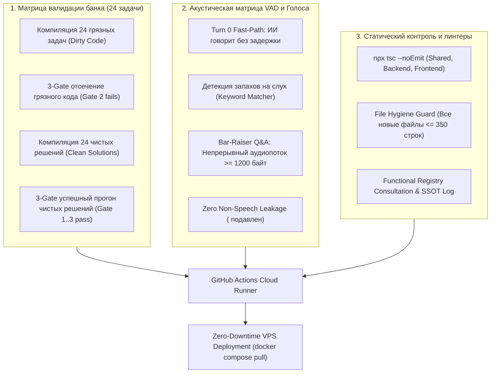

# Phase 5: Сквозная верификация, канареечная матрица и развертывание

> **Директория:** `docs/roadmap/wave_16_canonical_refactoring_arena_and_voice_first_code_review/`  
> **Целевой стандарт:** SOTA Late 2026 End-to-End Acoustic & Sandbox Verification  
> **Шлюз:** `Gate 5: Zero-Regression & Production Ready`

---

## 1. Проблема и цели этапа

Добавление 24 новых задач, статического анализатора байткода и голосового трекера запахов не должно нарушить существующие сервисы платформы. Кроме того, на сервере с ограниченной памятью (VPS 1.8 ГБ RAM) строго действует **Правило 0**: запрет локальных сборок Docker и тяжелых компиляторов.

**Цель Фазы 5:** Провести исчерпывающую сквозную верификацию всего контура (песочница + AST + голос + UI), запустить канареечные акустические тесты и безопасно доставить релиз через GitHub Actions без даунтайма.

---

## 2. Матрица верификации (Verification Matrix)



---

## 3. Канареечные тесты песочницы и акустики

1. **Скрипт верификации каталога рефакторинга (`scripts/verify_refactoring_suite.ts`):**
   - Итерируется по всем 24 задачам из `json/refactoring_challenges.json`.
   - Запускает грязный код через `RefactoringSandboxEvaluator` $\to$ проверяет, что Gate 2 возвращает статус `REJECTED` с ожидаемым списком запахов.
   - Запускает чистое решение $\to$ проверяет, что все 3 шлюза возвращают `PASSED` с временем выполнения $< 1500$ мс на задачу.
2. **Акустический канареечный прогон (`scripts/runAcousticVadMatrix.ts --suite=canary`):**
   - Проверяет Dual-Sided Handshake в новом режиме `sessionType: 'refactoring_review'`.
   - Подтверждает, что переключение микрофона не блокируется при воспроизведении вводной задачи на Turn 0.
   - Проверяет отсутствие выпадений звука (SLA $\ge 1200$ байт на реплику ИИ).

---

## 4. Протокол соблюдения серверных инвариантов (VPS & CI/CD Invariants)

1. **Строгий запрет локальных сборок на VPS (Правило 0):**
   - На сервере **ни при каких обстоятельствах** не запускаются `docker build`, `docker compose build` или тяжелые процессы `esbuild`/`tsc`.
   - Локально на рабочей машине выполняется только быстрая проверка типов:
     ```bash
     npm run build:check # (npx tsc --noEmit)
     ```
2. **Канонический CI/CD конвейер:**
   - Изменения коммитятся в Git с конвенциональными префиксами (`feat(refactoring): ...`, `test(refactoring): ...`).
   - `git push origin main` триггерит сборку контейнеров в облачных раннерах GitHub Actions (`.github/workflows/deploy.yml`).
   - GitHub Actions собирает образы, пушит в GHCR и по SSH обновляет контейнеры на сервере через `docker compose pull && docker compose up -d`.

---

## 5. Обновление Функционального Реестра (Правило 10)

После завершения реализации в `docs/architecture/functional_registry/` создается раздел:
- `docs/architecture/functional_registry/refactoring_arena_subsystem.md`

Фиксируются:
1. Архитектурные решения по внедрению 3-Gate Sandbox.
2. Логика распознавания запахов на слух в реальном времени.
3. Протокол взаимодействия Monaco IDE с сессией Gemini Live WebSocket.
4. Результаты бенчмарков времени отклика песочницы.

---

## 6. Критерии приемки и прохождение Шлюза 5 (Exit Gate 5)

- [ ] Все 24 задачи на рефакторинг успешно валидированы автоматическим раннером.
- [ ] Канареечный тест акустической матрицы подтверждает отсутствие регрессий звука и VAD.
- [ ] Все проверки `tsc --noEmit` и линтеры проходят с кодом 0.
- [ ] GitHub Actions успешно собирает и деплоит образы без сбоев памяти на VPS.
- [ ] Функциональный реестр обновлен и зафиксирован в Git.
