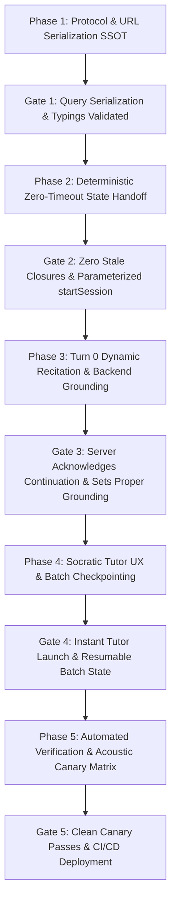

# Wave 17: Unified Voice Batch Progression, Question Continuity & Tutor/Interview Grounding Remediation

> **Directory:** `docs/roadmap/wave_17_unified_voice_batch_and_continuity_remediation/`  
> **Status:** Planning Gate (Approved Architecture Spec)  
> **Target Subsystems:** `VoiceModal.tsx`, `liveVoiceUrlBuilder.ts`, `LiveGreetingReplay.ts`, `liveWsSessionParams.ts`, `StudyDeck.tsx`, `QuestionExplorer.tsx`, `ExamQuiz.tsx`  
> **Authoritative Specification:** [`docs/architecture/specs/AUTO_VAD_LIVE_AUDIO_SPECIFICATION.md`](../../architecture/specs/AUTO_VAD_LIVE_AUDIO_SPECIFICATION.md)

---

## 1. Executive Summary & Defect Scope

This wave remediates a foundational multi-turn continuity defect across both **Socratic Tutoring** and **Oral Interview** voice modalities.
When a user launches a multi-question study session or blitz interview from Theory Explorer or StudyDeck:
- Navigating to question 2, 3, etc. visually advances the flashcard on the screen, but the AI interviewer/tutor remains grounded in question 1, repeatedly reciting and evaluating question 1.
- In Interview mode, clicking "Следующий вопрос" in the Verdict view reconnects to question 1 instead of question 2 due to an asynchronous stale closure over `startSession()`.
- The URL builder drops `questionIndex` and `totalQuestions`, forcing the server to treat every incoming question as turn 0 of question 0.
- Grand Finale results collapse into a single overwritten evaluation rather than recording progress for the entire question batch.

---

## 2. Verified Root Causes

| ID | Component | Defect | Root Cause |
| :--- | :--- | :--- | :--- |
| **DEF-01** | `VoiceModal.tsx` | Stale closure in `handleNextQuestion` | `setTimeout(() => startSession(), 100)` invokes captured `startSession` from previous render (`index = 0`) |
| **DEF-02** | `liveVoiceUrlBuilder.ts` | Missing query params | `cfg.questionIndex`, `cfg.totalQuestions`, and `cfg.isRetry` omitted from `URLSearchParams` |
| **DEF-03** | `VoiceModal.tsx` | Desynchronized state | `useState(initialQuestionIndex)` does not update when parent passes new `initialQuestionIndex` |
| **DEF-04** | `VoiceModal.tsx` | Key collisions in `batchResults` | Overwriting `batchResults[activeQuestionId]` with stale question ID |
| **DEF-05** | `VoiceModal.tsx` | UX mismatch in Tutor mode | Default `stage = 'lobby'` forces users through FAANG exam lobby when seeking quick card clarification |
| **DEF-06** | `VoiceModal.tsx` | Inactive checkpointing | Hardcoded `activeBatchSession={null}` leaves users vulnerable to lost sessions |
| **DEF-07** | `liveAudioStreamRouter.ts` | Turn 0 Greeting amnesia | Server cannot distinguish initial question from subsequent without `questionIndex > 0` |

---

## 3. Phase Hierarchy

---

## 4. Phase Breakdown & File Mapping

1. [`PHASE_01_PROTOCOL_AND_URL_SERIALIZATION.md`](./PHASE_01_PROTOCOL_AND_URL_SERIALIZATION.md)
   - Scope: `frontend/src/audio/liveVoiceUrlBuilder.ts`, `backend/src/services/live/liveWsSessionParams.ts`, `backend/src/services/live/liveWsClientFrameHandler.ts`.
2. [`PHASE_02_ZERO_TIMEOUT_STATE_HANDOFF.md`](./PHASE_02_ZERO_TIMEOUT_STATE_HANDOFF.md)
   - Scope: `frontend/src/components/VoiceModal.tsx`, `frontend/src/components/voice/VoiceActiveView.tsx`, `frontend/src/components/voice/VoiceVerdictView.tsx`.
3. [`PHASE_03_DYNAMIC_RECITATION_AND_BACKEND_GROUNDING.md`](./PHASE_03_DYNAMIC_RECITATION_AND_BACKEND_GROUNDING.md)
   - Scope: `backend/src/services/live/LiveGreetingReplay.ts`, `backend/src/services/live/liveEvaluationToolDispatcher.ts`, `backend/src/services/live/liveAudioStreamRouter.ts`.
4. [`PHASE_04_TUTOR_UX_AND_BATCH_CHECKPOINTING.md`](./PHASE_04_TUTOR_UX_AND_BATCH_CHECKPOINTING.md)
   - Scope: `frontend/src/components/VoiceModal.tsx`, `frontend/src/components/StudyDeck.tsx`, `frontend/src/store/useAppStore.ts`.
5. [`PHASE_05_VERIFICATION_MATRIX_AND_E2E_SUITE.md`](./PHASE_05_VERIFICATION_MATRIX_AND_E2E_SUITE.md)
   - Scope: `backend/src/testing/acoustic/scenarios/voiceBatchProgression.scenario.ts`, GitHub Actions deploy pipeline verification.

---

## 5. Architectural Invariants Enforced
- **Zero Local VPS Builds:** All image builds strictly executed by GitHub Actions runner (Rule 0).
- **Cognitive Bounding Limit:** Every file modified or created strictly adheres to $\le 350$ lines (Rule 8).
- **Strict Reuse Invariant:** No secondary WebSocket hooks or parallel engines; strictly maintain `NativeLiveVoiceEngine` / `useLiveVoiceSession` (Rule 8).
- **Functional Registry Traceability:** Record all architectural changes in `docs/architecture/functional_registry/` (Rule 10).
