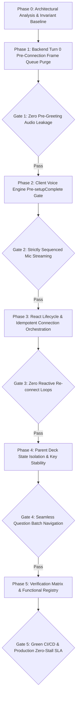

# Wave 18: Gemini Live Voice Session Stabilization & Anti-Race Remediation
## Master Architecture & Phase-Gate Roadmap (SOTA Late 2026)

> **Document:** `00_MASTER_PLAN.md`  
> **Status:** Draft / Pending Approval  
> **Target Standard:** SOTA Late September 2026 Canonical Gemini 3.8 Live Protocol  
> **Subsystem:** Client-Server Real-Time Audio Streaming, Auto-VAD & React Lifecycle  

---

## 1. Executive Summary & Root-Cause Diagnosis

During empirical production verification of Wave 17, live voice dialogue sessions exhibited sudden disconnections followed by repeated greeting recitation, and in some sessions total silence from the AI model on Turn 0. Telemetric triangulation across LiteLLM Gateway logs, backend stream router events, and Docker container state confirmed that the upstream Google Gemini 3.8 Live API is 100% operational. The root cause stems from a conjunction of 4 specific architectural race conditions:

```
+--------------------------------------------------------------------------------------------------+
| ROOT CAUSE TRACEABILITY MATRIX                                                                   |
+--------------------------------------------------------------------------------------------------+
| # | Defect Vector               | Manifestation                      | Mechanism                 |
+---+-----------------------------+------------------------------------+---------------------------+
| 1 | Pre-setupComplete Audio     | Turn 0 silence; Gemini aborts      | Client mic streams chunks |
|   | Queue Flush                 | greeting generation (0 tokens)     | during CONNECTING. Backend|
|   | (liveAudioStreamRouter.ts)  |                                    | buffers into frameQueue   |
|   |                             |                                    | and dumps into Gemini     |
|   |                             |                                    | immediately after greeting|
|   |                             |                                    | prompt, triggering false  |
|   |                             |                                    | acoustic barge-in.        |
+---+-----------------------------+------------------------------------+---------------------------+
| 2 | Reactive Auto-Start Loop    | Sudden session termination and     | useEffect in VoiceModal   |
|   | (VoiceModal.tsx)            | re-connection mid-dialogue         | has startSessionForIndex  |
|   |                             | with repeated greetings            | in dependency array. Any  |
|   |                             |                                    | state transition to IDLE  |
|   |                             |                                    | or prop churn invokes     |
|   |                             |                                    | startSessionForIndex again|
|   |                             |                                    | closing the live socket.  |
+---+-----------------------------+------------------------------------+---------------------------+
| 3 | Ungated Pre-Setup Capture   | Audio packets leak to WebSocket    | MicrophoneCapture starts  |
|   | (NativeLiveVoiceEngine.ts)  | before upstream session setup      | before setupComplete.     |
|   |                             | is negotiated                      | handleMicrophoneChunk     |
|   |                             |                                    | transmits whenever state  |
|   |                             |                                    | is not AI_SPEAKING.       |
+---+-----------------------------+------------------------------------+---------------------------+
| 4 | Parent Deck Key Invalidation| Uncoordinated session remounts     | Changing questions in deck|
|   | (StudyDeck.tsx)             | during continuous multi-question   | triggers parent re-renders|
|   |                             | batch tutoring                     | passing mutated references|
|   |                             |                                    | into active VoiceModal.   |
+---+-----------------------------+------------------------------------+---------------------------+
```

---

## 2. Phase-Gate Architecture & Milestones

Wave 18 decomposes the complete remediation into 5 strictly verified phase gates:



---

## 3. Phase Directory Structure

All detailed phase specifications reside in `docs/roadmap/wave_18_voice_session_stabilization_and_anti_race/`:

1. [`00_MASTER_PLAN.md`](./00_MASTER_PLAN.md) — Master architecture, root causes, and verification gates (This file).
2. [`PHASE_01_BACKEND_TURN0_FRAME_PURGE.md`](./PHASE_01_BACKEND_TURN0_FRAME_PURGE.md) — Elimination of pre-connection audio frame queue flushing on Turn 0.
3. [`PHASE_02_CLIENT_ENGINE_PRE_SETUP_GATE.md`](./PHASE_02_CLIENT_ENGINE_PRE_SETUP_GATE.md) — Client-side audio chunk gating during `CONNECTING` and `AI_RECITING_QUESTION`.
4. [`PHASE_03_VOICE_MODAL_IDEMPOTENT_ORCHESTRATION.md`](./PHASE_03_VOICE_MODAL_IDEMPOTENT_ORCHESTRATION.md) — Elimination of reactive `useEffect` start loops via ref guards.
5. [`PHASE_04_PARENT_DECK_STABILITY.md`](./PHASE_04_PARENT_DECK_STABILITY.md) — Parent-child prop memoization and key lifecycle isolation.
6. [`PHASE_05_VERIFICATION_MATRIX_AND_REGISTRY.md`](./PHASE_05_VERIFICATION_MATRIX_AND_REGISTRY.md) — Headless canary verification and Rule 10 Functional Registry updates.

---

## 4. Architectural Invariants Enforced

1. **Turn 0 Non-Interference Invariant (Rule 2.6):**
   Upstream Gemini Live MUST receive ONLY the system prompt and `initialGreetingTurn` on Turn 0. No microphone PCM frames may be forwarded until Turn 0 speech generation and DAC playout finish.
2. **Idempotent Connection Invariant:**
   A voice session connection attempt MUST be triggered ONLY by an explicit user gesture or an atomic, single-fire lifecycle mount. It MUST NEVER be triggered by reactive FSM state changes to `IDLE`.
3. **Single-Socket Lifecycle Invariant:**
   A running WebSocket connection MUST NOT be disconnected unless explicitly requested by the user, by fatal server error (e.g. 4401), or by intentional navigation to the next question.
4. **Cognitive & File Hygiene Standard (Rule 8):**
   All modified files must remain strictly under 400 lines; newly created files strictly under 350 lines.
