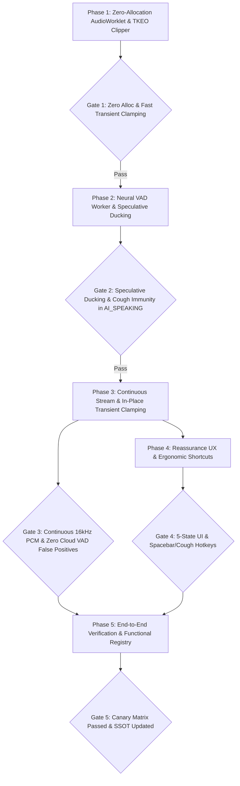

# Wave 19: Continuous Neural Audio Filtering & Speculative Barge-In Resilience for Gemini 3.8 Live
## Master Architecture & Phase-Gate Roadmap (SOTA Late 2026)

> **Document:** `docs/roadmap/wave_19_neural_audio_filtering_and_speculative_barge_in/00_MASTER_PLAN.md`  
> **Status:** Draft / Pending Approval  
> **Target Standard:** SOTA Late-2026 Canonical Gemini 3.8 Live Protocol & Web Audio API Level 2  
> **Subsystems:** AudioWorklet DSP, Neural Phonetic VAD, Speculative Ducking & WebSocket Stream Arbitration  

---

## 1. Executive Summary & Root-Cause Diagnosis

During realistic candidate evaluation sessions, any non-speech transient—such as a cough, throat clear, sneeze, laughter burst, pen tap, or keyboard click—prematurely interrupts AI tutor speech, disrupts candidate focus, and pollutes evaluation transcripts.

A forensic audit of the codebase alongside the authoritative Gemini 3.8 Live protocol specifications in `tmp/gemini 3.8 live docs/` identified two distinct root causes operating in different state machine phases:

```
+------------------------------------------------------------------------------------------------------+
| ROOT CAUSE TRACEABILITY MATRIX                                                                       |
+------------------------------------------------------------------------------------------------------+
| Phase / State  | Defect Vector                   | Manifestation               | Root-Cause Mechanism|
+----------------+---------------------------------+-----------------------------+---------------------+
| 1. AI_SPEAKING | Naive RMS dB Schmitt Trigger    | AI speech immediately cuts  | AudioWorklet runs   |
|    (AI Tutor   | in audio-capture-processor.js   | out mid-sentence when the   | energy-only Schmitt |
|     is talking)| & NativeLiveVoiceEngine.ts:195  | candidate coughs or clicks. | trigger (db > -35). |
|                |                                 | AI state resets to IDLE.    | Trips acoustic barge|
|                |                                 |                             | in without voicing! |
+----------------+---------------------------------+-----------------------------+---------------------+
| 2. LISTENING   | Raw High-Energy Acoustic Spike  | AI starts speaking nonsense | Raw cough (-15 dBFS)|
|    (Candidate  | Forwarding over WebSocket       | or hallucinating an answer  | is sent to Gemini.  |
|     thinking)  | to Gemini 3.8 Live Gateway      | while user was only coughing| Google Cloud VAD    |
|                |                                 | or clearing their throat.   | trips ACTIVITY_START|
+----------------+---------------------------------+-----------------------------+---------------------+
| 3. PROTOCOL    | Discontinuous 0-byte Gating     | WebSocket timeout or Cloud  | Proposed naive fix  |
|    HAZARD      | (Deep Research Plane 3 Hazard)  | VAD adaptation failure;     | of sending 0 bytes  |
|    (Avoided)   |                                 | server VAD deadlocks.       | violates Rule 2.6 & |
|                |                                 |                             | silenceDurationMs.  |
+----------------+---------------------------------+-----------------------------+---------------------+
```

### The SOTA Resolution: Continuous Clean PCM Streaming & Speculative Ducking
1. **During `AI_SPEAKING`:** Microphone audio is evaluated locally by a zero-overhead neural phonetic VAD (Silero v5). Non-speech transients ($P(\text{speech}) < 0.20$) are 100% ignored. If acoustic energy contains potential voicing, audio volume ducks speculatively by $-12$ dB over $15$ ms while waiting for Minimum Voicing Duration ($T_{\text{min\_voice}} = 224$ ms). Transients trigger an instant rollback to $0$ dB; genuine sustained speech commits a clean barge-in.
2. **During `LISTENING`:** The 16kHz 16-bit Mono PCM stream remains **strictly continuous**, preserving Google Cloud VAD noise-floor adaptation and WebSocket keepalive. Non-speech transients (coughs/clicks) are clamped in-place within the audio buffer down to ambient noise floor ($-50$ dBFS). Google Cloud VAD never triggers `ACTIVITY_START` on non-speech.
3. **Strict Audio Mutex:** Audio streaming is unconditionally paused during tool execution turns (`toolCall` to `toolResponse`), preventing WebSocket 1008 policy errors.

---

## 2. Phase-Gate Architecture & Milestones

Wave 19 decomposes the implementation into 5 strictly ordered, verifiable phase gates:



---

## 3. Phase Directory Structure

All phase specifications reside in `docs/roadmap/wave_19_neural_audio_filtering_and_speculative_barge_in/`:

1. [`00_MASTER_PLAN.md`](./00_MASTER_PLAN.md) — Master architecture, root-cause traceability, and phase gates (This file).
2. [`PHASE_01_WORKLET_ZERO_ALLOC_AND_TKEO_CLIPPER.md`](./PHASE_01_WORKLET_ZERO_ALLOC_AND_TKEO_CLIPPER.md) — AudioWorklet real-time thread zero-allocation refactor, Teager-Kaiser Energy Operator (TKEO) impulse clipper, and 512-sample frame packaging.
3. [`PHASE_02_NEURAL_VAD_WORKER_AND_SPECULATIVE_DUCKING.md`](./PHASE_02_NEURAL_VAD_WORKER_AND_SPECULATIVE_DUCKING.md) — Web Worker neural phonetic VAD integration, Minimum Voicing Duration gating ($224$ ms), and speculative ducking with instant rollback in `AudioPlayoutManager`.
4. [`PHASE_03_CONTINUOUS_STREAM_IN_PLACE_TRANSIENT_SUPPRESSION.md`](./PHASE_03_CONTINUOUS_STREAM_IN_PLACE_TRANSIENT_SUPPRESSION.md) — Continuous 16kHz 16-bit Mono PCM streaming, in-place non-speech clamping during `LISTENING`, and strict tool execution audio mutex.
5. [`PHASE_04_REASSURANCE_UX_AND_ERGONOMIC_SHORTCUTS.md`](./PHASE_04_REASSURANCE_UX_AND_ERGONOMIC_SHORTCUTS.md) — 5-state conversational visual indicator (reassuring State B: Transient Ignored), Spacebar Push-to-Talk, and `C` Cough-Mute hotkey.
6. [`PHASE_05_END_TO_END_VERIFICATION_AND_REGISTRY.md`](./PHASE_05_END_TO_END_VERIFICATION_AND_REGISTRY.md) — Acoustic replay matrix tests, memory stability profiling, and Rule 10 Functional Registry updates.

---

## 4. Architectural Invariants Enforced

1. **Continuous Mic Streaming Invariant (Rule 2.6):**
   The microphone stream flows continuously as 16kHz 16-bit Mono PCM chunks wrapped in `{ realtimeInput: { audio: { data, mimeType: 'audio/pcm;rate=16000' } } }`. No discontinuous 0-byte gating or empty `clientContent` injections.
2. **First-Turn Lockdown Invariant (Rule 2.1):**
   Turn 0 question recitation cannot be barged into acoustically. Microphone chunks are never streamed until Turn 0 DAC playout drains completely.
3. **Dual-Sided Handshake Invariant (Rule 2.2):**
   Transitions to `CANDIDATE_LISTENING` wait for both network `turnComplete: true` and DAC drain `onPlaybackFinished`.
4. **Strict Audio Mutex Invariant:**
   Between receiving a `toolCall` from Gemini and dispatching `toolResponse`, microphone streaming is strictly frozen to avoid WebSocket 1008 policy violations.
5. **Cognitive & File Hygiene Standard (Rule 8):**
   New source files $\le 350$ lines; modified files $\le 400$ lines.

---

## 5. Rollback & Risk Mitigation Strategy

- If the neural VAD Web Worker fails to load (e.g. network/WASM restriction), the system falls back gracefully to a conservative RMS + TKEO gate without breaking audio streaming.
- Speculative ducking uses smooth linear gain ramps ($15$ ms) preventing acoustic clicks or popping artifacts.
- Every phase includes automated regression tests against `runAcousticVadMatrix.ts`.
