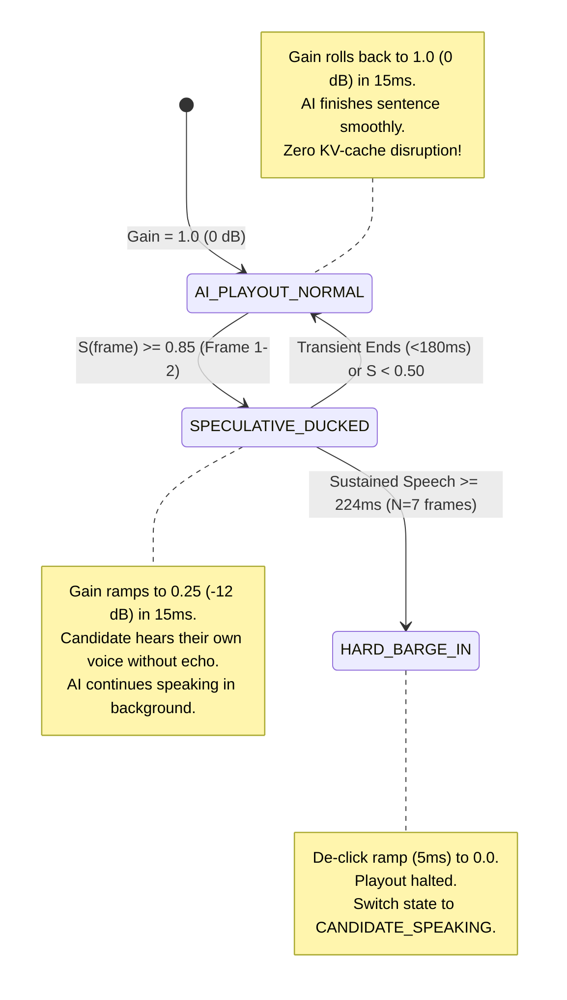

# Phase 2: Neural Phonetic VAD Worker & Speculative Ducking Controller

> **Document:** `docs/roadmap/wave_19_neural_audio_filtering_and_speculative_barge_in/PHASE_02_NEURAL_VAD_WORKER_AND_SPECULATIVE_DUCKING.md`  
> **Status:** Draft / Pending Approval  
> **Target Standard:** SOTA Late-2026 Non-Blocking Neural Audio Worker & Speculative Playout Arbitration  
> **Target Subsystems:** `frontend/src/audio/NeuralVadWorker.ts`, `frontend/src/services/AudioPlayoutManager.ts`, `frontend/src/audio/NativeLiveVoiceEngine.ts`  

---

## 1. Objectives & Rationale

In the baseline codebase, any sound registering above $-35$ dB in `audio-capture-processor.js` triggered an instantaneous, unconfirmed hard barge-in (`handleBargeInInterruption('acoustic')`), abruptly silencing the AI interviewer and discarding the conversation turn.

Phase 2 replaces this fragile heuristic with:
1. A dedicated background `NeuralVadWorker` running Silero VAD v5 with WASM SIMD (inference latency $< 2$ ms, zero main-thread jank).
2. Minimum Voicing Duration gating ($T_{\text{min\_voice}} = 224$ ms / 7 consecutive 32 ms frames).
3. A speculative audio ducking state machine in `AudioPlayoutManager` that smoothly attenuates AI speech by $-12$ dB upon speech onset, rolling back instantly if the sound turns out to be a transient cough, or committing clean barge-in only upon sustained human speech.

---

## 2. Technical Specification & Implementation Details

### 2.1. Neural Phonetic Discrimination (Speech vs Cough)
Acoustic research establishes clear physical boundaries between human vocal cord phonation and non-speech transients:
- **Speech Phonation:** High fundamental frequency (F0) periodicity ($85 - 255$ Hz), high harmonicity, spectral roll-off $< 2.8$ kHz, sustained duration $> 200$ ms.
- **Coughs & Throat Clears:** Turbulent non-periodic noise, rapid rise time ($< 15$ ms), high spectral roll-off ($> 4.4$ kHz), short impulsive duration ($< 180$ ms).
- **Worker Scoring:**
  $$S(frame) = P_{\text{silero}}(\text{speech}) \cdot (1 - \text{penalty}_{\text{roll-off}}) \cdot \text{harmonicity}$$
  - $S(frame) < 0.20 \implies$ Non-speech transient. Completely ignored.
  - $S(frame) \ge 0.85 \implies$ Candidate speech onset candidate.

### 2.2. Speculative Ducking State Machine
To eliminate conversational awkwardness, the system does not wait $224$ ms in full volume before responding:

### 2.3. AudioPlayoutManager API Enhancements
`AudioPlayoutManager.ts` receives three deterministic gain-control methods:
- `speculativeDuck(targetGain = 0.25, rampMs = 15)`: Uses Web Audio `gainNode.gain.linearRampToValueAtTime()` for smooth, click-free attenuation.
- `rollbackDucking(rampMs = 15)`: Smoothly restores gain to `1.0`.
- `commitBargeIn(deClickMs = 5)`: Executes a 5 ms exponential decay ramp down to `0.0`, flushes remaining audio queues, and emits `onBargeInCommitted`.

---

## 3. Files Modified / Created

| File | Modification | Line Limit Target |
|---|---|---|
| `frontend/src/audio/NeuralVadWorker.ts` | (New) Web Worker hosting Silero VAD v5 with WASM SIMD, processing 512-sample frames. | $< 250$ lines |
| `frontend/src/services/AudioPlayoutManager.ts` | Add speculative ducking, rollback, and de-click commit methods. | $< 350$ lines |
| `frontend/src/audio/NativeLiveVoiceEngine.ts` | Integrate `NeuralVadWorker` events with `AI_SPEAKING` state machine. | $< 380$ lines |

---

## 4. Phase Gate 2 Verification & Acceptance Criteria

- [ ] **Gate 2.1 (Worker Latency):** `NeuralVadWorker` processes a 512-sample (32 ms) frame in $< 3.0$ ms on 4-core CPU with WASM SIMD.
- [ ] **Gate 2.2 (Cough Immunity in `AI_SPEAKING`):** Replaying 10 recorded coughs/throat clears during AI playback produces 0 barge-ins; AI continues speaking without disruption.
- [ ] **Gate 2.3 (Speculative Ducking Rollback):** A 100 ms burst of vocalized sound ("uh...") ducks gain to $-12$ dB and recovers cleanly to $0$ dB within $15$ ms after sound stops, with zero audio pops or clicks.
- [ ] **Gate 2.4 (Genuine Barge-In):** Sustained candidate speech ("Подожди, давай уточним...") triggers speculative ducking at $32$ ms and commits hard barge-in at $224$ ms.
