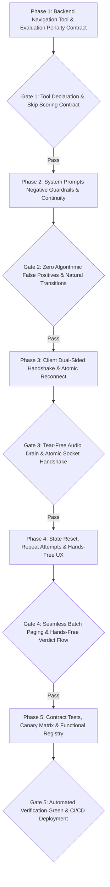

# Wave 20: Hands-Free Voice Batch Navigation, Dialogue Continuity & Seamless Question Paging
## Master Architecture & Phase-Gate Roadmap (SOTA Late 2026)

> **Document:** `docs/roadmap/wave_20_hands_free_voice_batch_navigation_and_continuity/00_MASTER_PLAN.md`  
> **Status:** Draft / Pending User Approval  
> **Target Standard:** SOTA Late-2026 Canonical Gemini 3.8 Live Tool Protocol & Hands-Free Ambient Voice Agent  
> **Subsystems:** Gemini Live Tool Dispatcher, Dual-Sided Handshake FSM, Atomic Session Pacing, Prompt Invariants & Continuous Batch State  

---

## 1. Executive Summary & Root-Cause Diagnosis

In modern ambient voice tutoring and mock interview sessions, candidates frequently train on topics in a "free-hands" environment (e.g. wearing headphones while walking, commuting, or resting in a chair). However, when navigating through a group/batch of questions, candidates are currently forced to reach for a mouse or keyboard to click "Следующий вопрос" or "Завершить", completely disrupting conversational immersion and hands-free flow.

When introducing voice-commanded navigation ("следующий вопрос", "пропусти этот вопрос", "вернись назад"), naive implementations introduce severe architectural pitfalls:
1. **Accidental Intent Collisions (False Skips):** A candidate answering a deep concurrency or system design question saying *"На следующем шаге мы вызываем CAS..."* or *"Если поток пропустит проверку..."* accidentally triggers the skip tool, terminating the interview and failing the candidate mid-sentence.
2. **Audio Tear & WebSocket Race Conditions:** If the client disconnects immediately upon receiving a navigation tool call, the AI's natural verbal acknowledgment (*"Хорошо, пропускаем..."*) is cut off mid-syllable, causing clicks, errors, and disorienting UX.
3. **Context Bleed vs. Latency Degradation (The In-Session Multi-Question Trap):** Re-prompting new questions into a single long-lived WebSocket session inflates audio context tokens, driving Time-To-First-Token (TTFT) latency from ~350ms to >2.5s and causing evaluation rubric bleed.
4. **State Asymmetry on Skips and Retries:** When a candidate skips a question during an interview, it must be fairly penalized (score: 0, FSRS knowledge gap registered). But if the candidate later returns ("вернись к вопросу 1"), the question must restart with a clean slate, pristine context, and fair re-evaluation.

---

### Root Cause & SOTA Late-2026 Resolution Matrix

```
+-------------------------------------------------------------------------------------------------------------------+
| ARCHITECTURAL HAZARD & RESOLUTION TRACEABILITY MATRIX                                                             |
+-------------------------------------------------------------------------------------------------------------------+
| Hazard Vector                   | Manifestation                  | Root Cause                  | SOTA Late-2026 Resolution|
+---------------------------------+--------------------------------+-----------------------------+--------------------------+
| 1. Intent Collision &           | AI skips question while user is| Naive keyword matching or   | Strict Negative Tool     |
|    Accidental Skip              | discussing algorithmic steps   | unconstrained LLM tool      | Directives in JSON       |
|                                 | ("на следующем шаге...").      | triggers.                   | Schema & System Prompts. |
+---------------------------------+--------------------------------+-----------------------------+--------------------------+
| 2. Audio Tear on Reconnect      | Voice cuts off mid-word        | Immediate WebSocket teardown| Dual-Sided Handshake FSM |
|                                 | ("Хоро... *click*") during     | before DAC audio drain.     | with `NAVIGATING` state  |
|                                 | transition.                    |                             | & `onPlaybackFinished`.  |
+---------------------------------+--------------------------------+-----------------------------+--------------------------+
| 3. Multi-Question Context Bleed | Response latency balloons to   | Accumulating audio PCM in   | Atomic Micro-Sessions:   |
|    & Latency Inflation          | 2.5s; rubric criteria cross-   | a single long-lived session.| clean socket reconnect   |
|                                 | contaminate across questions.  |                             | per question (<300ms).   |
+---------------------------------+--------------------------------+-----------------------------+--------------------------+
| 4. Evaluation Hole on Skip      | Skipped question leaves empty  | Evaluation only triggers on | Synthetic Zero-Evaluation|
|                                 | slot; total score corrupted.   | full answer completion.     | payload on skip with FSRS|
|                                 |                                |                             | gap registration.        |
+---------------------------------+--------------------------------+-----------------------------+--------------------------+
| 5. Sticky Context on Retry      | Returning to skipped question  | Residual conversational turns| Clean-slate isRetry flag;|
|                                 | causes AI to lecture on past   | leak into retry context.    | pristine Turn 0 greeting |
|                                 | failure instead of asking fresh|                             | and rubric reset.        |
+---------------------------------+--------------------------------+-----------------------------+--------------------------+
```

---

## 2. Phase-Gate Architecture & Milestones

Wave 20 decomposes the end-to-end hands-free navigation implementation into 5 strictly ordered, verifiable phase gates:



---

## 3. Phase Directory Structure

All detailed specifications reside in `docs/roadmap/wave_20_hands_free_voice_batch_navigation_and_continuity/`:

1. [`00_MASTER_PLAN.md`](./00_MASTER_PLAN.md) — Master architecture, root-cause traceability, and phase gates (This file).
2. [`PHASE_01_BACKEND_NAVIGATION_TOOL_AND_PENALTY_CONTRACT.md`](./PHASE_01_BACKEND_NAVIGATION_TOOL_AND_PENALTY_CONTRACT.md) — Tool declaration `navigate_question`, dispatcher `liveNavigationToolDispatcher.ts`, boundary bounds checking, and synthetic fail-evaluation generation for uncompleted interview skips.
3. [`PHASE_02_SYSTEM_PROMPTS_NEGATIVE_GUARDRAILS_AND_CONTINUITY.md`](./PHASE_02_SYSTEM_PROMPTS_NEGATIVE_GUARDRAILS_AND_CONTINUITY.md) — Anti-collision negative prompt constraints, verbal transition protocols, post-verdict continuous transition prompts (*"Готов идти к следующему вопросу?"*).
4. [`PHASE_03_CLIENT_DUAL_SIDED_HANDSHAKE_AND_ATOMIC_RECONNECT.md`](./PHASE_03_CLIENT_DUAL_SIDED_HANDSHAKE_AND_ATOMIC_RECONNECT.md) — `STAGE_NAVIGATING` FSM state, temporary mic gating during transition, DAC playout drain before disconnect, and atomic fresh socket reconnection.
5. [`PHASE_04_STATE_RESET_REPEAT_ATTEMPTS_AND_HANDS_FREE_UX.md`](./PHASE_04_STATE_RESET_REPEAT_ATTEMPTS_AND_HANDS_FREE_UX.md) — Clean-slate repeat attempts, `batchResults` idempotent update, batch boundary announcements, and Hands-Free auto-advance toggle.
6. [`PHASE_05_CONTRACT_TESTS_CANARY_MATRIX_AND_REGISTRY.md`](./PHASE_05_CONTRACT_TESTS_CANARY_MATRIX_AND_REGISTRY.md) — Unit and contract integration tests, acoustic harness verification, and Rule 10 Functional Registry updates.

---

## 4. Architectural Invariants Enforced

1. **Context Purity via Atomic Sessions Invariant:**
   Each question in a batch runs in an independent, clean-slate WebSocket session. Context is never indefinitely concatenated across multiple questions to guarantee invariant latency ($<400$ms TTFT) and zero rubric bleeding.
2. **Dual-Sided Handshake Navigation Invariant (Rule 2.2):**
   When navigating questions, socket teardown and index incrementing NEVER occur until the AI's verbal confirmation (*"Хорошо, переходим к следующему вопросу..."*) has fully drained through the physical audio DAC (`AudioPlayoutManager.onPlaybackFinished`).
3. **Fair Evaluation on Interview Skip Invariant:**
   Skipping a question before completing an oral answer in `interview` mode unconditionally generates a `VoiceEvaluationResult` with `score: 0`, `isPassed: false`, and registers an unlearned gap in vector memory/FSRS.
4. **Clean-Slate Retry Invariant:**
   Returning to a previously skipped or failed question re-initializes the session with `isRetry: true`, completely clearing previous turn memory so the candidate experiences a fresh question recitation without residual bias.
5. **Anti-Collision Semantic Invariant:**
   The AI interviewer is strictly prohibited from triggering `navigate_question` unless the candidate explicitly addresses the tutor with a direct meta-command. Algorithmic and technical discourse cannot trip navigation.
6. **Cognitive & File Hygiene Standard (Rule 8):**
   New source files $\le 350$ lines; modified files $\le 400$ lines.
