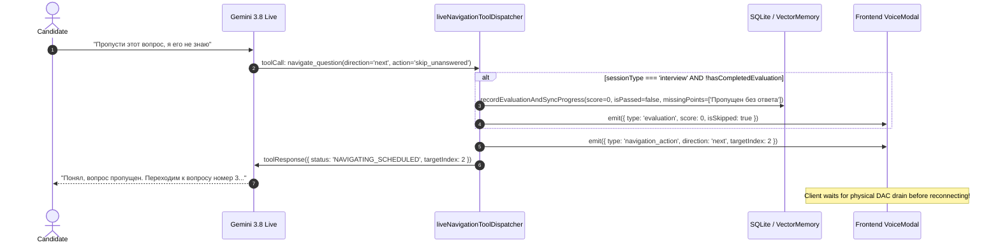

# Phase 1: Backend Navigation Tool & Evaluation Penalty Contract
## SOTA Late-2026 Canonical Tool Specification

> **Document:** `docs/roadmap/wave_20_hands_free_voice_batch_navigation_and_continuity/PHASE_01_BACKEND_NAVIGATION_TOOL_AND_PENALTY_CONTRACT.md`  
> **Status:** Draft / Pending User Approval  
> **Target Subsystem:** `backend/src/services/live/` (`liveToolDeclarations.ts`, `liveNavigationToolDispatcher.ts`, `liveToolDispatcher.ts`)  

---

## 1. Tool Declaration Contract (`liveToolDeclarations.ts`)

The `navigate_question` tool is registered for all batch-enabled sessions (`interview`, `tutor`, and `explorer`/`ask`):

```typescript
{
  name: 'navigate_question',
  description: 'Вызывается ИСКЛЮЧИТЕЛЬНО по прямой просьбе пользователя переключить текущую карточку вопроса в группе (например: "перейди к следующему вопросу", "пропусти этот вопрос", "вернись назад", "давай дальше"). КАТЕГОРИЧЕСКИ ЗАПРЕЩЕНО вызывать при рассуждениях о шагах алгоритма ("на следующем шаге"), технических пропусках ("пропустим валидацию") или возвратах к тезисам ("вернемся назад к CAS").',
  behavior: 'NON_BLOCKING',
  parameters: {
    type: 'OBJECT',
    properties: {
      direction: {
        type: 'STRING',
        enum: ['next', 'prev', 'to_index', 'finish'],
        description: 'next: переход к следующему вопросу; prev: возврат к предыдущему; to_index: переход к конкретному номеру; finish: досрочное завершение всей серии'
      },
      action: {
        type: 'STRING',
        enum: ['skip_unanswered', 'proceed_next', 'review_previous', 'finish_batch'],
        description: 'skip_unanswered: пропуск без ответа (в интервью влечет 0 баллов); proceed_next: переход после ответа; review_previous: возврат назад; finish_batch: завершение темы'
      },
      targetIndex: {
        type: 'INTEGER',
        description: '0-based индекс целевого вопроса (используется при to_index)'
      },
      candidateReason: {
        type: 'STRING',
        description: 'Причина переключения, озвученная пользователем'
      }
    },
    required: ['direction', 'action']
  }
}
```

---

## 2. Dispatcher Architecture (`liveNavigationToolDispatcher.ts`)

A dedicated module (adhering to Rule 8, $\le 350$ lines) handles the tool call execution:



---

## 3. Boundary & Edge Case Handling

1. **First Question Boundary (`direction === 'prev'` at index 0):**
   - Returns `{ status: 'BLOCKED_AT_START', message: 'Кандидат уже находится на первом вопросе батча. Назад идти некуда.' }`.
   - Gemini verbally informs: *"Мы уже находимся на первом вопросе темы. Куда именно вы хотите перейти?"*.
2. **Last Question Boundary (`direction === 'next'` at index `totalQuestions - 1`):**
   - Automatically maps to `action: 'finish_batch'`.
   - Gemini verbally announces: *"Это был заключительный вопрос темы! Завершаем серию и подводим итоги."*.
   - Client triggers `GrandFinale` screen.
3. **Target Index Out of Range:**
   - Clamped safely to `[0, totalQuestions - 1]`.

---

## 4. Gate 1 Verification Criteria

- [ ] Unit test verifies `getLiveToolDeclarations` includes `navigate_question` with `NON_BLOCKING` behavior.
- [ ] Dispatcher test verifies that `skip_unanswered` in `interview` mode saves score 0 to DB and emits synthetic evaluation to client.
- [ ] Dispatcher test verifies that boundary conditions (index 0 `prev`, index max `next`) return structured guidance to model without crashes.
- [ ] Dispatcher emits `{ type: 'navigation_action' }` over `clientSocket` with correct payload.
- [ ] File length of `liveNavigationToolDispatcher.ts` $\le 350$ lines.
