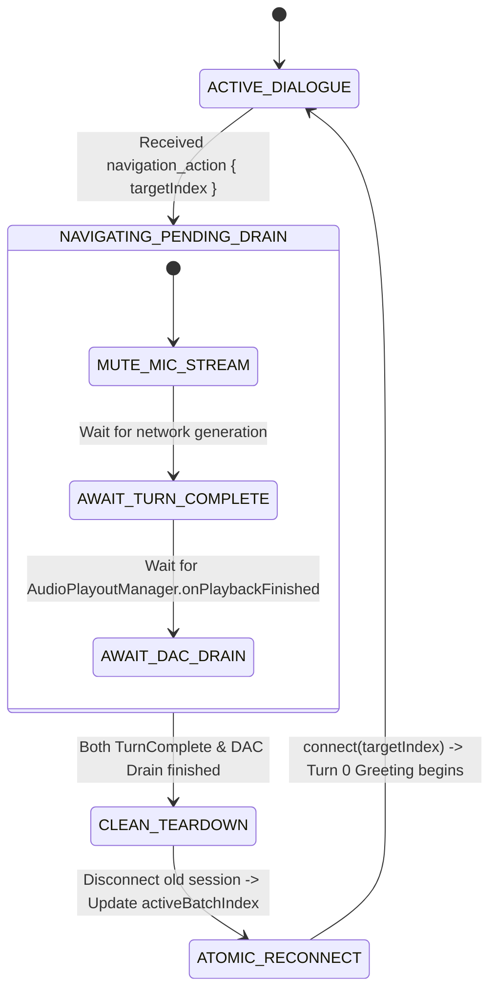

# Phase 3: Client Dual-Sided Handshake & Atomic Reconnect
## SOTA Late-2026 Tear-Free Audio State Machine

> **Document:** `docs/roadmap/wave_20_hands_free_voice_batch_navigation_and_continuity/PHASE_03_CLIENT_DUAL_SIDED_HANDSHAKE_AND_ATOMIC_RECONNECT.md`  
> **Status:** Draft / Pending User Approval  
> **Target Subsystem:** `frontend/src/audio/` (`NativeLiveVoiceEngine.ts`, `useLiveVoiceSession.ts`, `types.ts`), `frontend/src/components/VoiceModal.tsx`  

---

## 1. The Audio Tear Hazard in Socket Switching

When a voice agent switches contexts, naively closing the WebSocket connection immediately upon receiving a tool call causes an **Audio Tear**:
1. Gemini synthesizes: *"Хорошо, пропускаем этот воп..."*
2. Client abruptly calls `ws.close()`.
3. Playout buffer is forcefully terminated mid-phoneme, producing an audible click/pop and cutting off the speaker's sentence.

### The SOTA Solution: Playout-Drained Reconnection Protocol



---

## 2. Implementation Specifications

### A. State Machine Extension in `NativeLiveVoiceEngine.ts`

- Add `pendingNavigationTarget: number | null = null`.
- On receiving `{ type: 'navigation_action', targetIndex }`:
  1. Set `this.pendingNavigationTarget = targetIndex`.
  2. Mute microphone capture (`this.micCapture.setMuted(true)`) to prevent ambient background noise from contaminating the closing socket or tripping Turn 0 on the new socket.
  3. Emit state event `onNavigationScheduled?.(targetIndex)`.

### B. Dual-Sided Handshake Resolution

In `NativeLiveVoiceEngine.ts` / `AudioPlayoutManager.ts`:
- When both conditions are satisfied:
  1. Upstream `turnComplete: true` has been received for the navigation phrase.
  2. `AudioPlayoutManager.onPlaybackFinished()` fires (DAC queue is empty).
- The engine dispatches `onNavigationCommit?.(targetIndex)`.

### C. Atomic Reconnect Orchestration in `VoiceModal.tsx`

```typescript
const handleNavigationCommit = useCallback(async (targetIndex: number) => {
  disconnect();
  pendingEvaluationRef.current = null;
  setActiveBatchIndex(targetIndex);
  onIndexChange?.(targetIndex);
  
  // Clean-slate atomic connect
  await startSessionForIndex(targetIndex, false);
}, [disconnect, onIndexChange, startSessionForIndex]);
```

---

## 3. Gate 3 Verification Criteria

- [ ] Automated contract test confirms that `NativeLiveVoiceEngine` does NOT call `disconnect()` until `AudioPlayoutManager.isPlaying() === false`.
- [ ] Test verifies that microphone streaming is frozen during `NAVIGATING_PENDING_DRAIN`.
- [ ] Test verifies that target index is clamped and parent `onIndexChange` is called with the exact `targetIndex`.
- [ ] No file in `frontend/src/audio/` exceeds 400 lines (Rule 8).
