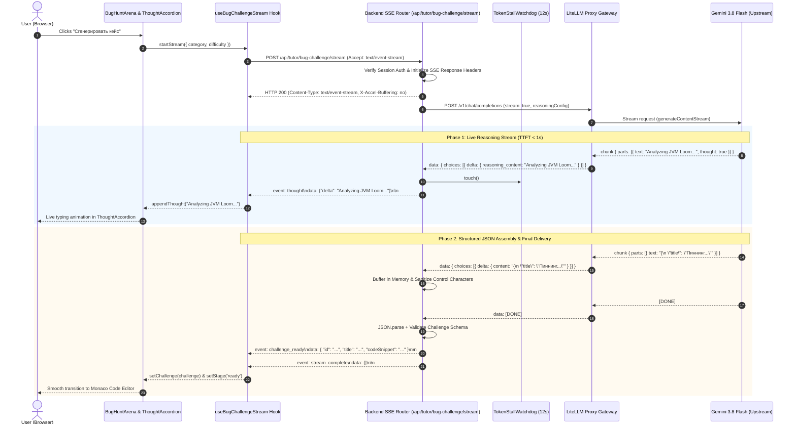
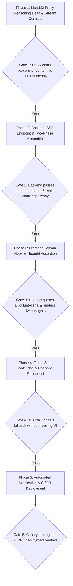

# Wave 21: SOTA Two-Phase SSE Streaming & Live Reasoning for Bug Hunt
## Master Architecture & Phase-Gate Roadmap (SOTA Late 2026)

> **Document:** `docs/roadmap/wave_21_sota_two_phase_sse_streaming_and_live_reasoning/00_MASTER_PLAN.md`  
> **Status:** Draft / Pending Architectural Approval  
> **Target Standard:** SOTA Late-2026 Two-Phase Server-Sent Events (SSE) Protocol with Live Thinking Stream & Strict Schema Delivery  
> **Subsystems:** LiteLLM Proxy Reasoning Delta Streamer, Backend SSE Dispatcher, Token-Level Watchdog, Frontend Thought Accordion & BugHuntArena Decomposer  

---

## 1. Executive Summary & Problem Diagnosis

In technical assessment platforms, generating deep, realistic production incident challenges (such as concurrency race conditions, Project Loom virtual thread pinning, or transaction isolation anomalies) requires massive reasoning overhead from frontier reasoning models (`gemini-3.8-flash` with extended thinking).

Under non-streaming REST execution (`POST /api/tutor/bug-challenge`), this synthesis legitimately takes **25 to 45 seconds**. While the backend and proxy can withstand this duration via deadline propagation (RFC 9651 `Request-Timeout: 90`), leaving the user facing a static spinner for 45+ seconds introduces severe user-experience and operational failure vectors:

1. **Dwell Time Anxiety & Perceived Hang:** Users assume the application has frozen or encountered a deadlock, leading to rapid double-clicks, page reloads, and redundant heavy upstream generation.
2. **Intermediate Proxy Timeouts:** Upstream NAT gateways, corporate firewalls, mobile operator carrier switches, and reverse proxies (e.g. Caddy/Nginx) enforce silent TCP idle drop timeouts on requests with zero data flow after 60 seconds.
3. **The Streaming vs. Strict JSON Parsing Dilemma:** Naively streaming raw completion tokens to the client destroys JSON parsing. You cannot render half a Monaco editor, half a bug description, or broken AST snippets while opening brackets remain unclosed.
4. **Reasoning Token Collisions:** Google Gemini API emits thinking tokens via `parts[i].thought === true`. If the gateway does not cleanly separate `reasoning_content` from `content`, thinking commentary corrupts the JSON output payload.
5. **Streaming Failover Trap:** Once an HTTP 200 SSE stream is committed to the client, a gateway cannot silently switch models on mid-stream failure.

---

### Root Cause & SOTA Late-2026 Resolution Matrix

```
+-------------------------------------------------------------------------------------------------------------------+
| ARCHITECTURAL HAZARD & SOTA RESOLUTION MATRIX                                                                     |
+-------------------------------------------------------------------------------------------------------------------+
| Hazard Vector                   | Manifestation                  | Root Cause                  | SOTA Late-2026 Resolution|
+---------------------------------+--------------------------------+-----------------------------+--------------------------+
| 1. Blind Wait Anxiety           | User refreshes after 30s of    | Monolithic JSON wait;       | Live SSE Thought Stream: |
|    (TTFT Latency)               | static spinner.                | TTFT = 35s.                 | TTFT < 1000ms with live  |
|                                 |                                |                             | thought token stream.    |
+---------------------------------+--------------------------------+-----------------------------+--------------------------+
| 2. Thought / JSON Collision     | JSON.parse crashes with syntax | Gateway puts thought parts  | Gateway delta separation:|
|                                 | error when model comments.     | directly into delta.content.| `reasoning_content` vs   |
|                                 |                                |                             | `content`.               |
+---------------------------------+--------------------------------+-----------------------------+--------------------------+
| 3. Partial JSON Rendering Crash | Monaco editor displays invalid | Frontend attempts to stream | Two-Phase SSE Protocol:  |
|                                 | syntax / broken layout.        | raw JSON tokens into UI.    | Phase 1: thoughts live;  |
|                                 |                                |                             | Phase 2: complete JSON.  |
+---------------------------------+--------------------------------+-----------------------------+--------------------------+
| 4. Mid-Stream Deadlock/Stall    | Upstream hangs; client waits   | No token-level activity     | Token-Level Watchdog:    |
|                                 | indefinitely on open socket.   | monitoring.                 | 12s inter-chunk limit;   |
|                                 |                                |                             | automatic fallback retry.|
+---------------------------------+--------------------------------+-----------------------------+--------------------------+
| 5. Cognitive / File Bloat       | BugHuntArena exceeds 400 lines | UI presentation tangled with| Decompose BugHuntArena   |
|                                 | violating Rule 8.              | SSE streaming DSP logic.    | into headless hook &     |
|                                 |                                |                             | ThoughtAccordion.        |
+---------------------------------+--------------------------------+-----------------------------+--------------------------+
```

---

## 2. End-to-End Two-Phase SSE Architecture



---

## 3. Phase-Gate Milestones

Wave 21 decomposes the implementation into 5 strictly ordered, verifiable phases:



---

## 4. Phase Directory Structure

All detailed specifications reside in `docs/roadmap/wave_21_sota_two_phase_sse_streaming_and_live_reasoning/`:

1. [`00_MASTER_PLAN.md`](./00_MASTER_PLAN.md) — Master architecture, root-cause traceability, and phase gates (This file).
2. [`PHASE_01_LITELLM_PROXY_REASONING_STREAM_AND_DELTA_CONTRACT.md`](./PHASE_01_LITELLM_PROXY_REASONING_STREAM_AND_DELTA_CONTRACT.md) — Differentiating `thought: true` into `reasoning_content` in `chat.py`.
3. [`PHASE_02_BACKEND_SSE_ENDPOINT_AND_TWO_PHASE_DISPATCHER.md`](./PHASE_02_BACKEND_SSE_ENDPOINT_AND_TWO_PHASE_DISPATCHER.md) — SSE endpoint `/api/tutor/bug-challenge/stream`, session auth, buffered JSON compilation, and control character sanitization.
4. [`PHASE_03_FRONTEND_STREAM_HOOK_AND_THINKING_ACCORDION.md`](./PHASE_03_FRONTEND_STREAM_HOOK_AND_THINKING_ACCORDION.md) — Headless hook `useBugChallengeStream.ts`, `BugHuntThoughtAccordion.tsx`, and proactive decomposition of `BugHuntArena.tsx` (< 350 lines).
5. [`PHASE_04_TOKEN_STALL_WATCHDOG_AND_FAILOVER_RECOVERY.md`](./PHASE_04_TOKEN_STALL_WATCHDOG_AND_FAILOVER_RECOVERY.md) — Inter-chunk watchdog (12s), keepalive pings (`: ping\n\n`), and graceful stream reset events.
6. [`PHASE_05_VERIFICATION_CANARY_MATRIX_AND_CI_DEPLOY.md`](./PHASE_05_VERIFICATION_CANARY_MATRIX_AND_CI_DEPLOY.md) — Contract tests, SSE mock integration tests, and GitHub Actions CI/CD deployment.

---

## 5. Architectural Invariants Enforced

1. **Reasoning Delta Separation Invariant:**
   Thinking tokens from Google Gemini (`thought: true`) MUST strictly route to `delta.reasoning_content`. They MUST NEVER be injected into `delta.content`.
2. **Two-Phase Atomicity Invariant:**
   The client UI MUST never receive raw unparsed JSON chunks. The code editor and challenges are only unlocked after complete schema validation on `challenge_ready`.
3. **Inter-Chunk Watchdog Invariant:**
   If no SSE chunk is emitted for $> 12$ seconds during generation, the stream MUST NOT hang. The backend watchdog triggers a clean retry or emits an error recovery event.
4. **File-Hygiene & Cognitive Bounding Invariant (Rule 8):**
   `BugHuntArena.tsx` (currently 398 lines) must be decomposed into subcomponents and custom hooks so that all touched files remain $\le 350$ lines.
5. **No Local Builds on VPS Invariant (Rule 0):**
   All Docker images built strictly via GitHub Actions CI/CD.
