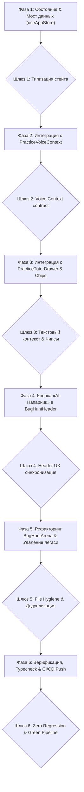

# Wave 22: Unified AI Co-Pilot & Real-Time Voice Review for Bug Hunt Arena

> **Document:** `docs/roadmap/wave_22_unified_ai_copilot_bug_hunt_arena/phase_01_unified_ai_copilot_bug_hunt.md`  
> **Status:** Active / Execution  
> **Target Branch:** `feat/wave-20-hands-free-voice-navigation`  
> **SOTA Standard:** Late 2026 Dual-Modal Voice Architecture & Cognitive Bounding  

---

## 1. Executive Summary & Problem Statement

### 1.1 The As-Is Defect
In the Bug Hunt section (`BugHuntArena`), users experienced an absence of the standard **AI-Напарник (Co-Pilot)** available in Katas and Spring Transaction Lab. Investigation revealed:
1. The UI lacked the canonical «AI-Напарник» header button (`Bot` icon), slide-out drawer (`PracticeTutorDrawer`), and hands-free floating pill (`AmbientVoicePill`).
2. An isolated, legacy inline component (`BugHuntVoiceMentor.tsx`) was rendered at the bottom of the page beneath the code editor and hints, invisible above the fold.
3. This setup violated **Rule 8 (Zero Parallel Reimplementation)** by instantiating a duplicate `useLiveAudioSession` hook inside `BugHuntArena.tsx`, bloating the file to 379 lines and fragmenting state.
4. Meanwhile, the backend already possessed complete, production-grade support for `tutorMode: 'bug_hunt'`, golden master fixes, reproducing unit tests, incident context, and the `mark_bug_solved` tool.

### 1.2 The To-Be Architecture
Unify the Bug Hunt arena with the platform's central practice voice and tutoring architecture:
- Reuse `PracticeVoiceProvider` and `usePracticeVoice`.
- Mount `PracticeTutorDrawer` and `AmbientVoicePill`.
- Add standard `AI-Напарник` header action button to `BugHuntHeader.tsx`.
- Pass live Bug Challenge context to Gemini Live (`tutorMode: 'bug_hunt'`) and text tutoring stream.
- Delete `BugHuntVoiceMentor.tsx` and strip redundant voice code from `BugHuntArena.tsx`, reducing file length from 379 to $\le 220$ lines.

---

## 2. Phase-Gated Implementation Plan

---

### Phase 1: State Bridge & Global App Store
- **Goal:** Enable global visibility of the active bug challenge across drawer and voice contexts.
- **Files Touched:**
  - `frontend/src/store/useAppStore.ts`
- **Actions:**
  - Add `activeBugChallenge: BugChallenge | null` and `setActiveBugChallenge: (challenge: BugChallenge | null) => void` to `useAppStore`.
  - Reset `activeBugChallenge` upon `closeTopicBugHunt()`.
- **Gate 1:** `npx tsc --noEmit` passes with zero type errors.

---

### Phase 2: Live Voice Context Unification (`PracticeVoiceContext.tsx`)
- **Goal:** Connect `PracticeVoiceProvider` to Bug Hunt domain and live parameters.
- **Files Touched:**
  - `frontend/src/components/practice/tutor/PracticeVoiceContext.tsx`
- **Actions:**
  - Read `activeBugChallenge` and `activeTopicBugHunt` from `useAppStore`.
  - When in Bug Hunt context (`activeBugChallenge` present):
    - Set `domain = 'testing'` (or `'bug_hunt'`).
    - Set `sessionType = 'tutor'`, `tutorMode = 'bug_hunt'`.
    - Pass `bugTitle`, `bugExplanation`, `codeSnippet`, `fixedCode`, `unitTest`, `incidentContext`, `hints`.
    - Connect `onBugSolved` callback to trigger `setIsSolved(true)`, confetti, and academy progress if active.
- **Gate 2:** `launchPracticeSession()` builds valid `LiveAudioSessionParams` with full bug context without regressions in existing Kata/Transaction Lab flows.

---

### Phase 3: Drawer Context & Bug Hunt Action Chips
- **Goal:** Provide rich Socratic tutoring, hints, and quick-action chips for Bug Hunt in `PracticeTutorDrawer`.
- **Files Touched:**
  - `frontend/src/components/practice/tutor/PracticeTutorDrawer.tsx`
  - `frontend/src/components/practice/tutor/TutorQuickActionChips.tsx`
- **Actions:**
  - In `PracticeTutorDrawer.tsx`, populate `currentContext` using `activeBugChallenge` when available (`kataTitle: activeBugChallenge.title`, `activeFileContent: activeBugChallenge.codeSnippet`, etc.).
  - In `TutorQuickActionChips.tsx`, add quick actions tailored for bug hunting:
    - 🐛 *В чем подвох?*
    - 💡 *Намекни на дефект*
    - 🧪 *Как написать воспроизводящий тест?*
- **Gate 3:** Drawer renders bug context and chips without type or layout regressions.

---

### Phase 4: Header Action Button (`BugHuntHeader.tsx`)
- **Goal:** Provide identical, intuitive entry point for AI-Напарник in the top navigation bar.
- **Files Touched:**
  - `frontend/src/components/incidents/bughunt/BugHuntHeader.tsx`
- **Actions:**
  - Connect to `usePracticeTutorStore` (`toggleOpen`, `isOpen`).
  - Read voice connection state (`isConnected` from `usePracticeVoice` or store).
  - Add button «AI-Напарник» with `Bot` icon and animated pulse dot.
- **Gate 4:** Header button matches the look, feel, and active states of `PracticeArenaWorkspace`.

---

### Phase 5: Arena Refactoring & Legacy Code Deletion
- **Goal:** Wrap `BugHuntArena` in `PracticeVoiceProvider`, render drawer and ambient pill, and remove legacy duplicated voice code.
- **Files Touched:**
  - `frontend/src/components/incidents/BugHuntArena.tsx`
  - Delete `frontend/src/components/incidents/bughunt/BugHuntVoiceMentor.tsx`
- **Actions:**
  - Remove inline `useLiveAudioSession` instantiation and manual bridge methods from `BugHuntArena.tsx`.
  - Wrap arena with `<PracticeVoiceProvider>` and mount `<PracticeTutorDrawer />` + `<AmbientVoicePill />`.
  - Sync current challenge to `setActiveBugChallenge(challenge)`.
  - Delete `BugHuntVoiceMentor.tsx` completely.
  - Verify `BugHuntArena.tsx` is reduced from 379 to $\le 250$ lines.
- **Gate 5:** File length $\le 350$ lines, zero parallel implementations remaining, clean imports.

---

### Phase 6: Local Verification, Registry Logging & CI/CD Deployment
- **Goal:** Verify build, typechecks, update functional registry, commit, push, and observe GitHub Actions.
- **Files Touched:**
  - `docs/architecture/functional_registry/INDEX.md`
  - `docs/architecture/functional_registry/06_practice_evaluation_and_sandbox_pipeline.md` (or new subsystem file)
  - Git commits on `feat/wave-20-hands-free-voice-navigation`.
- **Actions:**
  - Execute `npm run typecheck` or `npx tsc --noEmit`.
  - Document all architectural choices and invariants in the functional registry.
  - Commit and push to origin.
  - Monitor GitHub Actions workflow run until all quality gates pass.
- **Gate 6:** CI/CD run succeeds with status `completed` and conclusion `success`.
