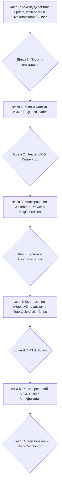

# Wave 22.2: Interactive AI Whiteboard Integration for Bug Hunt Arena

> **Document:** `docs/roadmap/wave_22_unified_ai_copilot_bug_hunt_arena/phase_02_interactive_ai_whiteboard_bug_hunt.md`  
> **Status:** Active / Execution  
> **Target Branch:** `feat/wave-20-hands-free-voice-navigation`  
> **SOTA Standard:** Late 2026 Multimodal Shared Artifact Architecture & Cognitive Bounding  

---

## 1. Executive Summary & Problem Statement

### 1.1 The As-Is Defect
While the AI-Напарник (Co-Pilot) drawer and ambient voice pill were unified in Bug Hunt, users noted that the **Интерактивная доска ИИ (AI Whiteboard)** — available in Katas (`PracticeArenaWorkspace`) and Spring Transaction Lab (`TransactionLabArena`) — was not yet surfaced in the Bug Hunt arena:
1. In `BugHuntHeader.tsx`, there is no «Доска ИИ» button to toggle the whiteboard drawer.
2. In `BugHuntArena.tsx`, the `<WhiteboardDrawer />` component was not mounted.
3. In `liveTutorPromptBuilder.ts`, the `tutorMode === 'bug_hunt'` system prompt lacked explicit directives to use `update_whiteboard` when demonstrating code patterns, concurrency races, or fixes.

### 1.2 The To-Be Architecture
Fully connect the Bug Hunt arena to the platform's universal `WhiteboardState` subsystem:
- Direct reuse of the production-tested [`WhiteboardDrawer.tsx`](file:///home/djelu/projects/interview_tutor/frontend/src/components/WhiteboardDrawer.tsx).
- Add the canonical «Доска ИИ» toggle button to [`BugHuntHeader.tsx`](file:///home/djelu/projects/interview_tutor/frontend/src/components/incidents/bughunt/BugHuntHeader.tsx) with active pulse dot indicator.
- Mount `<WhiteboardDrawer />` inside [`BugHuntArena.tsx`](file:///home/djelu/projects/interview_tutor/frontend/src/components/incidents/BugHuntArena.tsx).
- Add explicit whiteboard prompt directive in [`liveTutorPromptBuilder.ts`](file:///home/djelu/projects/interview_tutor/backend/src/services/live/liveTutorPromptBuilder.ts) so Gemini Live uses `update_whiteboard` naturally during bug review.
- Add quick action chip `🎨 Нарисуй на доске` in [`TutorQuickActionChips.tsx`](file:///home/djelu/projects/interview_tutor/frontend/src/components/practice/tutor/TutorQuickActionChips.tsx).

---

## 2. Phase-Gated Implementation Plan

---

### Phase 1: Backend System Prompt Directive
- **Goal:** Direct the AI techlead to use `update_whiteboard` during bug hunt sessions.
- **Files Touched:**
  - `backend/src/services/live/liveTutorPromptBuilder.ts`
- **Actions:**
  - In `tutorMode === 'bug_hunt'`, add explicit instruction for `update_whiteboard`:
    `4. ИНТЕРАКТИВНАЯ ДОСКА (update_whiteboard): Для наглядного разбора дефекта, демонстрации исправленной логики, контрпримера или подсветки ключевых строк вызывай update_whiteboard (с кодом и пояснением), одновременно проговаривая суть голосом вслух.`
- **Gate 1:** Prompt builders compile cleanly; tool declarations already include `update_whiteboard` across all sessions.

---

### Phase 2: Header Button Integration (`BugHuntHeader.tsx`)
- **Goal:** Provide identical visual access to the interactive board from the header.
- **Files Touched:**
  - `frontend/src/components/incidents/bughunt/BugHuntHeader.tsx`
- **Actions:**
  - Read `isWhiteboardOpen`, `setIsWhiteboardOpen`, and `activeWhiteboardState` from `useAppStore()`.
  - Add «Доска ИИ» button with `Sparkles` icon and pulse badge when `activeWhiteboardState?.code` is present, identical to `PracticeArena.tsx`.
- **Gate 2:** File remains $\le 170$ lines; button toggles `isWhiteboardOpen` state.

---

### Phase 3: Mount Whiteboard Drawer (`BugHuntArena.tsx`)
- **Goal:** Render the slide-out whiteboard inside the Bug Hunt workspace.
- **Files Touched:**
  - `frontend/src/components/incidents/BugHuntArena.tsx`
- **Actions:**
  - Import `WhiteboardDrawer` from `../WhiteboardDrawer`.
  - Read `isWhiteboardOpen`, `setIsWhiteboardOpen`, and `activeWhiteboardState` from `useAppStore()`.
  - Render `<WhiteboardDrawer isOpen={isWhiteboardOpen} onClose={() => setIsWhiteboardOpen(false)} state={activeWhiteboardState} />`.
- **Gate 3:** File remains $\le 320$ lines ($\le 350$ limit). Drawer opens upon tool call from Gemini Live or user button click.

---

### Phase 4: Quick Action Chip for Whiteboard
- **Goal:** Provide 1-click text prompt for users to request board drawings.
- **Files Touched:**
  - `frontend/src/components/practice/tutor/TutorQuickActionChips.tsx`
- **Actions:**
  - Add `🎨 Нарисуй на доске` chip into `BUG_HUNT_CHIPS` with request to use `update_whiteboard`.
- **Gate 4:** Clean chip rendering without layout overflow.

---

### Phase 5: Verification, Functional Registry & CI/CD Push
- **Goal:** Commit, update functional registry, push, and verify green GitHub Actions pipeline.
- **Files Touched:**
  - `docs/architecture/functional_registry/06_practice_evaluation_and_sandbox_pipeline.md`
  - Git commits on `feat/wave-20-hands-free-voice-navigation`
- **Actions:**
  - Update functional registry entry.
  - Push to remote branch.
  - Monitor CI/CD workflow to ensure all jobs pass.
- **Gate 5:** All quality gates green, VPS containers updated.
