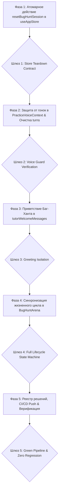

# Wave 22.3: Atomic Context Isolation & Lifecycle State Machine for Bug Hunt Arena

> **Document:** `docs/roadmap/wave_22_unified_ai_copilot_bug_hunt_arena/phase_03_atomic_context_isolation_and_lifecycle.md`  
> **Status:** Active / Execution  
> **Target Branch:** `feat/wave-20-hands-free-voice-navigation`  
> **SOTA Standard:** Late 2026 Dual-Modal Context Isolation & Deterministic Lifecycle Teardown  

---

## 1. Executive Summary & Root Cause Analysis

### 1.1 The As-Is Defect
When users navigate to a new challenge ("Новый кейс", "Следующий", "Предыдущий", "Вариация", or workout preset change) in the Bug Hunt arena, the AI assistant (both in text chat and voice mode) continued referencing the previous challenge's code, symptoms, and explanations.

Investigation revealed 4 distinct root causes across the state and communication layers:
1. **Unsynchronized Text Chat History:** `usePracticeTutorStore.messages` was never re-initialized or cleared when changing bug challenges. The entire previous chat history was passed into `/api/practice-tutor/chat`, causing the LLM to anchor to the old conversation.
2. **Gemini Live Stateful WS KV-Cache:** Gemini Live retains the initial system prompt in its KV-cache. Changing state on the client without disconnecting and establishing a fresh WebSocket setup left the model pinned to the first challenge.
3. **Premature Auto-Reconnect Race in `PracticeVoiceHUD`:** When `disconnectSession()` was called, `fetchChallenge()` began its 10–15s SSE generation. During that window, `PracticeVoiceHUD` detected `!isConnected` and immediately called `startPracticeSession()` with the stale `activeBugChallenge` still lingering in the store.
4. **Stale Whiteboard & Code Revisions:** `activeWhiteboardState` and `codeRevisions` from previous cases were never wiped, leaking old code snippets into `selectActiveWhiteboardArtifact` for subsequent challenges.

### 1.2 The To-Be Architecture
Establish an atomic Lifecycle State Machine:
- **Teardown on Challenge Request:** Atomically disconnect active voice, clear whiteboard and code revisions, set `activeBugChallenge: null`, and clear stale turns.
- **Hydration on Challenge Ready:** Set `activeBugChallenge: newChallenge`, re-initialize `usePracticeTutorStore` with domain-specific Bug Hunt greeting, and if voice mode is active, smoothly initiate a fresh Gemini Live session (`session_bughunt_${newChallenge.id}`) reciting the new case.
- **Race Guard in `PracticeVoiceContext`:** Strictly prohibit voice session establishment if `activeTopicBugHunt` is active but `activeBugChallenge === null` (generating state).

---

## 2. Phase-Gated Implementation Plan

---

### Phase 1: Atomic Reset Action in `useAppStore.ts`
- **Goal:** Provide a single atomic action that clears all challenge-specific artifacts from global state.
- **Files Touched:**
  - `frontend/src/store/useAppStore.ts`
- **Actions:**
  - Add `resetBugHuntSession: () => void` to `AppStore` interface and implementation.
  - Reset: `activeBugChallenge: null`, `activeWhiteboardState: null`, `codeRevisions: []`, `activeRevisionId: null`, `isWhiteboardOpen: false`.
- **Gate 1:** Action updates store atomically without modifying unrelated studio or academy properties.

---

### Phase 2: Race Condition Guard in `PracticeVoiceContext.tsx` & Turn Manager Cleanup
- **Goal:** Prevent premature auto-reconnect while a new challenge is streaming; clear stale dialogue turns.
- **Files Touched:**
  - `frontend/src/components/practice/tutor/PracticeVoiceContext.tsx`
  - `frontend/src/audio/NativeLiveVoiceEngine.ts`
- **Actions:**
  - In `PracticeVoiceContext.tsx` (`launchPracticeSession`): If `state.activeTopicBugHunt` is truthy and `!state.activeBugChallenge`, abort connection attempt early with diagnostic log.
  - In `NativeLiveVoiceEngine.ts` (`connect`): Call `this.turnManager.clear()` so turns from the previous session never leak into the new connection.
- **Gate 2:** File lengths remain $\le 350$ lines; no socket connects during empty challenge state.

---

### Phase 3: Domain Welcome Message in `tutorWelcomeMessages.ts`
- **Goal:** Supply an authentic, isolated welcome message for Bug Hunt text chat.
- **Files Touched:**
  - `frontend/src/components/practice/tutor/tutorWelcomeMessages.ts`
- **Actions:**
  - Update `getDomainWelcomeMessage` to support `isBugHunt?: boolean` or custom challenge title prefix.
  - When in Bug Hunt, set message: `👋 Привет! Я твой напарник по код-ревью и поиску багов. Открыт кейс «${challengeTitle}». Изучи код и симптомы инцидента, а я готов помочь с гипотезами и разобрать механику на доске!`
- **Gate 3:** Text chat opens with contextually isolated greeting.

---

### Phase 4: Lifecycle Synchronization in `BugHuntArena.tsx`
- **Goal:** Bind all user navigation and generation events to the lifecycle state machine.
- **Files Touched:**
  - `frontend/src/components/incidents/BugHuntArena.tsx`
- **Actions:**
  - Track `prevChallengeIdRef = useRef<string | null>(null)`.
  - In `fetchChallenge`, `handleNextChallenge`, `handlePreviousChallenge`, `handleGenerateVariation`, and preset changes:
    - Disconnect voice session if active.
    - Call `resetBugHuntSession()`.
  - When a valid challenge is ready (`challenge && challenge.id !== prevChallengeIdRef.current`):
    - Update `prevChallengeIdRef.current = challenge.id`.
    - Call `setActiveBugChallenge(challenge)`.
    - Call `initChallengeContext('testing', challenge.title)`.
    - If `modality === 'voice'`, call `startPracticeSession()` so Gemini Live greets the user with the new challenge.
- **Gate 4:** Total line count of `BugHuntArena.tsx` stays $\le 330$ lines (strictly under 350 limit). Zero stale context leakage on navigation.

---

### Phase 5: Verification, Functional Registry & CI/CD Deployment
- **Goal:** Verify types, document in functional registry, commit, push, and observe green GitHub Actions.
- **Files Touched:**
  - `docs/architecture/functional_registry/06_practice_evaluation_and_sandbox_pipeline.md`
  - Git commits on `feat/wave-20-hands-free-voice-navigation`
- **Actions:**
  - Update functional registry with section 2.12.
  - Push to remote branch and monitor CI/CD.
- **Gate 5:** All tests pass, zero regressions, successful production deployment on VPS.
